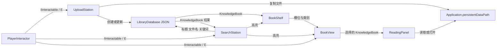

# Arcane Archive P0 技术设计

## 范围和原则

本设计覆盖“导入 → 书籍 → 书架 → 检索 → 阅读”P0 闭环。项目使用 Unity 6.3、URP 3D `UniversalRenderer` 和 `LibraryMain` 场景。业务书籍信息由数据驱动，场景对象只保存运行时引用和视觉状态，不保存书名、关键词、文件路径或书架位置等业务事实。

## 目录约定

- `Assets/Art/Materials`、`Models`、`Textures`、`Audio`：可提交的项目美术资产。
- `Assets/Prefabs/Environment`、`Interactables`、`UI`：环境、可交互物和 UI 预制体。
- `Assets/Scenes`：场景；当前启动场景为 `LibraryMain.unity`。
- `Assets/ScriptableObjects`：可提交的静态配置资产，例如书架定义。
- `Assets/Scripts/Core`、`Player`、`Interaction`、`Knowledge`、`UI`、`Visuals`：未来 C# 模块目录。

## KnowledgeBook 数据模型

每条导入资料对应一个 `KnowledgeBook` 记录。字段名称固定，以便 JSON 序列化、书籍显示和检索共享同一份数据。

| 字段 | 建议类型 | 说明 |
| --- | --- | --- |
| `id` | string | 全局唯一标识，用于关联 BookView、检索结果和文件记录。 |
| `title` | string | 显示标题，默认可由原始文件名生成。 |
| `sourceFileName` | string | 用户导入时的原始文件名。 |
| `storedFilePath` | string | 文件在 `Application.persistentDataPath` 下的实际保存路径。 |
| `fileType` | string | 标准化文件类型，例如 txt、md、image、pdf、docx、pptx。 |
| `category` | string | 归档类别，用于决定目标书架。 |
| `keywords` | string array | 用户或系统生成的检索关键词。 |
| `importedAt` | ISO 8601 string | 导入完成时间。 |
| `pageCount` | integer | 已知页数；未知时使用 0。 |
| `summary` | string | 简短摘要，P0 可为空。 |
| `shelfId` | string | 目标书架的唯一标识。 |
| `shelfSlotIndex` | integer | 书架内槽位索引。 |
| `coverColor` | color value | 书脊或封面显示颜色。 |
| `contentPreview` | string | TXT/Markdown 的截断预览；其他格式可为空。 |

## 核心模块

| 模块 | 职责 |
| --- | --- |
| `LibraryDatabase` | 唯一书籍数据来源。加载、保存、增加、更新与查询 `KnowledgeBook`；元数据持久化为 JSON。 |
| `ShelfDefinition` | 静态书架配置：`shelfId`、类别、容量、场景定位规则。可作为 ScriptableObject 保存。 |
| `BookShelf` | 管理一个类别的已占槽与空槽，将 `KnowledgeBook.shelfSlotIndex` 映射到可见位置。 |
| `BookView` | 只呈现传入的 `KnowledgeBook` 数据，负责标题、颜色、选中和高亮状态；不拥有业务数据。 |
| `UploadStation` | 接收用户文件，复制到持久化目录，创建元数据并请求书架分配。 |
| `SearchStation` | 接收检索词，调用数据库搜索，并驱动书架与 BookView 高亮。 |
| `ReadingPanel` | 显示书籍信息；显示 TXT/Markdown 内容、预览图片，或请求系统打开 PDF、Word、PPT。 |
| `PlayerInteractor` | 从相机中心发射交互射线，处理 E 键、提示与可交互目标切换。 |

## 数据关系和持久化

- `LibraryDatabase` 是唯一书籍数据来源。`BookShelf`、`BookView`、`ReadingPanel` 和 `SearchStation` 均通过 `id` 或 `KnowledgeBook` 读取数据，不维护独立副本。
- `BookShelf` 根据 `ShelfDefinition` 管理类别和空槽；新增书籍先由类别选择书架，再分配空槽并回写 `shelfId`、`shelfSlotIndex`。
- `BookView` 只呈现数据和视觉反馈。销毁或重建 BookView 不影响 LibraryDatabase 中的书籍记录。
- 搜索结果返回 `KnowledgeBook` 列表；界面与高亮通过每条记录的 `id` 回到对应 BookView 和 BookShelf。
- 用户资料复制到 `Application.persistentDataPath` 的应用专属目录。书籍元数据以 JSON 保存到同一持久化目录；`Assets` 仅保存可提交的静态工程资源。

## 交互规则

1. `PlayerInteractor` 从第一人称相机中心持续进行有限距离射线检测。
2. 可交互对象实现 `IInteractable` 概念接口，至少提供交互提示、可交互状态和执行交互的入口；上传台、检索台和书籍视图均遵守这一契约。
3. 玩家对当前有效目标按 E 触发交互。射线命中变化时更新提示，不通过硬编码物体名称判定功能。
4. 打开 ReadingPanel、上传界面或检索界面时，暂停玩家输入并释放鼠标，以便操作 UI。
5. 关闭 UI 时恢复玩家输入并重新锁定鼠标；不影响 LibraryDatabase 已保存的数据。

## 搜索和高亮规则

- 搜索对 `title`、`sourceFileName`、`keywords` 做不区分大小写的模糊包含匹配。
- 关键词数组逐项匹配；任一字段匹配即可返回该 `KnowledgeBook`。
- 有结果时，相关 BookView 显示书籍高亮，所属 BookShelf 显示书架高亮；再次搜索或关闭检索时清理旧高亮。
- 无结果时，SearchStation 显示明确的无结果状态，不保留上一次结果的高亮。
- P0 不包含向量检索、语义检索或 AI 模糊问答。

## 文件显示规则

- TXT 与 Markdown：ReadingPanel 显示 `contentPreview` 和文件内容。
- 图片：ReadingPanel 在 Unity 内预览。
- PDF、Word、PPT：ReadingPanel 显示元数据并调用系统默认程序打开 `storedFilePath`。
- P0 不解析 Office 或 PDF 正文。
