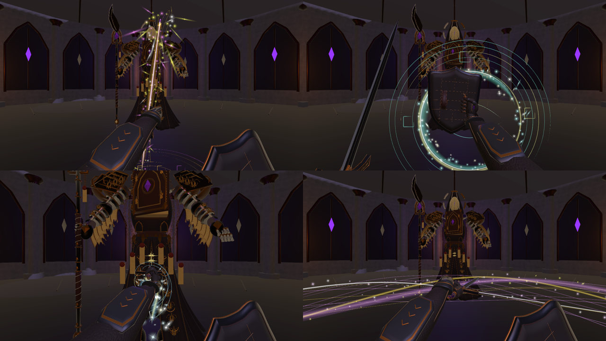

# 剑刃、录屏挥舞与技能特效 · 2026-10-29

在用户指定的当前 1.0.6 工程完成。本轮依据反馈再次校正刃口，并按用户提供的 2077 录屏重建挥舞姿态与节奏，强化四种技能的粒子和光带。

## 已实现

- **持剑刃口：** 导入后的剑长轴为握持枢轴 +Y，双刃位于 ±X。默认刃口朝向前方，剑尖向前内侧；手掌、剑柄与剑共同转动。修正此前只改变剑尖倾斜、未校正剑身轴向转角的问题。
- **挥舞：** 七个时间点控制当前持握、侧身收刀、蓄势、快速过刀、延伸、低位回收和待机。连击为正向横斩、反向横斩、斜向斩；在普攻 70% 收招时接续输入缓存。每刀从上一刀实际姿态接出，命中时刻仍与实际伤害一致。
- **手腕与护臂：** 用四元数描述剑轴和刃口，双刃换向选择较近的刃口姿态，避免多余半圈翻腕。第一人称叠加相机每次渲染重算手部蒙皮矩阵，修复反斩时护臂突兀放大的问题。
- **技能光效：** 蓄势聚集符文与粒子，释放后出现有亮芯、柔光和细丝的多层光带，随后粒子渐隐。所有光效保持世界空间位置。

| 技能 | 释放表现 |
| --- | --- |
| 1 破誓重斩 | 金色纵向落刃、紫色细丝、地面刻环、方向碎光 |
| 2 缄眼盾击 | 青金扩散光环、眼纹封印、外圈符片与散射星芒 |
| 3 踏影突刺 | 冰蓝螺旋光带、前端切环、沿突刺方向飞散的亮粒 |
| 4 回旋封印 | 紫金交错弧带、倾斜环绕轨迹、符文碎片与环形粒子 |

每次释放使用 18 条分层光带/刻纹，前三技能各 128 个粒子，回旋 176 个；蓄势另有短暂聚集效果。粒子使用原生 ParticleSystem，由现有暂停状态控制手动推进，避免菜单打开后继续飘动。未改变技能伤害、体力消耗、冷却或判定范围。

## 动作参考与预览

只读参考为 `E:\录屏\Cyberpunk 2077\Cyberpunk 2077 2026.10.02 - 19.03.29.05.mp4`。本轮补看 06:25.0 起 1.6 秒、06:26.9 起 1 秒的 20 fps 连续帧，并结合此前 09:41.8–09:44.7 的斩击帧。参考侧身收刀、跨身过刀、反向接斩与回收顺序，适配本项目左剑右盾和现有武器模型。

- [三刀连击动态预览](ThreeCutCombo.mp4)：固定相机，按 30 fps 采样实际动作与连击缓存；无音轨、无 HUD，便于观察握持和轨迹。
- [动作连续帧](MotionContactSheet.jpg)
- [最终待机与技能栏](Captures/11_FinalReadyHUD.png)
- [默认刃口近景](Captures/08_IdleEdge.png)
- [重斩](Captures/Skill_1.png)、[盾击](Captures/Skill_2.png)、[突刺](Captures/Skill_3.png)、[回旋](Captures/Skill_4.png)

四技能图为实际 Unity 相机堆叠的固定阶段预览，释放后 0.12 秒采样；暂停 AI 与自动移动以方便比较，突刺保留技能自身位移。参考抽帧只用于内部动作分析，不作为运行时游戏素材。

## 修改文件

- `Assets/Scripts/Player/SwordShieldView.cs`：剑轴/刃口方向、七段姿态、换向与蒙皮矩阵刷新。
- `Assets/Scripts/Player/PlayerMelee.cs`：普攻缓存接续时间与新技能特效调用。
- `Assets/Scripts/Core/MeleeLoadout.cs`：新增粒子材质引用。
- `Assets/Scripts/Visuals/BladeRibbon.cs`：提高刀光层次、技能余光和颜色区分。
- 新增 `Assets/Scripts/Visuals/MeleeSkillVfx.cs` 及 `.meta`：四技能多层光带、符文和原生粒子生命周期。
- 新增 `Assets/Art/PlayerSwordShield/SpellMote.shader` 及 `.meta`：柔光、亮芯和四向星芒粒子着色器。
- 新增 `Assets/Art/PlayerSwordShield/Materials/SkillSpellMote.mat` 及 `.meta`：粒子 HDR 材质。
- `Assets/Art/PlayerSwordShield/OathboundLoadout.asset`：绑定粒子材质。
- `Assets/Scenes/MilanLibrary_Magic_V6.unity`：保存修正的默认握持姿态。
- `README.md`、`CHANGELOG.md` 与本目录：本轮交付记录。

实际变更和 SHA-256 见 `ChangedFiles.json`。`Before/` 与 `BeforeHashes.json` 保存修改前候选文件；其中未实际改变的候选文件不会计入变更清单。

## 最小验证

遵照用户“仅做最小测试”：未构建独立运行包，未执行完整回归或性能验收。

1. 编译完成，最后运行检查 Console 为 0 Error / 0 Warning，粒子着色器可用。
2. 默认刃口朝前夹角余弦约 0.952；横斩接触时刃口与横向运动方向对齐约 0.969；两只手启用每相机蒙皮矩阵刷新。见 `BladePoseCheck.json`。
3. 使用现有动作缓存完成三段连续攻击，记录 75 帧姿态并检查画面；修正换向阶段的多余翻腕，见 `MotionCapture.json` 和动态预览。
4. 重斩在接触帧前无伤害，跨过接触帧造成 82 点伤害，后续推进不重复命中。见 `ContactCheck.json`。
5. 四技能均能创建对应光带和粒子；打开菜单后，粒子数量、特效年龄与真实冷却均保持不变。见 `MinimalVfxChecks.json`。
6. 推进真实 Unity 游戏帧后，过期效果数量归零，见 `ExpiryCheck.json`。预览期间后台未推进游戏帧时的待回收数量单独保留在 `effectsAwaitingGameFrameAtStart`，不作为最终清理结果。
7. 最终退出 Play Mode，主场景已保存、缺失脚本为 0，见 `FinalState.json`。后台运行开关和所有预览隔离均已恢复。

手动复核：进入试炼观察默认刃面；连续按住左键检查正斩、反斩、第三刀接续；分别释放 1～4，观察光带与粒子；释放后按 I 或 Esc 暂停，关闭后确认特效继续并消散。
