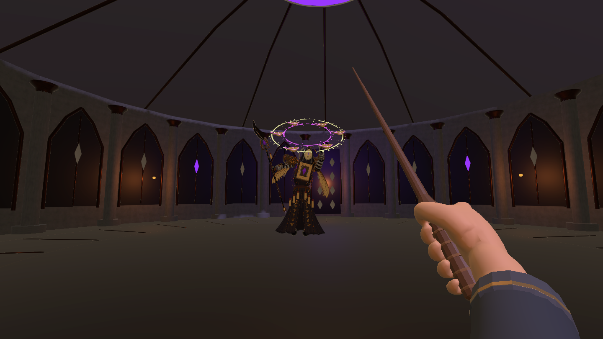
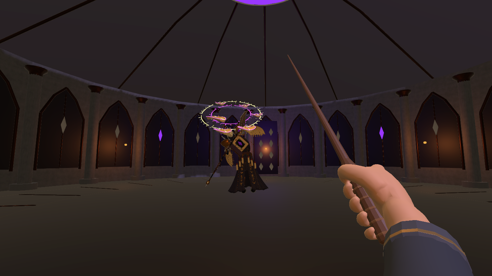
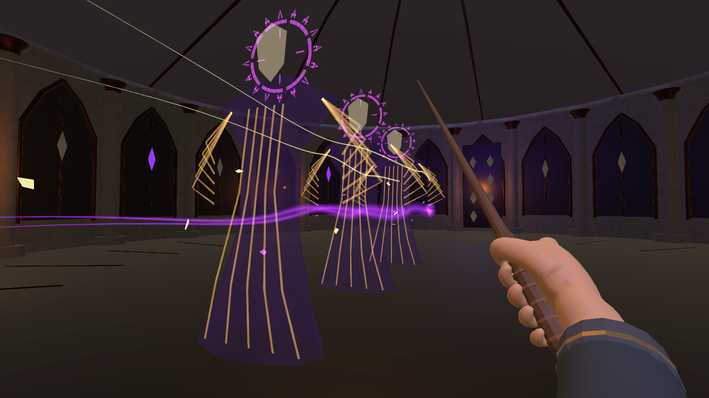
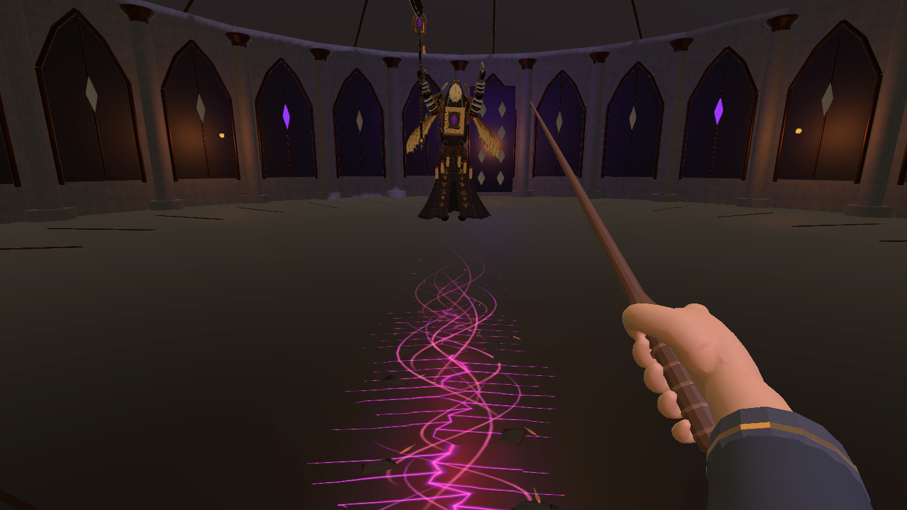

# 禁页冠环、瞬冲残影与扩域裂地

2026-10-27，按用户确认的方案在 `project123/1.0.6` 当前工作区完成。Unity 6000.3.25f1，URP 17.3.0。沿用哥特式魔法图书馆的紫黑、旧金、象牙纸页和禁书封印元素。按当日线上 README 的新协作规则，将本工程提交至 `program/1.0.6/` 待管理者验收，历史 `lixiang` 不覆盖。

## 实际行为

| 项目 | 修改前 | 当前 |
| --- | --- | --- |
| 裂地宽度 | 0.8 米 | 一阶段 1.8 米、二阶段 2.2 米 |
| 每段裂地预警 | 0.65 秒、中央细线 | 0.8 秒、中央前导纹与两侧金色界线 |
| 裂地伤害 | 18 点、每段一次 | 保留；视觉、边界与玩家体宽余量一致 |
| 冲撞 | 11.5 米/秒，0.18 秒加速 | 75 米/秒目标速度，按路长限定在 0.12～0.18 秒内完成；碰撞会提前结束 |
| 冲撞预警／收招 | 1.35／1.45 秒 | 保留，预警最后 0.5 秒锁定方向 |
| 冲撞拖尾 | 随 Boss 移动，攻击结束即隐藏 | 固定在实际经过的路径，收招后约 0.85 秒消散；三道简化残影无追加伤害 |
| 禁页 | 右手直接逐发生成 3／5 发，速度 8 米/秒 | 头顶成环 6／8 发，第二次挥手释放，速度 22 米/秒 |
| 禁页节奏 | 0.9 秒预警，0.17 秒发射间隔 | 1.25 秒召唤；释放动作第 0.20 秒开始，以 0.05 秒间隔连射 |
| 禁页伤害 | 每发 10 点 | 一阶段每发 5 点、二阶段每发 6.25 点；理论整轮合计仍为 30／50 点 |

实际受伤还受已有的无敌间隔、躲避、吞印和格挡影响，理论整轮伤害不等于玩家必定受到的伤害。

第一次挥手时禁页由小变大，在头顶倾斜冠环上停悬；内外符文反向转动。第二次挥手后，原位的同一批禁页脱离环列进入飞弹列表。待发页没有伤害和吞印判定。子弹用弯曲纸页、发光旧金文字、紫黑核心和双层拖尾表现；撞击碎符向外散开，吞印碎符向玩家收束。

裂地仍从 Boss 前方沿地面连续追踪，推进速度、有限转向、近身锁线及延伸时长沿用上一版。增加分叉、上升能量丝和少量石屑。整条宽度用 BoxCast 检测墙体；玩家体宽按世界空间计算，不随非等比缩放放大。独立的缄默环波招式保留。

冲撞始终走完整路径的 CapsuleCast，不直接把坐标跳到终点。残影使用共享的简化长袍、无眼面具、冠环与书翼线条网格，不复制完整蒙皮角色。飞弹拖尾按战斗时间和距离采样，限长 2.4 米。

## 验证与截图

- [技能实战检查](RuntimeAcceptance.json)：36 项，实际 Input System 输入和生产战斗参数；涵盖两阶段冠环、暂停、逐枚释放、高速吞印、冲撞躲避/命中/墙体、20 FPS 路径检测、两阶段裂地、胜利、重试和返回。
- [最终编辑器状态](FinalEditorValidation.json)：后台完整运行后已退出 Play Mode，场景未改脏。交互式重跑曾在侧闪断言中止；改用独立虚拟键盘并增加诊断后，后台重跑 36 项全部通过。编译成功；启动时的许可服务 token 更新提示未阻止运行。
- [资源检查](AssetValidation.json)：12 个现用 Prefab、17 段导入动画，检查缺失脚本/材质/网格和两个特效 Shader。
- [动作衔接回归](FlowRegression/MotionFlowAcceptance.json)：当前版本动作、激光/环波/冲撞/弹幕切招与胜利重试记录。
- [动画时长](AnimationManifest.json) 与 [本轮文件清单](ChangedFiles.json)。文件清单以开始任务时的工作区哈希为基线，不把此前尚未提交的修改归入本轮。

截图来自 Play Mode 的真实主相机渲染，1440×810，不含 Overlay HUD；部分截图调整了相机观察方向以看清地面或拖尾。

## 修改位置

以下路径相对于 1.0.6 工程根目录。

| 文件／目录 | 作用 |
| --- | --- |
| `Assets/Scripts/Core/BossEncounter.cs`、`BossCombatBehaviours.cs`、`BossRitualEffects.cs` | 招式时序、环列释放、高速扫掠、完整宽度裂地阻挡及清理 |
| `Assets/Scripts/Core/BossDefinition.cs`、`Assets/Art/ForbiddenWarden/WardenEncounter.asset` | 两阶段宽度、召唤/发射、瞬冲与拖尾参数 |
| `Assets/Scripts/Visuals/BossArena.cs` | 三种新增特效 Prefab 的引用 |
| `Assets/Scripts/Visuals/WardenVolleyVisuals.cs`、`WardenRushWake.cs`、`WardenPageImpact.cs` | 冠环、世界空间残影及命中/吞印表现 |
| `Assets/Scripts/Visuals/WardenSpellMotion.cs`、`WardenAnimationDriver.cs` | 待发/飞行切换、有界拖尾、旧光带停用 |
| `Assets/Scripts/Visuals/GroundFractureVisuals.cs` | 扩域裂地表现、世界空间命中边界 |
| `Assets/Scripts/Visuals/Editor/WardenRitualBuilder.cs`、`WardenRiftBuilder.cs` | 技能资产制作工具 |
| `Assets/Scripts/Visuals/Editor/WardenRitualAcceptance.cs` 及相关旧验收脚本 | 本轮检查、适配瞬冲和宽预警的断言 |
| `Assets/Art/ForbiddenWarden/CombatV2/Prefabs/`、`Models/Ritual/`、`Models/Rift/`、`Materials/` | 技能 Prefab、共享网格、材质、`RitualInk.shader` |
| `Blender/WardenCombatV2/SilentWarden_Combat_v2.blend`、`Tools/WardenMotion/refine_motion.py`、对应 FBX | 原生动作、可复现导出与 Unity 导入资源 |

保留原模型的 85 根骨骼和 17 段动画。导出工具重烘焙相同动作集，本次改动的动作设计为 `VolleyWindup`、`VolleyRelease`；伤害继续由战斗时钟驱动，不启用 Root Motion 或第二套动画事件伤害。

## 试玩与复查

1. 打开 `Assets/Scenes/MilanLibrary_Magic_V6.unity`，进入 Play Mode，Esc → 深入探索。
2. 观察首次挥手后的头顶环列，第二次挥手前提前横移，或按右键吞印；两阶段分别检查 6／8 枚。
3. 看到冲撞锁线路径后侧闪，确认 Boss 几乎瞬间到达，原路径的残影在收招时继续消散。
4. 裂地出现后持续侧移，检查两侧金线与紫红裂光，靠墙检查危险带不会穿过墙体。
5. 在冠环、裂地和残影期间分别暂停，再继续；胜负后重试，再返回图书馆，检查没有遗留特效。

自动技能检查：进入 Play Mode 后执行菜单 `Arcane Archive → Boss → Test ritual effects 20261027`。动作回归入口为 `WardenFlowAcceptance.Start()`，与其他测试顺序执行。检查会恢复原后台运行、帧率、VSync 与输入设置，移除测试鼠标、键盘及障碍物。后台复查可用 Unity `-batchmode -projectPath <1.0.6目录> -executeMethod ArcaneArchive.Visuals.Editor.WardenRitualBatch.Run`；不要加 `-quit`，脚本会在检查和退出 Play Mode 后自行退出。

制作菜单 `Apply ritual effects 20261027` 会重新生成相关技能资产，不是正常运行步骤；手工调整 Prefab 后应先备份再执行。当前 FBX 和原生 Blender 文件已保存，正常试玩不需要 Blender。

本地 `BeforeRitualEffects.zip` 与 `BeforeHashes.json` 保存任务开始时的相关工作区状态；备份 ZIP 不作为发布源码上传。没有改动旧版本目录，也没有修改图书馆主场景。尚未制作独立运行包，20 FPS 检查用于验证低帧率判定，不等同于目标设备性能验收。
