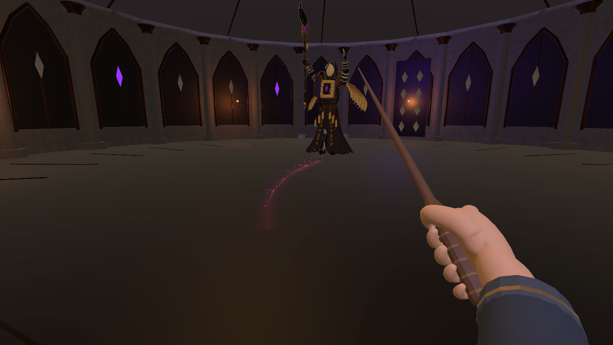

# Boss 动作衔接、线状追踪裂地与格挡恢复

2026-10-26，继续修改用户已授权的 `project123/1.0.6`，Unity 6000.3.25f1。主场景为 `Assets/Scenes/MilanLibrary_Magic_V6.unity`，通过 Esc → 深入探索进入战斗。本轮未提交或上传。

## 动作与节奏

旧动作在关键姿态逐次减速到零，部分动画先播完而状态仍等待，退出动作在混合期间停止采样；收招还等待场上弹体消失，形成明显停顿。

- 重做现有 17 段骨骼动作曲线：连续三次插值、躯干带动、前臂与手腕延迟、肩翼与袍摆跟随。保留现有模型、骨骼及蒙皮。
- 混合器保留当前完整权重，退出动作继续采样；蓄力→释放约 0.10 秒，普通切换约 0.18～0.24 秒，收势约 0.62～0.70 秒。
- 裂地持续段循环维持施法，双臂交替发力，避免动画结束后定格。
- 观察换位增加起步与减速；按间隔感知位置调整朝向，收招不自动追踪玩家。
- 弹体及环波独立运行，Boss 不再等待它们消失。世界位移与伤害仍由战斗逻辑控制，不开启 Root Motion，不增加第二套动画事件伤害。

| 参数 | 原值 | 当前值 |
| --- | --- | --- |
| 入场 / 二阶段转换 | 3.0 / 2.5 秒 | 2.2 / 2.2 秒 |
| 观察换位 | 2.8 秒 | 1.35 秒 |
| 换位速度 | 2.4 米/秒 | 3.1 米/秒 |
| 弹幕 / 环波预警 | 1.1 / 1.4 秒 | 0.9 / 1.05 秒 |
| 激光 / 冲撞预警 | 2.2 / 1.65 秒 | 1.8 / 1.35 秒 |
| 裂地起手 | 2.0 秒 | 1.6 秒 |
| 普通 / 重施法 / 冲撞收招 | 1.5 / 2.0 / 2.4 秒，另等弹体 | 0.95 / 1.15 / 1.45 秒 |

准确导出时长见 [AnimationManifest.json](AnimationManifest.json)。动作按 30 FPS 烘焙，与战斗时钟同步。

## 线状追踪裂地

本轮最终版本替换了中途的脚下圆形点状方案，**没有圆形裂地、圆环警示或整块发光地板**。原有独立的扩散环波招式仍保留；它与本招式不同。

1. Boss 沉身、抬手，裂纹从 Boss 前方开始，沿地面首尾相接向玩家延伸。
2. 前端以 **6 米/秒**推进，最多 **70°/秒**转向；每 **0.20 秒**生成约 **1.2 米**的一段。已经出现的线段固定在地面，不随玩家移动。
3. 距离玩家不足 **3 米**时，前端暂时保持方向 **0.65 秒**，给玩家侧移机会。接近时不会突然拐弯贴住脚底。
4. 每段有完整 **0.65 秒**预警，然后产生一次 **18 点**伤害并在 **0.90 秒**内消散。条带宽 **0.8 米**，命中计入玩家体宽；跳起沿用现有高度判定。
5. 一阶段最多延伸 **4.2 秒**，二阶段 **5.4 秒**；遇实体墙或场地边界提前停止，不穿墙追击。最后一段消散后进入收招。
6. 暂停冻结预警、延伸、爆发、余辉与动作；阶段转换、胜负、重试、返回都会取消残余线段。原场地 Collider 保留。
7. 同屏数量由预警和消散时间限制，不会随整场战斗不断堆积。

### 视觉

- 暗色锯齿裂口，细窄紫红发光芯与柔和紫色边光。
- 一条细金色前导纹给出路线预警；裂光沿前进方向生长，四种共享分叉网格交替使用。
- 每段仅两枚小石屑、三枚金色碎光和少量上升能量丝，无大石板、圆盘、圆形光晕。
- 局部弱光限量出现。URP Shader 使用战斗传入的时间，不使用全局 `_Time`，暂停时不会继续闪烁。
- 共享网格与材质，通过 `MaterialPropertyBlock` 控制表现，不逐帧创建 Mesh/Material。

## 格挡恢复

| 参数 | 修改前 | 当前 |
| --- | --- | --- |
| 恢复速度 | 26 点/秒 | **12 点/秒** |
| 最后一次消耗后延迟 | 1.5 秒 | **2.5 秒** |

保留持盾每秒 18 点消耗、启动吞印 14 点成本与受击消耗。满值 100，耗尽后若不再消耗，理论约需 **10.83 秒**恢复满值（含延迟）；暂停不推进计时。需要松开防御并走位恢复，持续按住不会免费回满。

## 修改文件

以下路径相对于当前 Unity 根目录：

| 文件 | 作用 |
| --- | --- |
| `Assets/Scripts/Core/BossEncounter.cs` | 招式时序、线段生命周期与状态衔接 |
| `Assets/Scripts/Core/BossCombatBehaviours.cs` | 线头推进、有限转向、障碍停止、分段伤害与换位起停 |
| `Assets/Scripts/Core/BossDefinition.cs`、`Assets/Art/ForbiddenWarden/WardenEncounter.asset` | 裂地、节奏及格挡恢复参数 |
| `Assets/Scripts/Visuals/WardenAnimationDriver.cs`、`WardenVisuals.cs` | 连续采样、姿态混合与收招过渡 |
| `Assets/Scripts/Visuals/GroundFractureVisuals.cs` | 线状裂纹、碎屑、余辉与命中区域 |
| `Assets/Scripts/Visuals/Editor/WardenRiftBuilder.cs`、`WardenCombatV2Builder.cs` | 资产制作与动画导入 |
| `Assets/Art/ForbiddenWarden/CombatV2/Materials/RiftFilament.shader` | 裂光生长与消散 |
| `Assets/Art/ForbiddenWarden/CombatV2/Models/Rift/`、`Prefabs/IlluminatedFractures.prefab` | 分叉线段、预警细线、柔光与碎屑资产 |
| `Assets/Art/ForbiddenWarden/CombatV2/Models/SilentWarden_Combat_v2.fbx` | 重做的 17 段骨骼动作 |
| `Blender/WardenCombatV2/SilentWarden_Combat_v2.blend`、`Tools/WardenMotion/refine_motion.py` | 可编辑动作源与可复现导出工具 |
| `Assets/Scripts/Visuals/Editor/TrackingRiftAcceptance.cs` | 线状追踪、伤害、格挡计时、暂停、障碍与返回验证 |
| `Assets/Scripts/Visuals/Editor/WardenFlowAcceptance.cs` | 招式节奏、姿态连续性、胜利、重试验证 |

Blender MCP 当时未连接，使用本机 Blender 后台打开项目内源文件制作与导出。未修改图书馆布局、玩家控制脚本、UI 功能、Package 或历史版本目录。

## 验证与复查

最终验证记录为 [LineAndGuardAcceptance.json](LineAndGuardAcceptance.json) 和 [MotionFlowAcceptance.json](MotionFlowAcceptance.json)。测试使用现有 Input System、实际战斗参数及 CharacterController，仅指定下一招顺序，不通过降低伤害获得通过结果。

- **30/30** 线状追踪与格挡检查通过：实际测得持盾一秒消耗约 32.08 点，延迟与恢复速度符合 2.5 秒 / 12 点每秒；两阶段侧移躲避、停留受伤、墙体阻挡、暂停与返回均通过。同屏峰值 8 个线段。
- **25/25** 动作流程检查通过：弹幕、激光、冲撞、环波的起手与收招计时正常；采样骨骼最长静止约 0.0168 秒，最大角速度约 715.7°/战斗秒，未超过设定的异常跳变阈值。胜利动作能播完，重试及返回正常。这些数值用于发现定格和跳变，不等于美术质量评分。
- [资产检查](AssetValidation.json)：9 个现用 Prefab、468 个 Renderer、17 段动作，无缺失脚本、无无效材质，裂地 Shader 无编译错误。
- [最终编辑器检查](FinalEditorValidation.json)：编译与导入完成，Console **0 Error / 0 Warning**；已退出 Play Mode，场景无未保存改动，没有残留测试鼠标。
- 检索当前项目 230 个场景 / Prefab 的依赖后，额外移除 20 个无引用旧裂地网格：原厚石板及底板 18 个、圆形预警与圆盘光晕 2 个。与此前移除的 138 个旧 Boss 资源分开计数，未删除场地 Collider。

输入验证使用临时虚拟鼠标，经过现有 InputAction 触发持盾，结束后移除设备并恢复 Input System 设置。早期向桌面物理鼠标注入的诊断没有成功触发防御，不能作为游戏格挡失效的证据；旧 LaserGuard 报告已注明这一限制。最后以这里两份成功报告为本轮依据。

截图由 Play Mode 主相机输出 1440×810，不包含 Overlay HUD，是实际场景渲染，不是概念图。

手动复查：

1. 进入战斗，观察挥杖弹幕、双手激光、持续裂地和冲撞之间的起手、释放与收势。
2. 裂地起手后持续横移：确认裂纹从 Boss 沿地面延伸、前端转向，旧段保持固定；原地站在线上会受到爆发伤害。
3. Esc 暂停，确认裂纹和动作同时冻结；松键、继续，再重新按移动键。
4. 持盾约一秒后松开，确认 2.5 秒内不恢复，之后明显缓慢恢复；持盾期间继续消耗。
5. 检查胜负、重试和返回图书馆，确认无残留特效。

骨骼连续性检测使用四元数 atan2 差值，避免 `Quaternion.Angle` 将细微呼吸运动舍入为零；校准见 [MotionMetricCalibration.json](MotionMetricCalibration.json)。美术观感与整体难度仍需团队真人试玩评审。本轮未做 standalone 构建或目标硬件性能验收。
