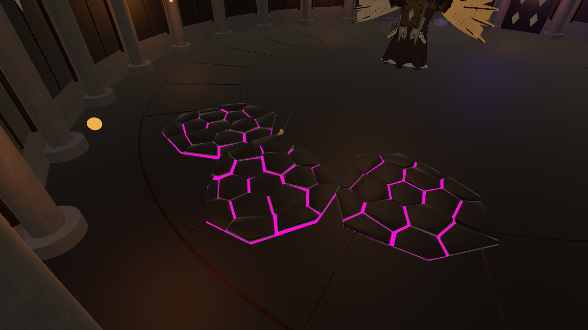

# 战斗细化 · 2026-10-19

适用于当前 `1.0.5`，入口为主场景 `MilanLibrary_Magic_V6` → Esc → 深入探索。沿用旧金、深紫、羊皮纸与哥特封印厅，不改图书馆建筑、玩家移动或资料业务。

## 行为与公平性

Boss 不再每帧朝玩家转身。观察阶段先感知再决策：每 0.7 秒检查一次 210° 视野、35 米距离及实体遮挡，记录最后看见的位置。根据记忆距离选择接近、拉开或侧向移动的固定目标；超过 3 秒没见到玩家时搜索，超过 5 秒时使用环波。身体最多转动 65°/秒。观察阶段最后 0.65 秒停步转向，施法预警后段锁定方向。

收招期间不移动、不自动面向玩家，允许绕到侧后方。一般收招 1.5–2 秒，冲撞后 2.4 秒。选择技能时沿用可读的轮转，并用距离与最近目击时间限制冲撞；不是完整 NavMesh 或行为树。

修正了初轮实测发现的决策顺序问题：进入观察阶段先刷新可见目标，再选择走位，避免刚结束长动画便误判目标丢失而只侧移。

## 五种攻击与动作

| 攻击 | 身体动作与时序 | 玩家应对 |
| --- | --- | --- |
| 禁页齐射 | 右臂后引、躯干扭转，0.42 秒挥臂前送；从 0.22 秒起由手边每 0.18 秒放出一枚禁页，一阶段 3 枚、二阶段 5 枚 | 横移、短时格挡或吞印 |
| 湮灭秘光 | 2.2 秒蓄力时双手举过肩线、展开书翼并打开胸书；发射时双臂前送；末 0.65 秒锁定，光束维持 1.3 秒 | 持续侧移；发射后仍有最高 10°/秒缓慢追踪 |
| 裂地禁咒 | 双手从低处缓缓托起，躯干先沉再抬；2 秒预警、末 0.55 秒锁定；三片裂地每隔 0.22 秒依次爆发，石片抬升后落回 | 离开紫红裂纹；仍站在其中承受 25 点地面伤害，不能格挡 |
| 封缄冲撞 | 1.65 秒压肩蓄势、左臂护胸、收拢书翼；末 0.6 秒锁线；前倾 24°，0.18 秒加速后直冲，结束后前倾缓收 | 看路线侧闪；不在冲出后追着玩家拐弯 |
| 缄默环波 | 双臂外展蓄势，再向下推出；二阶段连放两波 | 看距离起跳 |

冲撞速度上限 11.5 米/秒，最大距离 11 米，命中 32 点；胶囊扫掠先处理最近实体，撞墙或接触玩家即停，每次最多命中玩家一次。外圈半径限制保留。正面可格挡，但会消耗大量格挡值。

裂地使用固定随机种子的 Voronoi 不规则石片和不对称外轮廓；每片区域 17 块独立石片，内部裂隙透出紫红光，不画完整外圈法阵。每次旋转与落点不同。区域基础半径参数 1.9 米，实际命中按外轮廓多边形加 0.24 米玩家半径容差计算。原地面碰撞不挖洞，避免玩家陷入地板；抬升石片是表现层，没有额外阻挡玩家的 Collider。

## 格挡与飞弹参数

| 参数 | 原值 | 当前 |
| --- | --- | --- |
| 格挡容量 | 100 | 100 |
| 持盾持续消耗 | 7/秒 | 18/秒 |
| 受击额外消耗 | 伤害 × 1.5 | 伤害 × 2.8 |
| 吞印启动消耗 | 8 | 14 |
| 恢复等待 | 1.25 秒 | 1.5 秒 |
| 恢复速率 / 破防 | 26/秒 / 1.8 秒 | 保持 |

满条启动吞印并持续举盾，在不受击时约 4.78 秒耗尽；受到激光或冲撞时更快破防。持盾不能射击，破防后需要松开防御键。

| 飞弹 | 最大转速 | 每枚累计转角上限 | 有效追踪窗口 | 限制 |
| --- | --- | --- | --- | --- |
| Boss 禁页 | 10°/秒 | 12° | 发射后 0.12–1.15 秒 | 距目标 1.7 米内停止修正，越过目标不回头 |
| 玩家秘文弹 | 16°/秒 | 9° | 发射后 0.12–0.85 秒 | 仅发射时前方 15° 内且无遮挡才捕获，距目标 0.65 米内停止修正 |

两者均保持原速度；实体遮挡时不调整方向，真实弹体碰撞仍先命中最近障碍。追踪限额是上限，近距离飞行时间短，实际转向通常更小。不会把大角度射偏变成自动命中。

配置集中于 `Assets/Art/ForbiddenWarden/WardenEncounter.asset`。

## 修改文件

全部路径相对本 Unity 项目根目录。保留原 GUID 与场景引用，不重建图书馆。

- `Assets/Scripts/Core/BossDefinition.cs`：感知、冲撞、裂地、弱追踪与格挡参数。
- `Assets/Scripts/Core/BossEncounter.cs`：五招状态机、目标锁定、攻击时序、弹体创建和清理。
- `Assets/Scripts/Core/BossCombatBehaviours.cs`：感知记忆、走位、冲撞碰撞、裂地伤害与有限转向。
- `Assets/Scripts/Visuals/WardenVisuals.cs`：双臂、躯干、头部、胸书和书翼的分招动作。
- `Assets/Scripts/Visuals/BossArena.cs`：新增两种效果引用。
- `Assets/Scripts/Visuals/GroundFractureVisuals.cs`、`RushTelegraphVisuals.cs`：石片、裂光与冲撞路线表现。
- `Assets/Scripts/Visuals/Editor/BossCombatPolishBuilder.cs`：裂地网格和预警 Prefab 生成，字体烘焙。
- `Assets/Scripts/Visuals/Editor/BossEncounterBuilder.cs`：完整重建入口包含本轮升级，常规运行不需执行。
- `Assets/Scripts/Visuals/Editor/BossCombatPolishAcceptance.cs`：新增真实输入验收。
- `Assets/Scripts/Visuals/Editor/BossAcceptance.cs`、`BossLaserGuardAcceptance.cs`：适配新招式文案及更快破防。
- `Assets/Scripts/UI/RecoveryMenu.cs`：更新战斗说明。
- `Assets/Art/ForbiddenWarden/Prefabs/FracturedGround.prefab`、`RushTelegraph.prefab`：新效果；`SealChamber.prefab` 接入引用。
- `Assets/Art/ForbiddenWarden/Meshes/Fracture/`：裂地网格；`Materials/CrackMagenta.mat`：紫红裂光；`WardenEncounter.asset`：参数。
- `Assets/UI/Fonts/BossChineseSDF.asset`：新增提示文字字形。
- 本文、实现说明、设计评审、README、CHANGELOG、验收 JSON 与截图。

修改前备份在 `Docs/BossDesign/BeforeCombatPolish20261019/`。老封印柱资源保留，不再用于裂地。

## 手动复核

1. 进入战斗，远离、贴近、侧绕 Boss；观察选择路线后执行换位，收招不会始终面向你。
2. 看双手托举及脚下紫红裂纹，锁定后侧移离开；另一次留在范围内确认受伤，地面仍能正常站立。
3. 等冲撞路线出现，锁定后侧闪；观察冲撞直行及停步后的反击窗口。让障碍处于路线上，确认停止。
4. 激光蓄力时看双手高举，齐射时看挥臂放弹；按 Esc 确认动作、弹体与战斗计时暂停。
5. 按住右键观察更快扣条，硬接攻击确认破防；松开后等待恢复。
6. 左键稍微偏离 Boss 射击，看小幅纠偏；大幅射偏不会自动回头。横移时敌弹略弯，但可闪避。
7. 验证失败重试、二阶段胜利和返回图书馆。

动作仍为原模型的 Transform 分件动画，未新增完整蒙皮或动作捕捉。数值需结合真人试玩继续平衡；编辑器验收不等于独立构建性能验收。

## 验证证据

本轮 Play Mode 结果由 `CombatPolishAcceptance.json`、`LaserGuardAcceptance.json`、`PlayModeAcceptance.json` 记录；以完成后的状态、`failure` 为空与 PASS 检查为准。测试通过真实 Input System 排队输入；专项仅设定下一招索引，保持正式伤害、时长和碰撞规则。截图在 `Captures/polish_*.png`。

最终结果：新增战斗专项 **39 项**、激光/格挡专项 **19 项**、基础闭环 **19 项**，合计 **77 项 PASS**。三份报告 `failure` 均为空。基础闭环报告在最终返回检查（step 9）写入，随后工具内部切到完成状态，不表示测试未完成。

- 实际敌弹最大转角约 9.108°，玩家弹约 4.534°，均低于各自上限。
- 真实左键弹体触发二阶段、胜利，完成失败 → 重试 → 胜利 → 返回；没有修改生命或伤害作弊。
- 激光转速采样约 10.0003°/秒，侧向冲刺测试保持满血；提高后的格挡消耗和破防已实测。
- `CombatPolishAssetAudit.json`：10 个战斗 Prefab 无缺失脚本/材质，使用 URP Lit/Unlit；检查 143 个战斗脚本中文字形，无缺失。
- 完成后退出 Play Mode，主场景无未保存改动，输入路由恢复为 `PointersAndKeyboardsRespectGameViewFocus`，Console **0 Error、0 Warning**。
- 修正过两项验收工具问题：手臂超过 90° 后改用实际朝向验证抬手；激光专项在 Dynamic 输入更新前注入持盾状态，避免编辑器输入时序漏掉右键。原游戏输入逻辑保持。
- 未进行 1.0.6 干净克隆导入或独立构建；本轮测试发生在现有开发工程中。

上图为正常施法爆发后冻结帧的场内检查视角，便于查看裂纹形状。`polish_laser_raised_arms.png`、`polish_volley_sweep.png`、`polish_rush_attack.png` 为包含 HUD 的玩家视角截图。
