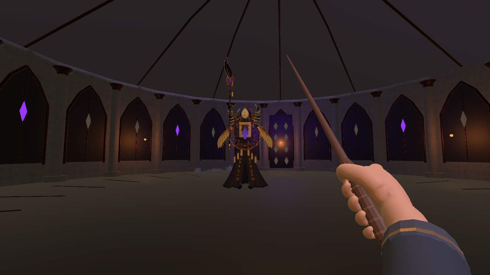
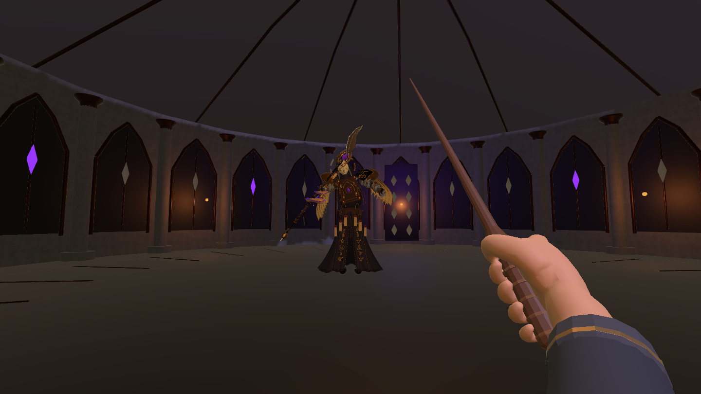
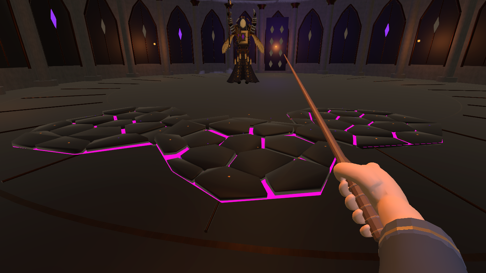

# 缄默典狱长：骨骼动作与法术表现 V2

> 这是 2026-10-24 的接入记录。当前动作时序与裂地已于 2026-10-26 修订；请以 [动作衔接与追击裂地](../CombatFlow20261026/README.md) 为准。下面的三片厚裂地石板描述属于历史状态。

日期：2026-10-24。目标为 `lixiang` 工作树中的 `1.0.6/`，Unity 6000.3.25f1。用户明确允许更新这份归档，并要求清除被替换的 Boss 测试模型、特效和动作。当前为本地工程更新，未提交或推送 GitHub。

## 已接入的成品

主场景仍为 `Assets/Scenes/MilanLibrary_Magic_V6.unity`。`BossEncounter.arenaPrefab` 已指向 `Assets/Art/ForbiddenWarden/CombatV2/Prefabs/SealChamberRigged.prefab`。不需要运行建场工具；正常打开场景即可从“深入探索”进入战斗。

Boss 沿用哥特石质环境、旧金、深色布料与诡紫符文的视觉语言：裂面、镂空冠饰、书页肩翼、分节手指与刃杖。新模型约 141,650 个三角面、85 根骨骼、12 个蒙皮材质组；使用 URP 材质。刃杖随握持骨骼运动，手指、肩翼、袍摆可继续制作动作。当前未新增刃杖近战伤害或剑盾玩法。

| 资产 | 项目内准确路径 |
| --- | --- |
| Boss 原生骨架与动作 | `Blender/WardenCombatV2/SilentWarden_Combat_v2.blend` |
| 特效原生网格 | `Blender/WardenCombatV2/WardenSpellMeshes.blend` |
| Boss FBX | `Assets/Art/ForbiddenWarden/CombatV2/Models/SilentWarden_Combat_v2.fbx` |
| 符文法环 | `Assets/Art/ForbiddenWarden/CombatV2/Models/WardenSealGate.fbx` |
| 禁书页 | `Assets/Art/ForbiddenWarden/CombatV2/Models/WardenForbiddenPage.fbx` |
| 扩散符文冠环 | `Assets/Art/ForbiddenWarden/CombatV2/Models/WardenShockCrown.fbx` |
| Boss 成品 | `Assets/Art/ForbiddenWarden/CombatV2/Prefabs/ForbiddenWardenRigged.prefab` |
| 竞技场成品 | `Assets/Art/ForbiddenWarden/CombatV2/Prefabs/SealChamberRigged.prefab` |
| 敌方禁页 / 玩家秘文弹 | `Assets/Art/ForbiddenWarden/CombatV2/Prefabs/ForbiddenPageIlluminated.prefab` / `PlayerGiltPage.prefab`（同目录） |
| 激光 / 裂地 / 环波 | `Assets/Art/ForbiddenWarden/CombatV2/Prefabs/IlluminatedLaser.prefab` / `IlluminatedFractures.prefab` / `RunicShockCrown.prefab`（同目录） |
| 命中特效 / 冲撞预警 | `Assets/Art/ForbiddenWarden/CombatV2/Prefabs/IlluminatedImpact.prefab` / `RushTelegraph.prefab`（同目录） |

原生 `.blend` 放在 Assets 外，运行依赖已导出的 FBX；打开工程不要求安装 Blender。新 FBX 和 `.blend` 已加入本版 Git LFS 规则。

## 动作与战斗时序

17 段动作保存在同一 FBX 中，导入名称带 `AA_` 前缀。采用 Generic 骨骼和手动采样 Playables，不开启 Root Motion，不通过动画事件重复造成伤害。观察阶段走位、预警锁定、攻击判定和收招时长仍由 `BossEncounter` 决定；预警动作按实际预警时长归一化，切换约 0.14 秒交叉淡化。

| 动作 | 动画时长（约） | 表现与用途 |
| --- | --- | --- |
| Intro | 3.0 秒 | 入场展开姿态 |
| Idle / Glide | 3.2 / 1.6 秒，循环 | 静止呼吸与漂移；由真实位移选择 |
| VolleyWindup / VolleyRelease | 1.1 / 1.5 秒 | 肩臂蓄势、刃杖挥扫释放禁页 |
| LaserCharge / LaserChannel | 2.2 / 1.3 秒 | 双手抬高，形成法环并维持激光施法 |
| FractureRaise / FractureRelease | 2.0 / 2.03 秒 | 双手托举后释放裂地；保留三片不规则裂纹及紫红发光 |
| WaveWindup / WaveRelease | 1.4 / 1.4 秒 | 聚力并推出冠环；二阶段第二道实际环波对应第二次动作 |
| RushWindup / RushDrive | 1.67 / 0.8 秒 | 前倾蓄势、承诺方向后冲撞；冲撞段循环 |
| Recovery | 2.0 秒 | 放下手臂、收杖，保留反击窗口 |
| PhaseBreak | 2.5 秒 | 二阶段转换，脚下符印展开 |
| Defeat | 3.2 秒 | 战斗胜利后完整播放倒伏；不受已冻结的攻击计时截断 |
| Stagger | 0.87 秒 | 新模型的预留受击动作；当前无对应战斗状态，未接入运行逻辑 |

`Stagger` 是新骨架的后续可用动作，不属于旧程序摆动动画。Blender 中的原始帧数与导出检查见 [动作清单](AnimationManifest.json)、[动作检查](BlenderMotionValidation.json)。

## 特效设计与实现

- **激光：** 金紫套环、分段轨道、柔边加色光束、两条螺旋线和晶体焦点。光束终点服从原有物理阻挡距离，弱追踪参数与伤害不变。
- **禁页：** 弯曲书页、金色刻文、紫色边缘和有长度上限的拖尾；玩家秘文弹使用较小的金色版本，双方仍采用原来的弱追踪限制。
- **裂地：** 复用已验证的龟裂石片几何与判定，补充缓升金屑，不恢复旧石柱招式，也不破坏完整地面碰撞。
- **环波 / 冲撞 / 转阶段：** 刻文冠环扩散、双侧冲撞光带和展开符印；已有冲撞路线预警迁入新资源目录继续使用。
- **暂停与退出：** 动作和特效读取同一战斗时钟；暂停冻结。竞技场临时启用适量 Bloom 和相机后处理，返回图书馆时恢复进入前相机配置并销毁实例。

特效 FBX 的单位换算和坐标轴保留在导入对象上，外套米制空节点负责动画缩放，避免 FBX 的 100 倍换算被覆盖。相关网格验证见 [特效检查](SpellMeshValidation.json)。

## 清理结果

先使用 `AssetDatabase.GetDependencies` 核对保留资源，再删除旧素材。已删除 **138 个无引用的旧资源**（不含对应 `.meta` 计数）：旧静态 Boss、旧竞技场组合 Prefab、旧石柱、旧弹体和法环、配套网格、闲置材质及旧 OBJ；清单见 [RetiredAssets.json](RetiredAssets.json)。3 个清空的素材目录也已移除。

删除旧生成脚本 `BossEncounterBuilder.cs`、`BossCombatPolishBuilder.cs`、`WardenModelRefinement.cs` 及其 `.meta`。`WardenVisuals` 只保留新骨骼的桥接接口，旧冠环、书翼和手臂程序摆动代码已移除。删除 3 组过时 Boss 制作备份、本轮临时备份 ZIP 和 2 张失败/中间截图，见 [RetiredBackups.json](RetiredBackups.json)。历史测试报告和截图作为记录保留。

仍被新竞技场引用的建筑网格、材质、地面碰撞、裂地石片和 `WardenEncounter.asset` 参数保留；不能只因处于旧目录而删除。历史版本 `1.0.1/`～`1.0.5/` 未改动。需要追溯已删除的旧素材时使用 Git 历史。

## 代码修改清单

以下路径均位于 `Assets/Scripts/`：

| 文件 | 修改 |
| --- | --- |
| `Visuals/WardenAnimationDriver.cs` | 新增；导入骨骼动作、状态映射、暂停与死亡动画 |
| `Visuals/WardenSpellMotion.cs` | 新增；禁页、拖尾与装饰粒子运动 |
| `Visuals/WardenArenaPostProcessing.cs` | 新增；战斗相机后处理保存/恢复 |
| `Visuals/WardenVisuals.cs` | 用新动画桥接替换旧程序摆动 |
| `Core/BossEncounter.cs` | 飞弹发射位置改用绑定右手的施法点 |
| `Visuals/BossArena.cs` | 移除未使用的旧 `sealEffect` 引用 |
| `Visuals/LaserBeamVisuals.cs` | 新法环与螺旋光束表现 |
| `Visuals/GroundFractureVisuals.cs` | 裂地金屑表现 |
| `Visuals/Editor/WardenCombatV2Builder.cs` | 新导入/生成工具，仅依赖当前成品模板，不依赖已删除的旧 Prefab |
| `Visuals/Editor/WardenCombatV2Acceptance.cs` | 新表现回归与游戏相机截图 |
| `Visuals/Editor/BossCombatPolishAcceptance.cs` | 将动作断言适配骨骼，保留实际输入/碰撞回归 |

主场景只更换战斗竞技场引用，未重建图书馆、玩家或菜单；保存后的场景无未保存标记。

## 本轮验证

在删除旧素材之后，以当前 `1.0.6/` 工程执行：

- **33 项表现检查通过**：[UnityPresentationAcceptance.json](UnityPresentationAcceptance.json)。覆盖 17 段导入动作、12 个蒙皮材质组、URP 支持、抬手、挥杖、裂地、冲撞、环波、二阶段、暂停、死亡、重试与返回。
- **39 项战斗检查通过**：[CombatPolishAcceptance.json](../CombatPolishAcceptance.json)。使用实际 Input System 虚拟输入、碰撞与攻击逻辑；仅指定下一招顺序，不降低伤害。覆盖格挡消耗、双方追踪角度限制、恢复阶段不自动朝向、裂地躲避/命中、冲撞躲避/命中/墙体阻挡与返回清理。
- **资源检查通过**：[UnityAssetValidation.json](UnityAssetValidation.json)。9 个新 Prefab，480 处网格引用；缺失脚本/材质/网格/序列化 GUID 为 0，主场景旧 Prefab 依赖为 0。
- 最终编译完成、资源导入空闲，**Console 0 Error、0 Warning**，见 [UnityFinalConsole.json](UnityFinalConsole.json)。过程中曾出现删除旧组合资源引起的临时导入报错及 MCP 临时 C# 执行器错误，已与最终工程编译/运行结果分开记录。

这些是 Editor Play Mode 自动验证，不等同于真人长时间试玩或 standalone 性能验收。约 14.2 万三角面的 Boss 暂无 LOD；数值平衡、不同硬件帧率和最终动作美感仍需团队试玩评审。此次未做独立构建、近战判定、音效或新资料业务。

### 实际游戏相机截图

截图由 Play Mode 主相机渲染，1440×810；不包含 Overlay HUD，不是概念图。8 张完整截图位于 [Captures](Captures/)。

### 手动复查步骤

1. 用 Unity 6000.3.25f1 打开 `1.0.6/`，等待编译，打开主场景并进入 Play Mode。
2. Esc → 深入探索 → 深入探索。观察新模型入场、漂移、双手蓄力激光、挥杖弹幕、托举裂地、环波和冲撞。
3. 横移躲激光；裂纹锁定后离开；冲撞锁线后侧闪；确认攻击仍按原规则命中/格挡。
4. 任一招式中 Esc 暂停，确认骨架、法环和弹体停止；继续后正常恢复。
5. 胜利或失败后重试，再返回图书馆。确认无残留 Boss/法术、相机恢复，Console 没有新增项目错误。

重跑自动验证时先进入 Play Mode，再调用编辑器类 `WardenCombatV2Acceptance.Start()` 或 `BossCombatPolishAcceptance.Start()`；两个测试应顺序运行。生成工具不是启动步骤，团队编辑新 Prefab 后不要随意重建覆盖。
