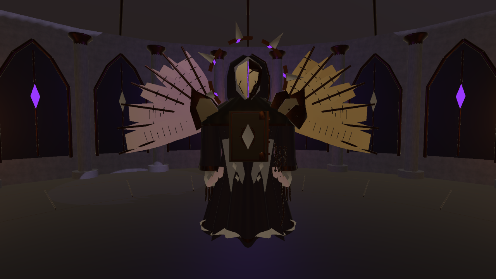
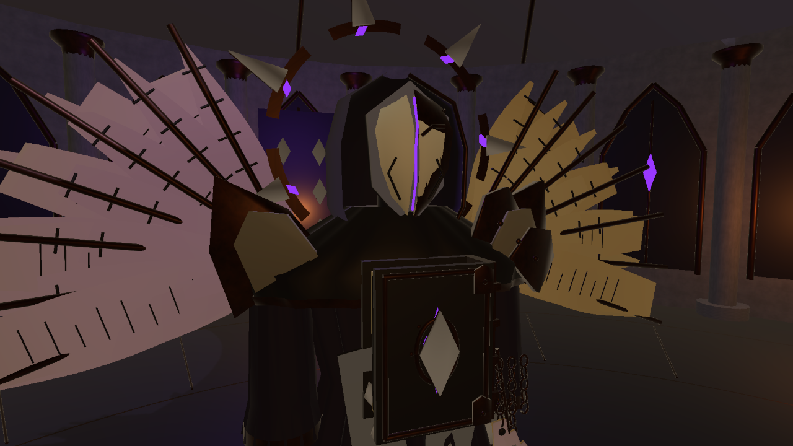

# 缄默典狱长 · 维纶：设计评审稿

更新：2026-10-19。面向当前 1.0.5。本文可直接修改：末尾留有你的修改意见区。最新动作、参数与验证见 [战斗细化记录](CombatPolish20261019.md)。

## 核心理念

**一名被禁书与誓约改造成封印机器的图书馆典狱长。**

它的外形仍保留看守、司祭和馆员的秩序感，但肉身身份已被抹掉。面具没有正常双眼，胸腔被一册禁书替代；书页、链条与封印不只是装饰，也是维持它存在的结构。恐怖来自庄严外形下的不自然，而不是堆满血肉和尖刺。

与竞赛主题 “I'm a monster” 的关系：玩家是被图书馆归档的异常存在，能够吞噬封印、转化为力量。Boss 认为自己在执行收容职责。它不必自称邪恶，玩家也不必立刻知道自己是什么。现有开场语“归档编号零。你不该醒来。”保留这种悬念。这是叙事提案，尚未制作完整剧情。

## 外形与颜色

剪影为窄头、宽肩、细腰、悬浮长袍，头后七段破碎冠环；两侧展开的不是羽毛，而是被金属书脊撑开的档案页。第一眼看轮廓，第二眼看面具与胸书，靠近后再看链节、页边和指节。

| 部位 | 设计含义 | 当前模型已细化 | 可调整方向 |
| --- | --- | --- | --- |
| 面具 | 个人身份被抹除，只剩执行职责 | 立体曲面象牙面片、金属底框、纵向裂缝、紫光、封口铆钉、颊部刻痕 | 更像人脸 / 更像空壳；裂缝更宽或更克制 |
| 兜帽与肩甲 | 司祭与狱卒的双重身份 | 开口深色兜帽、金边、三层肩甲和铆钉 | 增加布料比例 / 增加重甲比例 |
| 胸前禁书 | 心脏、武器与弱点合为一体 | 包角、尖拱封印框、书脊箍、独立页边、内部核心环；保留开合封面 | 改为锁链束缚的巨书 / 外露书页形成胸腔 |
| 手部 | 原本用于整理书籍的手，变成过长的封印工具 | 掌甲、皮革嵌片、指节、指面刻线、袖口符印；保留五指轮廓 | 更修长、骨感 / 更沉重、机械化 |
| 书页翼 | 它携带的不是翅膀，而是被拘禁的档案 | 双层曲面书页、疏密不同的刻文、装订边与铆钉 | 减少对称性 / 加入撕裂缺页；避免做成普通天使羽翼 |
| 长袍与挂件 | 被誓约和编号束缚 | 前襟金边、链节、纸质誓约牌、封蜡、背部书脊式装甲 | 更破败 / 更完整威严；挂件可减少以保持轮廓清楚 |
| 冠环 | 曾经完整的权限与身份 | 沿用七段断裂金环及低速浮动 | 减少尖饰 / 加大断口 / 增加不对称分段 |

色彩层级：**深紫黑构成主体，旧金定义结构，象牙色吸引视线，紫光只强调异常与攻击。** 书页使用发黄纸色与暗红皮革。常态压住发光面积，施法时集中亮起胸书和封印环。

正面与近景实机截图：

## 行为与战斗气质

它先观察，再选择接近、退让或侧向换位；途中执行已选路线，施法前才有限速地转向记忆位置。视野之外或被遮挡的玩家不会被持续更新位置，收招留下侧后方反击机会。动作基调是仪式性的蓄势、明确的释放和短暂的失衡，不依靠全身高频抖动。

| 招式 | 传达的形象 | 玩家应对 |
| --- | --- | --- |
| 禁页齐射 | 右臂向后引、躯干扭转，再挥出拘捕令般的飞页 | 横移、吞印或短时正面格挡 |
| 湮灭秘光 | 双手高举、书翼展开，胸书开启；放射时双臂前送稳定光束 | 持续横移或冲刺；格挡只能支撑很短一段 |
| 缄默环波 | 用地面封印驱逐异常 | 看距离起跳 |
| 裂地禁咒 | 双手从低处缓慢托举，地面不规则龟裂渗出紫红光，石片抬升 | 离开已经锁定的裂纹区域 |
| 封缄冲撞 | 书翼收拢、肩部压低，沿锁定路线猛冲；停下后身体前倾收招 | 路线锁定后侧闪，利用 2.4 秒收招反击 |

二阶段保留冠环错位、书页翼展开、攻势增强；不突然切换为高速乱跳的生物。更大的形态变化、面具真正裂开、独立手指动画、语音和剧情尚未实现。

## 激光追踪规则：本次已经接入

- 蓄力 **2.2 秒**；前段瞄准玩家，末 **0.65 秒**保持瞄准方向，保留明确预警。
- 发射持续 **1.3 秒**。发射后先保留 **0.18 秒**短暂停顿，再在 **0.25 秒**内平滑提升追踪转速。
- 最大转速 **10°/秒**，只朝玩家当前所在位置转动，不预测冲刺落点，也不瞬间转向。
- 光束仍被实体墙截断，格挡、破防、暂停和退出清理继续生效。
- “有追踪能力”不等于站在光路里必须硬吃伤害：持续侧移应当快于光束，转身跑回光路则有风险。最终难度仍需真人试玩调整。

可调位置：`Assets/Art/ForbiddenWarden/WardenEncounter.asset`。

| 字段 | 当前值 | 调整含义 |
| --- | --- | --- |
| `laserTrackingSpeed` | 10 | 越大越难甩开；建议先在 8–14 之间微调 |
| `laserTrackingDelay` | 0.18 | 发射后多久开始追踪 |
| `laserLockTime` | 0.65 | 蓄力末段保持方向的时间 |
| `laserDuration` | 1.3 | 持续时间，增加后也会提高总伤害与格挡消耗 |
| `laserDamage` | 14 | 每次伤害结算值 |

## 实际交付与制作边界

- 游戏 Prefab：`Assets/Art/ForbiddenWarden/Prefabs/ForbiddenWarden.prefab`。场地引用原 Prefab，新细节随原动画分组运动。
- 新增细节网格：`Assets/Art/ForbiddenWarden/Meshes/DetailV2/`；象牙面片材质为 `Materials/MaskIvory.mat`。
- 可编辑建模源：`Assets/Scripts/Visuals/Editor/WardenModelRefinement.cs`；Unity 菜单 `Arcane Archive → Boss → Refine Warden model only` 可重新生成。常规试玩无需执行。
- 网格导出：`Assets/Art/ForbiddenWarden/Source/ForbiddenWarden.obj`，含几何与分组，可导入建模工具；它不是带完整材质、骨骼和动画的 Blender 工程。
- 模型活动网格约 **34,416 三角面**。新增小零件按部件和材质合并，仍是 Transform 分件动画，尚未做完整蒙皮、LOD、贴图烘焙和性能验收。
- 原面具与掌甲保留在 Prefab 内并停用，碰撞和核心命中范围保持原尺寸。修改前文件在 `BeforeTrackingAndDetail/`。
- 本版不改玩家资料系统、馆藏逻辑或图书馆建筑。

## 你的修改意见

可直接改下表，再让我按你的版本制作。留空的项继续沿用上述方案。

| 项目 | 你的修改 |
| --- | --- |
| Boss 名称与身份 | |
| 玩家为什么被称为怪物 | |
| 外形整体：威严 / 诡异 / 破败的比例 | |
| 面具与眼部 | |
| 胸前禁书 | |
| 书页翼和轮廓 | |
| 金色、紫色、象牙色的比例 | |
| 激光追踪强弱 | |
| 二阶段想发生的变化 | |
