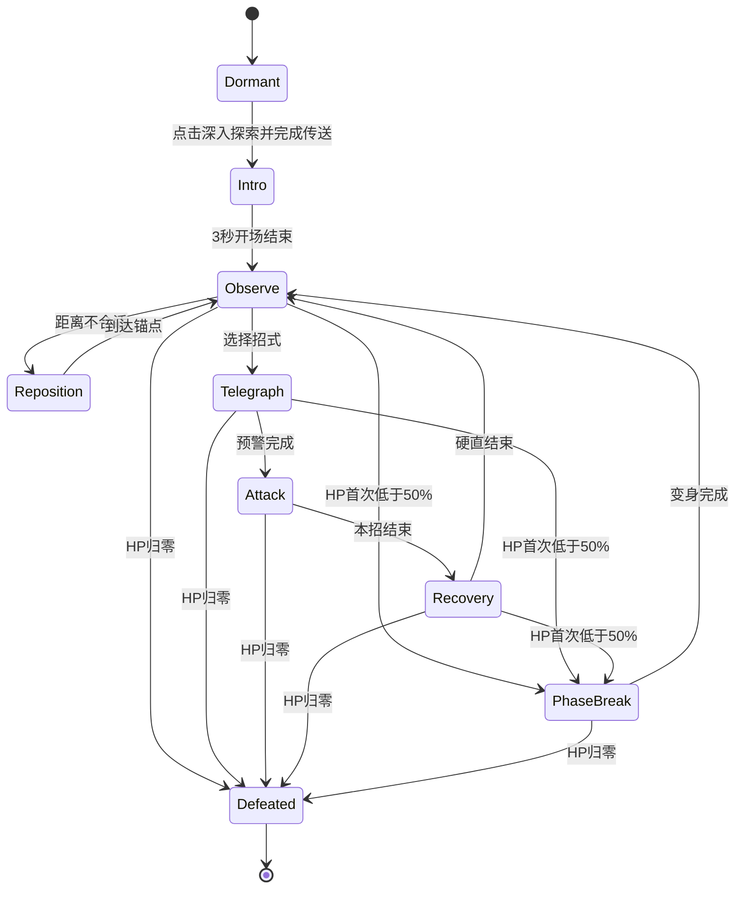

# Arcane Archive：缄默典狱长 Boss 遭遇设计

设计日期：2026-10-18。面向当前 1.0.5 工程。

本文保留完整制作规格。2026-10-18 已按用户确认制作可玩首版，并追加蓄力激光、主动追近/退让/绕侧移动及玩家格挡条：按钮进入封印厅、分件 Boss 模型、两阶段四种攻击、玩家射击/吞印/格挡、暂停、胜负、重试与返回。实际文件、测试证据和与规格的差异见 [实现与验证](BossDesign/ImplementationAndVerification.md)。文中 2–4 分钟、LOD、复杂分件动作等为后续制作目标，不能视为本次全部已完成。

## 1. 当前项目风格与可复用内容

实际主场景是 `Assets/Scenes/MilanLibrary_Magic_V6.unity`，使用 Unity 6000.3.25f1 / URP。视觉由象牙色哥特石构、深胡桃木、旧黄铜、彩窗、孔雀绿织物和暖色灯火组成。整体属于有材质细节的风格化中世纪魔法空间。

UI 延续深棕背景、金色细线、象牙白文字；“深入探索”按钮已使用暗紫底、金紫荆棘和眼形封印。战斗采用这套语言：旧金表达秩序和封印，紫色表达玩家体内的禁忌力量，白金色表达即将释放的攻击。危险必须同时有轮廓、动作、音效和时序提示，不能只靠颜色区分。

设计开始时已有第一人称移动/跳跃/冲刺、魔杖手部、E 交互、TMP 菜单和按键换绑；本次在这些基础上加入玩家伤害、Boss 状态机和战斗结算。

相关真实路径：

- `Assets/Scripts/UI/RecoveryMenu.cs`：唯一主菜单与 Esc 状态拥有者。书籍功能概述的“深入探索”直接进入战斗；Esc 菜单入口先显示试炼说明，再进入战斗。
- `Assets/Scripts/UI/GildedFiligree.cs`：现有金紫按钮纹样。
- `Assets/Scripts/Player/FirstPersonController.cs`：移动、跳跃、输入禁用和安全返回出生点。
- `Assets/Scripts/Core/LibraryInputBindings.cs`：现有换绑与存档。
- `Assets/Scripts/Interaction/BookPreviewInteractor.cs`：现有 E 交互入口。
- `Assets/Art/Models/GrandEntrance/Archive_AntiqueGold.mat`、`Archive_AmethystSeal.mat`、`Archive_ObsidianWood.mat`：现有金、紫、深色材质参考。战斗材质使用独立副本，避免改动大厅。
- `Assets/UI/Fonts/ArchiveChineseSDF.asset`：已烘焙部分中文；新增战斗文案必须补齐字形。
- 参考截图：`Docs/BossDesign/References/library_style.png`。

## 2. 主题与 Boss 身份

名称：**缄默典狱长 · 维纶 / Veyr, Warden of the Unwritten**。

它是禁书馆的封印执行者，由历代守卫的盔甲、书页和誓约共同构成。它没有人脸，胸前锁着一册仍在呼吸的禁书。玩家点击“深入探索”时，被它识别为馆内收容的异常存在。

竞赛主题“I’m a monster”落在玩家身上：玩家能吞噬守卫释放的封印碎片，将它们转化为力量。典狱长的台词揭露这个事实：“归档编号零。你不该醒来。”其造型与动作庄严克制；恐怖来自它坚持把玩家当作失控藏品的态度。

首场遭遇目标时长 2–4 分钟，一名 Boss、两阶段、四种基础招式。胜利后给出“封印已破，收容物正在离馆”的结果，不再把战斗解释为无关小游戏。

## 3. 按钮与完整体验流程

`魔法书功能概述 → 深入探索 → 淡出 → 封印厅 → 3 秒开场 → 战斗 → 胜利/失败 → 重试或返回图书馆`。

点击现有金紫按钮即进入遭遇，不再落到“开发中”说明页。切换期间禁用重复点击、移动、视角及攻击；先确认战斗资源与出生点可用，再移交玩家控制。资源缺失时留在图书馆并显示明确错误，禁止黑屏后卡死。

建议首版使用可独立制作的 `BossArena.prefab`：进入时实例化到与大厅隔离的位置，记录玩家返回位置、朝向及大厅原激活状态；停用大厅渲染组，保留玩家。离开时清理攻击、恢复大厅、验证返回位置，失败则回到大厅安全出生点。不复制另一套玩家或 EventSystem。

Esc 仍由 RecoveryMenu 处理。战斗中打开菜单必须暂停 Boss、弹体、伤害窗口和战斗计时；关闭后等待释放按键，避免关闭菜单的左键直接施法。暂停菜单提供“继续战斗 / 设置 / 放弃并返回图书馆”，结果页提供“再次挑战 / 返回图书馆”。失焦自动暂停。重试重置血量、阶段、资源、弹体、冷却和 HUD。

## 4. Boss 建模规格

尺寸：悬浮最低处离地 0.4 米；本体高约 4.2 米；冠环顶高约 4.8 米；完全展开书页翼宽约 5.6 米。正面剪影为窄头、宽肩、细腰、垂落长袍。主体要能在普通第一人称视野中看清，不依赖把相机抬到极限。

| 部件 | 建模要求 | 动画/功能 |
| --- | --- | --- |
| 封印面具 | 象牙色面具，中间一道纵向封印，眼部为空洞；不做完整人脸 | 抬头识别玩家，受击微侧头；二阶段面具分裂但不遮挡准星 |
| 破碎冠环 | 头后分段金属圆环，7 段不规则断片；外缘细长尖饰 | 低速错向旋转，施法前停止并对齐；避免快速无意义自转 |
| 胸部禁书 | 深色皮封、金属锁扣、可打开的上下封面、独立书芯 | 核心受击区；施法后打开，形成弱点窗口 |
| 肩甲与臂甲 | 哥特尖拱轮廓，金属边线，修长的书页状分片 | 右臂指向弹幕，双臂举起释放环波；动作先于特效 |
| 手部 | 每手五指，指节分段；手掌与手指长度刻意偏长 | 三种清楚的施法手势，不能以整个圆球替代手部 |
| 长袍 | 深紫黑外层、暗红内衬；独立的前襟与后摆，破损边缘 | 缓慢摆动；使用少量骨骼/分片驱动，不以实时布料作为首版依赖 |
| 书页翼 | 每侧 5–7 条书脊状骨架，沿骨架排列有厚度的纸页 | 平时收拢，攻击时依次展开；纸页可独立偏转 |
| 悬浮碎页与锁链 | 少量不对称环绕，链节有厚度，符文稀疏 | 只做轮廓补充；不遮住胸部、手部及攻击方向 |

建模交付应包含可编辑源文件、游戏网格和 Prefab；不是只有效果图。建议 Blender 源文件与 FBX 或项目可读网格分开保留。统一 1 单位=1 米，根节点脚底地面中心，Unity +Z 为正面，应用缩放。

建议 LOD0 目标 35k–55k 三角面、LOD1 18k–28k；材质槽控制在 4–5 个：布/皮、旧金、象牙骨石、书页、发光符文。大纹样通过法线/遮罩体现，近景锁扣、冠环、手指和轮廓破损保留真实几何。基础贴图以 2K 为主，UV 不把脸和核心挤到很小的空间。

骨架约 25–40 根：根/悬浮枢轴、躯干、头、双臂、手掌、简化手指、左右翼、前襟/后摆。冠环分段和胸书封面保留独立 Transform。碰撞使用简化躯干与核心触发体；书页、链条和袍边不参与玩家阻挡。

## 5. 玩家战斗能力

保留当前移动、冲刺和跳跃操作。战斗输入加入同一 Input System 管理，冲突检查与换绑一起处理。

| 能力 | 初始参数 | 反馈与限制 |
| --- | --- | --- |
| 左键：秘文弹 | 20 伤害，0.32 秒间隔，射程 35 米 | 魔杖前端聚光、短拖尾；被墙或最先命中的实体阻挡。核心开启期间伤害×1.5 |
| 右键：吞印 | 0.65 秒有效窗口，2.5 秒冷却 | 掌前张开紫金裂口，仅吞噬正面约 90°、2 米内的可吞噬弹体；不能吞地面冲击波 |
| 怪物力量 | 每次成功吞印 +25，上限 100 | 满值时下一发秘文弹转为 80 伤害裂印弹，命中/发射后消耗；不自动夺取操作 |
| 生命 | 100；受击后 0.7 秒保护 | 不采用满屏长时间红闪。清楚显示受击方向、血条与短音效 |

首次进入提供一条简洁操作提示；不能在战斗期间打开不可关闭的教程。吞印失败也能依靠走位和普通攻击获胜，避免唯一机制导致新手完全无法通关。

## 6. 行动逻辑与状态机



首轮数值：Boss 生命 1000；保持距离 7–13 米，悬浮移动速度 1.2 米/秒。围绕场内 3–5 个经过通行检查的锚点移动，施法前停稳，头部和躯干分层转向。没有冲刺近身或瞬移到玩家背后的招式。

选招规则：同一招不连续超过两次；地面审判后不立即再放地面审判；以可达安全区为前提；预警末段保留锁定落点或方向的窗口。激光按本次要求在发射后恢复有限速追踪，最大 10°/秒，玩家持续横移可甩开。一次只开启一个主招式，允许上一招余光淡出，但不叠加仍有伤害的攻击堵死安全区。

二阶段在 50% 生命触发一次：清除在途攻击，进入 2.5 秒不造成伤害的转阶段演出。冠环断裂、书页翼展开、胸书亮起，玩家保持可移动。第二阶段增加弹体数和一次延迟波，不压缩预警到难以辨识。转阶段期间 Boss 暂时免伤，结束后正常恢复。

玩家死亡、主动退出和场景卸载优先于普通状态；立即取消攻击生成与伤害。死亡状态只结算一次。计时器、攻击实例和阶段标志均属于一次战斗会话，不能残留到重试。

## 7. 四种攻击与特效建模

所有攻击遵循“动作预备 → 地面/空中预警 → 释放 → 命中反馈 → 消散”。发光轮廓与真实伤害范围一致，预警阶段不扣血。禁止用看不见的巨大 Collider 扩大命中范围。

| 招式 | 时间与数值 | 躲避/反击方式 | 特效模型与实现 |
| --- | --- | --- | --- |
| 禁页齐射 | 1.1 秒预备；一阶段 3 枚、二阶段 5 枚；0.18 秒间隔；速度 8 米/秒；每枚 10 伤害；1.3 秒收招 | 横移；正面吞印。发射后不追踪 | 有厚度的弯曲菱形书页网格，中央金色符文、紫色边缘；两条细带状拖尾；核心球只辅助发光，不代替弹体造型 |
| 湮灭秘光 | 蓄力 2.2 秒，最后 0.65 秒锁定；释放 1.3 秒，开火 0.18 秒后渐进追踪，最大 10°/秒；半径 0.30 米，每 0.22 秒尝试造成 14 伤害 | 持续横移或冲刺甩开；正面格挡消耗格挡条，持续硬接会破防；实体墙可遮挡 | 胸前收拢封印环、细紫预警线、半透明紫色外层与金色光芯、小型命中光点；渲染终点与实体遮挡一致 |
| 缄默环波 | 1.4 秒预警；半径从 1 扩至 14 米，速度 4 米/秒；伤害 22；二阶段延迟 1.4 秒再发第二圈；1.8 秒收招 | 根据环波距离跳跃；单次波对同一玩家只伤害一次 | 环带网格：内外半径、细分圆周、约 0.32 米厚的危险带；金色外沿、紫色细裂纹，能量高度约 0.35 米；预警为收拢圆环，释放向外扩张 |
| 封印审判 | 显示玩家位置附近 3 处落点；1.5 秒预警，最后 0.55 秒锁定；半径 1.6 米；伤害 25；2 秒收招 | 离开预警圈；收招期间胸书开启，鼓励反击 | 地面用双环、三角刻线与向内填充的倒计时；主体为从上方落下的尖棱金属封印柱，紫色竖向光带；落地形成短促碎片圈，随后收回消散 |

每个 VFX Prefab 包含 `Telegraph / CoreMesh / Trail / Impact / AudioAnchor` 中需要的节点。环带、纸页、光带、封印柱均保留独立网格和材质，便于美术替换。粒子只承担少量碎屑；主攻击轮廓不能依赖高密度粒子。

攻击材质使用 URP 支持的 Lit/Unlit 或项目内专用透明 Shader；禁止用 Built-In 粒子 Shader。透明层数和 Bloom 控制克制，任一时刻能看清玩家路线与 Boss 胸书。特效生命周期有明确回收条件，战斗结束全部回收。

碰撞：高速秘文弹和禁页使用上一帧到当前帧的 SphereCast，先处理最近实体，防止穿墙和低帧率穿过玩家；环波以玩家脚部高度和扫过的半径区间判断，避免帧间跳过；审判只在落地伤害窗口结算。一次攻击使用唯一命中记录，不能因玩家多 Collider 重复扣血。

## 8. 场地、灯光、声音和 UI

封印厅为半径约 14 米的独立圆形房间，8 米以上净高。地面平整，边界有可见石墙和实体碰撞；柱子位于战斗区外缘，不摆书桌、书架障碍。入口位于南侧，Boss 起始位于北侧，玩家有 8–10 米观察距离。

材质延续大厅石材和旧金，降低木作比例。主光为偏暖侧光，背后少量冷紫轮廓光；地面不使用高密度细纹以免掩盖预警。普通状态环境光不闪烁，阶段变化缓慢过渡。实时投影灯控制在 1–2 盏作为初始目标，最终以实际性能采样为准。

声音：冠环低频金属共鸣、纸页摩擦、施法前明确蓄力声、弹体掠过声、吞印短吸气/裂响、命中与盾反确认声。三招预警音不同；不开声音也能依靠动作和图形判断。

HUD：顶部中央 Boss 名与细长金边血条；左下玩家生命；右下吞印冷却与怪物力量；准星沿用大厅。阶段切换只短暂显示一行文字，不遮挡视野。胜负页延续现有横线分隔和悬停反馈。新增中文必须完成 TMP 字形覆盖与 1280×720、1920×1080 两档布局检查。

## 9. 代码、资产与层级规划

```text
BossEncounterRoot
├── Arena
│   ├── FloorAndBoundary
│   ├── OuterColumns
│   ├── EntranceSeal
│   ├── Lighting
│   └── SpawnPoints
├── Warden
│   ├── Rig
│   │   ├── BodyAndRobe
│   │   ├── Mask
│   │   ├── CrownSegments
│   │   ├── ChestBook
│   │   ├── ArmsAndHands
│   │   └── PageWings
│   ├── BodyHitbox
│   ├── CoreHitbox
│   └── CastSockets
├── AttackPool
└── CombatPresentation
```

代码沿用项目六模块约定：

| 模块 | 建议职责 |
| --- | --- |
| Core/BossEncounter | 战斗会话、阶段状态机、BossDefinition 数值资产、进入/返回/重试、伤害结算 |
| Player/PlayerCombat | 秘文弹、吞印、生命和资源；复用既有移动，不复制第一人称控制器 |
| Interaction | 现有按钮回调到会话入口；馆藏交互在战斗中暂停 |
| UI/BossCombatHUD | 血条、冷却、战斗提示、胜负页；Esc 所有权仍归 RecoveryMenu |
| Visuals/Boss | 动作表现、冠环/书翼/胸书动画、攻击 VFX 与音效 |

建议资产目录：`Assets/Art/Models/Boss/Warden/`、`Assets/Materials/Boss/`、`Assets/Prefabs/Boss/`、`Assets/Prefabs/VFX/Boss/`、`Assets/ScriptableObjects/Boss/`。模型、数值和表现分离；攻击状态决定什么时候发生伤害，动画/VFX 根据状态播放，不通过特效是否可见来决定战斗是否命中。

## 10. 制作顺序与完成门槛

1. 建立按钮进入/返回、场地边界、暂停与会话清理；验证连续进入退出 5 次没有重复玩家、Canvas 或事件监听。
2. 制作 Boss 高辨识度网格、材质、分件与基础动作，先验收正面/侧面/背面以及玩家视角中的比例。
3. 接入玩家射击、吞印与伤害；验证实体遮挡、冷却、受击保护和按键冲突。
4. 每次只接入一个招式，分别验证预警、命中、躲避、吞印与回收。三招独立通过后再接二阶段。
5. 接胜利、失败、重试与返回；死亡后不得再扣血、生成攻击或重复弹出结果页。
6. 执行 Play Mode 验证并截图；检查低帧率下弹体/环波仍正确。Console 无新增 Error，所有 Prefab 无 Missing Script、粉红材质和缺字。

验收必须包含一次正常获胜、一次正常失败、一次失败后重试、战斗中 Esc 暂停/继续、切出窗口、途中退出并返回图书馆，以及连续重试后的对象数检查。独立构建需要额外验证资源引用、字体和退出流程；编辑器验证不能冒充构建验证。

明确不纳入首场遭遇：多个 Boss、小怪群、装备掉落、复杂技能树、多人战斗、破坏场景、实时布料与长篇过场。这些不会影响本次完整战斗闭环的成立。
