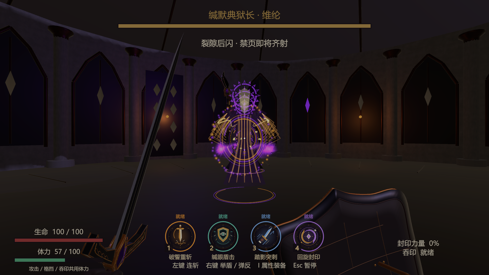
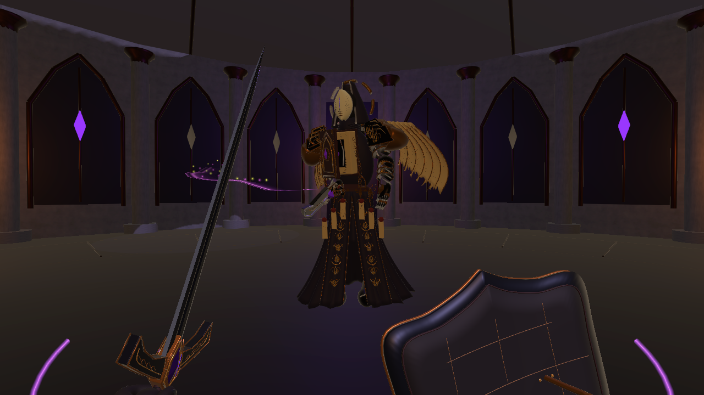
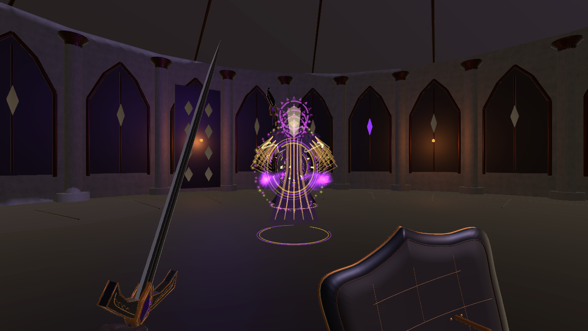
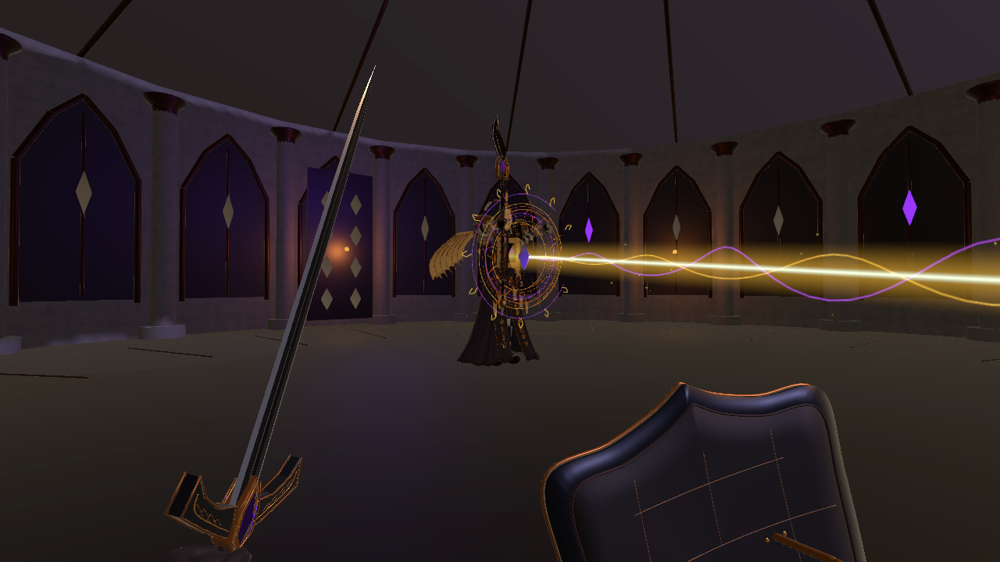
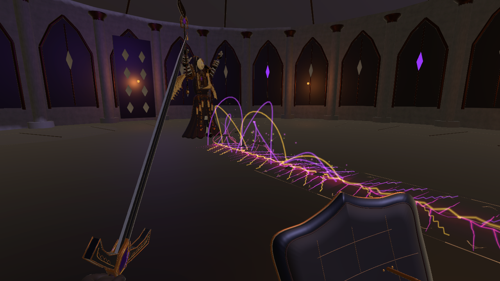

# 共用体力、Boss 后闪与禁咒强化（2026-10-29）

在当前打开的 1.0.6 工程中通过 Unity MCP 修改。保持旧金、紫黑、纸页符印的美术风格。本轮只做最小检查，没有完整回归或独立包构建。

## 当前行为与参数

| 项目 | 调整 |
| --- | --- |
| 统一体力 | 攻击、技能、举盾、格挡受击和吞印使用同一池 100 点体力，移除独立格挡条 |
| 体力恢复 | 消耗后等待 1.6 秒，每秒恢复 14；攻击、持盾、破防与等待松开防御键时不恢复 |
| 普攻与技能 | 普攻 12；1～4 技能分别 30 / 24 / 28 / 38；盾击命中返还 6，完美弹反返还 10（仅一次） |
| 防御 | 持盾 12/秒；普通格挡消耗伤害 × 1.45；吞印启动 10；不足时未支付部分扣生命，耗尽破防 |
| 破防 | 1.6 秒破防状态，体力恢复延迟 2.4 秒，需松开防御键 |
| Boss 体型 | 根节点统一缩放 0.82，模型、胶囊及冲撞/后闪残影相匹配 |
| 弹幕 | 0.1 秒预备后沿胶囊扫掠向后闪现，最多 4.2 米；0.3 秒进入原有两次挥手：召出头顶禁页，再快速发射 |
| 后闪特效 | 出发/落点破碎法环、收束/扩散粒子、世界空间光带和消散残影；受墙壁与竞技场边界约束 |
| 近身横斩 | 0.9 秒预备，0.72 秒挥击，0.22 秒单次命中；胸肩、持杖手和袍摆协同，刃口横穿玩家胸口高度；紫色双层刀弧、金紫火花 |
| 近战节奏 | 近战选择间隔 4.6 秒，让贴身战斗穿插后闪弹幕；保留侧退、格挡、弹反、盾击及失衡打断 |
| 追踪光束 | 总蓄力 2.25 秒，前 1.6 秒逐帧跟随玩家，最后 0.65 秒金线锁定；发射期间也固定方向 |
| 光束特效 | 旋转符印、锁定脉冲、亮芯、密集双螺旋、充能及束流粒子，继续按碰撞裁剪 |
| 裂地 | 推进速度 6 → 10.5 米/秒，转向上限 70 → 135 度/秒，分段间隔 0.16 秒，预警 0.65 秒；近身 2.5 米锁向 |
| 裂地特效 | 分叉金紫电纹、上扬能量丝、浮起碎片与星芒粒子；宽度仍为一阶段 1.8 米、二阶段 2.2 米 |

体力明显更紧缺，连续四技能无法一次全部释放。格挡资源旧访问器仅映射到体力，不存在第二个运行时资源池。旧配置中的 guardCapacity/guardRegen、激光发射追踪配置作为历史序列化兼容字段保留，当前运行逻辑不使用它们。

## 修改范围

- PlayerCombat、PlayerMelee、MeleeLoadout：统一消耗与恢复、破防、弹反退款。
- BossCombatHUD、RecoveryEquipment、RecoveryMenu：单体力条、防御状态、属性与说明同步。
- BossEncounter、BossCombatBehaviours、BossDefinition、BossRitualEffects、新增 BossVolleyRetreat：体型、后闪状态、实时追踪与锁定、追击速度和近战节奏。
- WardenAnimationDriver、SwordShieldSetup、两段 AA_Melee 动画：横斩编排、真实刃轨及相机堆叠时的蒙皮同步。
- LaserBeamVisuals、GroundFractureVisuals、WardenRushWake、新增 BattleVfx/WardenBlinkVisual：分层光带、符印、粒子及缩放匹配。
- WardenEncounter、OathboundLoadout、Boss/竞技场/激光/裂地 Prefab：实际引用与参数。
- WardenSpellRibbon 材质；BossPressureChineseSupplement 静态 SDF 字形“隙、共”及 BossChineseSDF fallback。
- 完整逐文件清单见 FilesChanged.json。Before 中保留本轮修改前快照。

## 最小验证

通过 MCP 在 Play Mode 下调用真实战斗逻辑，使用临时测试位置与战斗时钟；未改写测试用场景或保存运行中的状态。检查记录见 MinimalRuntimeChecks.txt。

- 共享体力的攻击/吞印/格挡扣除、破防溢出伤害、延迟与恢复速率。
- 后闪 4.2 米、先后闪再召页、缩小模型/碰撞、近战与弹幕交替。
- 光束跟随当前玩家位置，末段与发射锁线不漂移。
- 裂地每 0.16 秒推进 1.68 米，转向上限正确。
- 近战单次伤害；0.22 秒实际刃向水平且朝向玩家；相机渲染采用当前蒙皮；残影缩放和暂停时钟。
- 实机静帧检查 HUD、后闪、近战、光束、裂地；最后检查编译和 Console。

截图为临时定点演示，部分采用侧面机位以便观察特效，不代表完整战斗录像。运行设置和 Play Mode 均在检查结束后还原。

## 实机截图

完整数值平衡、长时间帧率及独立包仍需后续试玩验证；本轮按要求仅作最小检查。
