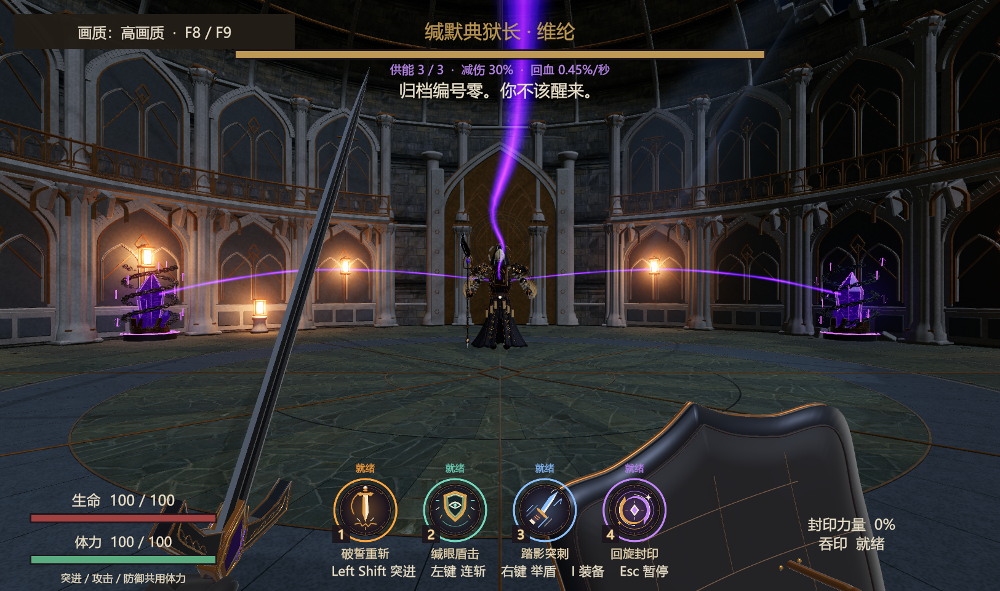
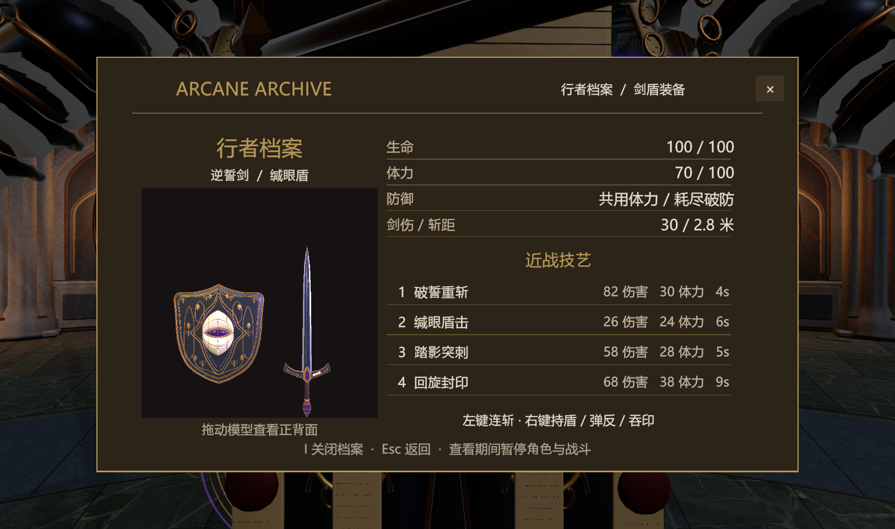

# main 战斗操作与界面统一到 1.0.8

2026-11-06。整合基线是 main `520dbea`，战斗来源是 lixiang `e3c0fbe` 中的 `1.0.8/`。本次将新版战斗模块接入 main，来源归档保持只读。工程继续使用 `1.0.6/` 历史路径，目录名不代表仍在使用旧战斗。

## 试玩入口

Unity 6000.3.24f1 打开本项目。完整入口：`Assets/Scenes/IMMonster_FullDelivery.unity`；直接战斗：`Assets/Scenes/SealedDuelArena_Showcase.unity`；图书馆：`Assets/Scenes/MilanLibrary_Magic_V6.unity`，Esc 菜单中的“深入探索”进入试炼。

本机 Windows 新包：`Builds/MainCombat108_20261106/IMMonster.exe`。运行后选择“Boss 斗场 · 锁链与水晶”。请保留同目录的 `IMMonster_Data`、`MonoBleedingEdge` 和 Unity 运行库；不要只复制 exe。

**本次 Git 提交发布源码、资源、场景和验收记录。Builds 被 Git 忽略，新 Windows 包不包含在源码推送中。2026-11-04 的旧 Release / 分卷包不含本次剑盾统一。** 队友拉取 main 后可按下面的步骤构建；旧试玩包没有被替换。

## 队友获取与构建

```bash
git clone --branch main https://github.com/yao8324/project123.git
cd project123
git lfs install
git lfs pull origin main
```

已有仓库先保存本地工作，再切换 main，执行 `git pull --ff-only origin main` 和 `git lfs pull origin main`。出现分叉或冲突时先处理本地工作，避免直接覆盖。

1. Unity Hub 添加仓库内 `1.0.6/`，使用 **6000.3.24f1**，与本次编译、Play Mode 检查和 Windows 构建一致。不要添加外层仓库目录。
2. 等待 Package、LFS 资源与脚本导入完成，打开完整入口场景进入 Play Mode。常规试玩无需运行场景重建脚本或重新生成模型。
3. 构建 Windows 前安装 **Windows Build Support（Mono）**，平台选择 Windows x86_64。
4. 保持 Build Profiles 中三个场景的顺序：`IMMonster_FullDelivery` → `IMMonsterContest20261107` → `SealedDuelArena_Showcase`。
5. 使用下方 `CombatUnificationBuilder.BuildWindows` 入口，在 `Builds/MainCombat108_20261106/` 生成完整包。分发时压缩整个目录。

`CombatUnificationBuilder.Apply` 是重新应用剑盾配置的维护工具，使用前先保存场景；普通启动不需要运行它。

## 操作

| 输入 | 行为 |
| --- | --- |
| WASD / 鼠标 | 移动 / 环视 |
| Space / C | 跳跃 / 蹲下 |
| 左键 | 剑术三段连斩，可按住连续出招 |
| 右键 | 举盾、短窗口弹反及吞印；攻防共用体力 |
| 1 | 破誓重斩 |
| 2 | 缄眼盾击，命中可打断 |
| 3 | 踏影突刺 |
| 4 | 回旋封印 |
| Shift | 突进；实际躲过近身威胁时触发极限闪避慢时间 |
| I | 装备与属性页，打开时暂停战斗 |
| Esc | 暂停菜单 |

沿用 1.0.8 的剑盾与手臂模型、动作时序、命中反馈、四个圆形技能与冷却图标、体力、破防、弹反、突进及装备预览。玩家正常左键已接入近战；旧秘文弹接口保留给历史测试兼容。

## main 内容保留及适配

原剧情、完整启动页、封闭斗场、三颗水晶、锁链、供能光束和分类音效保留。剑、盾击和其他近战技能可攻击水晶目标：先断链，再碎晶，单次打击不向水晶溢出锁链伤害。攻击要满足距离、角度和遮挡条件；同一击只结算一个供能目标。

三水晶各提供 10% 减伤、每秒 0.15% 最大生命回复；全部破坏触发 main 原有的 2 秒中断。普通近战失衡使用 1.0.8 的失衡时间与恢复状态，两种失衡分别处理。重试恢复水晶、体力和技能，离场清理斗场引用。

保留近战所依赖的 1.0.8 公共 Boss 模块，未增加圣骑士入口或导入其配置场景。临时来源参考场景已移除，剑盾视图保存为 `Assets/Art/PlayerSwordShield/Prefabs/MainCombatView.prefab`，可重复应用场景配置。

## 改动文件

完整 C# 文件清单见 [changed-scripts.json](changed-scripts.json)。主要修改：

- `Assets/Scripts/Player/PlayerMelee.cs`、`PlayerCombat.cs`、`PlayerDash.cs`、`FirstPersonController.cs`、`SwordShieldView.cs`、`MeleeFeedback.cs`：输入、体力、动作、格挡、弹反与突进。
- `Assets/Scripts/Core/BossEncounter.cs`、`BossMeleeCombat.cs`、`BossDefinition.cs`、`BossCombatBehaviours.cs`、`BossVolleyRetreat.cs`、`BossWavePresentation.cs`、`BossPerfectDodge.cs`：近战、供能目标适配及 Boss 对应招式。
- `Assets/Scripts/UI/BossCombatHUD.cs`、`RecoveryMenu.cs`、`RecoveryEquipment.cs`、`EquipmentPreview.cs`、`SkillCooldownBadge.cs`：HUD、技能冷却、装备页。
- `Assets/Scripts/Visuals/` 下随 1.0.8 迁入的动作与特效依赖；编辑器配置和专项验收代码；仅通过命令行启用的独立包验收探针。
- 两个场景：`MilanLibrary_Magic_V6.unity`、`SealedDuelArena_Showcase.unity`。
- 配置、资源：`WardenEncounter.asset`、`ForbiddenWardenRigged.prefab`、`IlluminatedLaser.prefab`、`IlluminatedFractures.prefab`、`Assets/Art/PlayerSwordShield/`、`Assets/UI/MeleeSkills/`、`Assets/Resources/PlayerDash/`、专用环波材质/着色器和中文补字字体。原 Boss 字体追加补字回退引用；TagManager 空闲层加入残影层。

## 验证

战斗专项 84 项、原剧情 171 项、Windows 独立包自动化操作 13 项均已通过，C# 编译与 Windows 构建 0 错误。以本目录 JSON 报告为准：

- `runtime-acceptance.json`：Unity Play Mode 战斗专项，实际虚拟键鼠驱动连斩、四技能、持盾、突进、装备暂停、破链碎晶与对 Boss 的命中；另用生产方法注入弹反、近失检测、资源倍率和生命周期条件。附加检查六种 Boss 攻击路径与专用环波资源。
- `story-regression.json`：本次原剧情完整路线回归快照，171 项通过，运行时错误与编辑器 Search 错误均为空。原验收器输出位置为 `Docs/Contest20261107/Acceptance/runtime-validation.json`。
- `windows-build.txt`：独立 Windows 构建结果。
- `Native/native-smoke.json`：打包后 exe 的 13 项虚拟键鼠操作及材质/着色器支持检查，截图的视觉限制见下一项。
- `Captures/`：Unity Play Mode 的实际 HUD、技能、装备和 Boss 特效画面。独立包以 computer-use 实际窗口抽查画面；`Native/` 隐藏运行时的自动截图是黑屏，不用作视觉证据。

测试通过不代表完成了真人难度、手感平衡或帧率验收。战斗专项临时禁用 AI 移动/自动选招以隔离玩家操作，随后显式选择并执行 Boss 六种攻击；这些配置只作用于运行时克隆，不写回游戏资产。独立包探针只在 `-combat108-smoke` 参数下启动，普通试玩不启用。

### 复现验证

从 Unity 项目 `1.0.6/` 目录执行，先关闭同一工程的 Unity 编辑器。PowerShell 示例：

```powershell
$unityEditor = 'D:\unity\download\6000.3.24f1\Editor\Unity.exe' # 按本机位置调整
$unityProject = (Get-Location).Path
$unityArgs = @('-batchmode', '-projectPath', ('"' + $unityProject + '"'),
  '-executeMethod', 'ArcaneArchive.Visuals.Editor.CombatUnificationAcceptance.Run',
  '-logFile', ('"' + (Join-Path $unityProject 'Logs/CombatUnificationAcceptance.log') + '"'))
$validationProcess = Start-Process -FilePath $unityEditor -ArgumentList $unityArgs -WindowStyle Hidden -Wait -PassThru
$validationProcess.ExitCode
```

- 战斗专项：使用上述入口，验收器自行退出；**不要加 `-quit`**，以免在 Play Mode 验收结束前退出。检查 `runtime-acceptance.json` 中 `complete=true`、`checksPassed=84`、`errors=[]`。
- 原剧情：将入口替换为 `ArcaneArchive.Visuals.Editor.ContestAcceptance.Run`，同样不加 `-quit`。检查原输出报告完成 171 项、运行时错误为空。检查会重写自己的报告与截图，运行前保存需要保留的旧证据。
- Windows 构建：入口替换为 `ArcaneArchive.Visuals.Editor.CombatUnificationBuilder.BuildWindows`，并在参数数组加入 `-quit`。检查退出码和 `windows-build.txt`，本次为 `Succeeded errors=0`。
- 独立包操作检查：运行 `IMMonster.exe -combat108-smoke -combat108-output "绝对输出目录"`。探针使用临时虚拟键鼠，完成后退出；不传参数则正常游戏。检查输出目录 `native-smoke.json` 中 13 项通过、错误为空；该模式不用于真人手感验收。

### 截图与特效修复





补齐了激光和裂地旧 Prefab 中新版脚本需要的细节材质引用，修复粉色特效。六种攻击已逐招检查有效材质；独立 Windows 窗口抽查了启动页、战斗 HUD、彩色施法效果及胜负/重试界面。隐藏运行的黑色截图不作视觉证据。

## 备份与原有修改

整合前完整源文件备份：`项目整理/备份_战斗操作统一_20261106_110643/main整合前文件`，排除 Library 等可再生缓存。原有 8 个修改项保持备份时的文件内容，逐字节核对见 `preserved-user-files.json`；根目录 Packages、ProjectSettings 和 .vsconfig 保留。

本次同步实际验证所用的 `ProjectVersion.txt`（6000.3.24f1）。原有材质浮点序列化差异和个人本地文件继续保留。备份目录是本机回退副本，不上传 GitHub。

版本回退可从 Git 历史取回整合前 main `520dbea`。团队已共享的 main 若需撤回，先保存工作，再用 `git revert` 生成撤回提交，避免强制推送覆盖队友提交。恢复本机原有未提交修改时，从上述完整备份取回对应文件。

