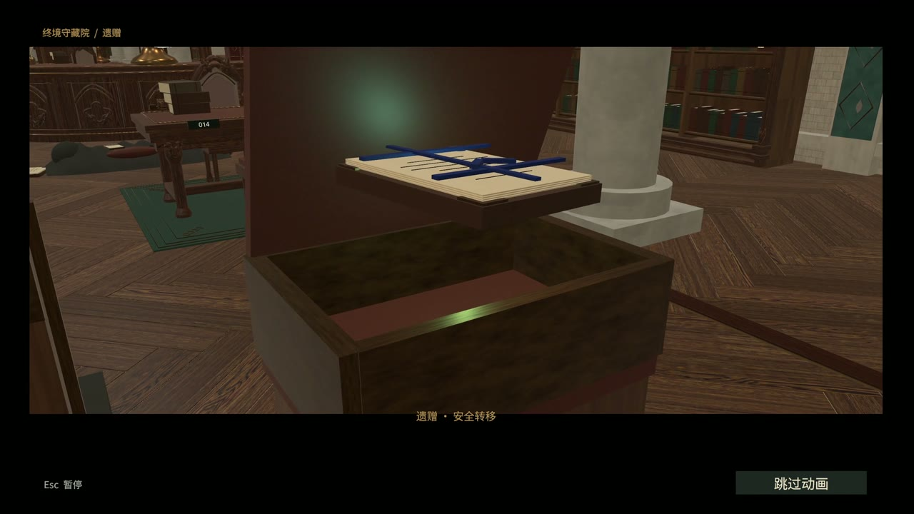
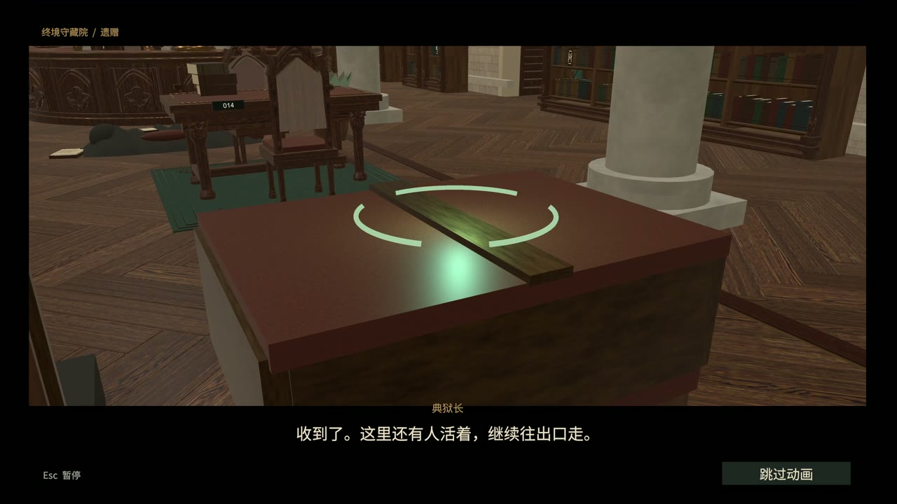
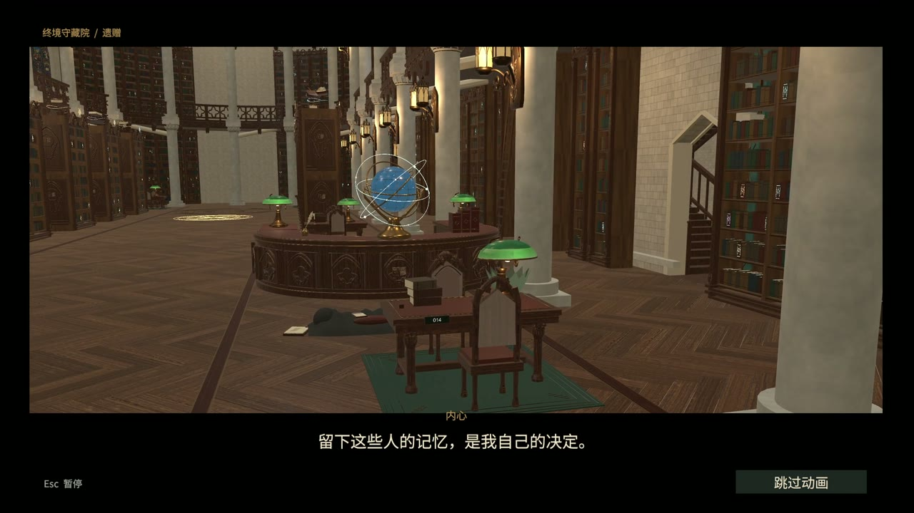
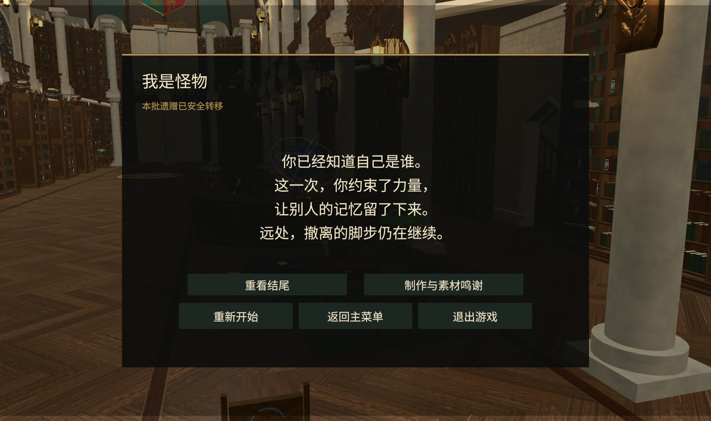

# program 结尾过场整合验证 · 2026-11-04

状态：源码交付，待管理者验收。验证环境为 Unity 6000.3.25f1、Intel Arc B390 GPU。由远端 program 的 b984c5d 建立独立工作区，导入 art 的 0253ec7 中工程内运行依赖，再加入结尾过场。缓存、用户配置、原工作区的其他未提交改动没有作为交付源。

| 检查 | 结果与证据 |
| --- | --- |
| C# 编译 | 错误 0；见 [audit.json](audit.json)。 |
| 最终结尾专项复测 | 51 项通过，实际交互键交付、保存后播放、唯一封档包、暂停、设置后恢复、三段跳过、重复跳过、重看、鸣谢及继续存档；见 [ending-checks.json](ending-checks.json)。 |
| 最终完整流程 | 170 项通过，游戏运行错误 0；见 [story-checks.json](story-checks.json)。最终检查包含后续的检查点重试修复与实际文件锁测试。 |
| 保存可靠性 | 临时独占文件锁释放后写入成功；持续独占锁下写入失败并保留原记录。后一项产生 1 条预期保存警告。正常故事流程检查点与最终通关记录通过。 |
| Unity 搜索索引 | 启动阶段出现 1 条 Editor.Search 索引异常，已在完整报告的 editorSearchErrors 单独保留；没有将其伪报成 Console 全部零错误。它未阻断本轮游戏流程，编辑器自身异常未在本任务修复。 |
| 观看用 MP4 | 26 秒、1920×1080、30 fps，共 780 帧，H.264/AAC；完整解码成功。见 [video-info.json](video-info.json)、[渲染说明](render-report.json)。音轨使用该过场的原创合成声音并统一响度，不是麦克风录音；视频不作为实机帧率证据。 |

独立工作区早期全流程检查发现过一次短时文件占用导致的保存失败，随后加入有限原子写入重试和实际锁文件测试。一次开启高 DPI 逐帧 PNG 录制的控制器走查发生超时，最终流程验证关闭非必需的逐帧录制，保留关键截图；观看视频用独立导出工具生成。原始失败日志及临时逐帧图片没有作为最终通过报告提交。

## 操作复核

1. Unity 打开仓库的 1.0.6，打开 Assets/Scenes/IMMonsterContest20261107.unity，等待编译后运行。
2. 完成档案、维护、身份、引导和取包流程，在转移箱前按当前交互键。确认先保存，再自动播放约 26 秒过场。
3. 检查 Esc 暂停、设置后继续、跳过、重看、鸣谢返回和完成存档继续。电影预览可用 IM Monster → Ending → Preview ending (no save)，不写玩家正常进度。

自动检查使用独立的 Logs/Ending20261104/ending-acceptance-checkpoint.json。正常存档不作为测试夹具。测试是自动输入与真实控制器、按钮回调和状态检查，不冒充首次真人试玩。

## 关键画面

## 交付范围

未重新构建独立 Windows 运行包，旧包不包含新增动画；未完成人工音效听感、首次真人试玩或目标设备性能验收。原 Boss 战不是本次验收路径。完整 MP4 另交用户，不放入 Git；其 SHA256 在 video-info.json 中，便于核对另行分享的文件。
