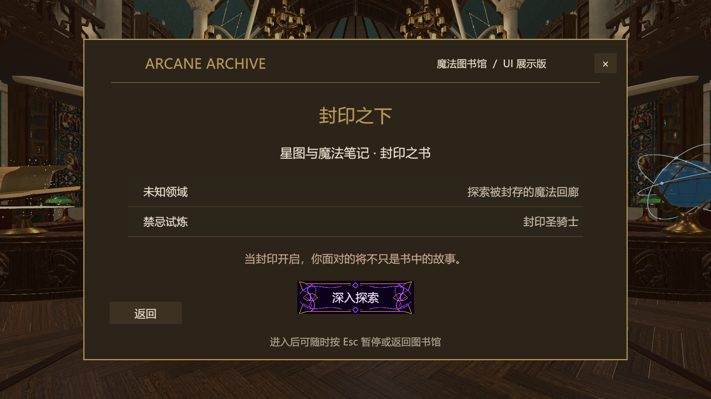

# 圣骑士 V3：书籍入口、连贯动作与范围强化

基于完整剑盾1.0.6，2026-11-05。本轮按用户要求临时接到大厅《星图与魔法笔记》的“深入探索”。打开 `Assets/Scenes/MilanLibrary_Magic_V6.unity`，运行后交互该书即可进入圣骑士；胜负后可重试或返回图书馆，再从书进入。当前不触发正式剧情结局。

## 本轮具体调整

参考本地洛希德视频00:28–00:40的挥刃、回旋、进退和金雷。刀光改为渐细、多层宽弧，武器尖端在前摇聚光，落雷增加分枝、双层接触环和贴地电纹。特效不额外造成伤害，暂停和打断沿用战斗时钟与统一清理。

武器朝向在角色根节点转身之后求解，使用上一帧缓存的世界旋转进行过渡，消除父节点旋转重复叠加。躯干和上臂已有混合，现补充肘、腿、旋转根与武器的时间相关插值；武器转速设上限，60Hz检查中的单帧角度不超过20°。旋锋两次挥刃围绕0.24/1.06秒命中时刻重新安排路径。腿部步态改由真实水平移动距离推进，停止时平滑收步；升降不再被误识别成走路。仍是程序化关节动画，正式脚底IK和双手持柄IK尚未实现。

行动由固定轮换改为按距离加权选招：近中距离倾向连锋/旋锋，远距离倾向突刺/飞矛，贴近时才有格御权重。不会连续选择同招；一般招式5秒复用间隔、格御10秒、落雷12秒。二阶段才加入落雷。权重只在选择下一招时读取位置，已锁定的攻击不因玩家输入临时改招。

观察时追近到约4.1米，近处切线绕步，过近时后撤；一阶段观察间隔0.55秒、二阶段0.38秒。恢复末段缓慢转向下一轮交锋，仍保留完整收招时间供玩家输出。旋锋切线移动3.2米，突刺推进上限6米，所有移动走实际胶囊扫掠。

| 技能 | V2 | V3 |
| --- | --- | --- |
| 誓舞连锋 | 半径3.9m / 120° | 半径5.4m / 150° |
| 贯门突刺 | 总覆盖6.4m / 宽1.2m | 总覆盖9m / 宽1.8m；推进6m+前端3m |
| 地脉雷裁 | 长12m / 宽1.35m | 长15m / 宽2.1m |
| 退界盾击 | 半径2.8m / 110° | 半径3.5m / 130° |
| 回身旋锋 | 半径4.4m / 280° | 半径6.5m / 300° |
| 悬誓落雷 | 半径1.45m | 半径2.2m；圈间距随半径调整为4.84m |

落雷中心限制在“场地半径－技能半径－0.25m”以内，防止扩圈后预警伸出围墙。突刺伤害长度按实际推进量加前端长度计算，碰墙时会缩短。原有伤害、弹反/格挡/吞印分类和恢复时间保持；这轮提高的是覆盖、进攻频率与位置压力。

## 验证与预览

[30项运行检查](Checks.json)与[15项入口/范围/AI/姿态检查](PressureChecks.json)全部通过。覆盖书籍实际菜单方法、扩大后的内外边界、碰墙、命中去重、弹反打断、落雷锁定、暂停、随机选招不连用、二阶段落雷、重试和返回。检查方法体同目录可复现。这是受控Play Mode验证，不等于完整人工获胜或目标设备性能测试。

[旋锋预览](Orbit.gif) / [落雷预览](Heavenfall.gif)是原生Game View的受控时钟录像，已实际检查分镜。前一轮V2的数值、图片与61项记录保留为历史，不代表本轮范围。最终编译完成，Console为0 Error、0 Warning；已退出Play并留在大厅场景，见 [最终状态](FinalVerification.json)。

## 本轮修改文件

- `Assets/Scripts/UI/RecoveryMenu.cs`：书籍配置引用、Boss名称、进入方法与中文字体。
- `Assets/Scripts/Core/Bosses/Knight/KnightEncounter.cs`：距离选招、冷却、绕步、落雷边界、突刺实际范围。
- `Assets/Scripts/Visuals/Bosses/Knight/KnightVisuals.cs`：全身衔接、步态、武器世界旋转与转速限制。
- `Assets/Scripts/Visuals/Bosses/Knight/KnightRefinedEffects.cs`：蓄力、分层金弧、落雷接触效果及正确宽度衰减。
- `Assets/Scripts/Visuals/Editor/KnightPressureSetup.cs`：范围配置和临时书籍接线；清空菜单组件的bookKnight即可恢复原入口。
- `Assets/Scripts/Visuals/Editor/KnightRefinementBuilder.cs`：重建时调用本轮范围配置。
- `Assets/Art/Bosses/Knight/Refined/KnightDefinitionRefined.asset`：本轮数值。
- `Assets/Scenes/MilanLibrary_Magic_V6.unity`：RecoveryMenu新增两个资源引用。
- `Tools/KnightReference/assemble_preview.py`：支持V3预览输出目录。

角色与场景进一步制作仍参考 [精细版制作说明](../RefinementV2/ArtProduction.md)，其中旧范围/固定轮换由本文件覆盖。正式动画、贴图、脚底植根和完整实战平衡继续属于后续工作。
