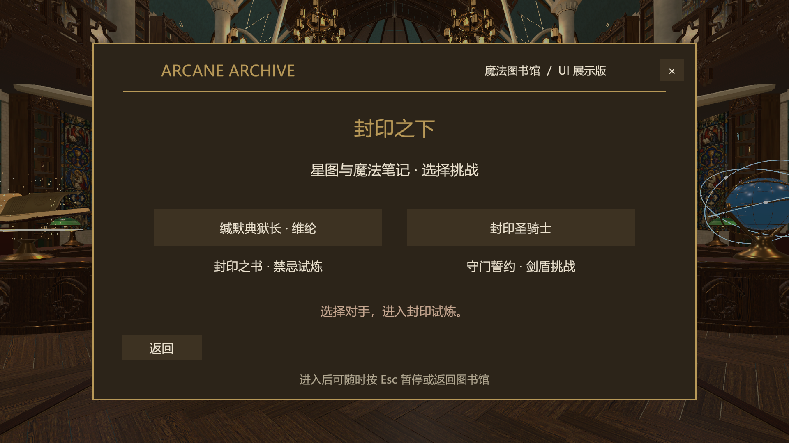

# V4：书籍选择与动作连续性

在大厅《星图与魔法笔记》中，两个按钮分别进入“缄默典狱长·维纶”和“封印圣骑士”。返回后可再次选任意一个，结果页“再次挑战”继续当前Boss。已通过实际生成按钮的onClick入口循环验证两轮切换，进入、失败重试、返回均正确，见 [BookChecks.json](BookChecks.json)。

## 动作更新

本轮再次查看本地参考视频，重点核对00:42–00:47的落雷回收与再进攻，并结合已有00:28–00:40旋身与挥刃分析。当前重点是动作曲线与过渡，未把视频剪辑当作游戏AI时间线。

- 连锋和旋锋：关键姿态之间改为带受限切线的三次Hermite曲线。经过中间姿态时保持速度，在换向处再停住，减少每个关键姿态都减速到零的问题。
- 连锋蓄势：肩胯扭转方向与第一击起手对齐，避免切入攻击时先反拧一次身体。
- 突刺：压低、加速、伸臂和回收按同一进度组织；推进曲线平滑启动和刹停，末端仍达到原6米上限。
- 旋锋：切线位移改为平滑加速/减速，保留3.2米总行程与两个原有命中时刻。
- 地脉：手臂、武器导向与倾身围绕0.15秒释放展开，延续到收招。
- 飞矛：三次释放各有短促抬腕回弹和躯干微转，不再整段举手不动。
- 盾击：加入压肩送腕再回收的独立动作曲线。
- 落雷：抬腿和伸腿取实际离地高度，降低尚未升空先收腿、落地仍蜷腿的脱节。
- 收招：保存攻击结束姿态，约0.48秒回到警戒；前摇过渡约0.28秒，攻击过渡约0.12秒。武器仍按战斗时间限制转速，暂停保持姿态。
- 长带：加入对旋转的滞后和分条回落，不只进行独立正弦摆动。

这轮保持V3技能范围、伤害和恢复窗口。当前仍是程序化关节模型；正式脚底IK、双手持柄IK、蒙皮与成品动画尚未制作。

## 提示词

三套完整、可复制的提示词已直接写入工程根 [README](../../../README.md)：

1. [Boss战场景精细建模提示词](../../../README.md#boss战场景精细建模提示词)：世界观、14米场地、门与外环、材质灯光、碰撞、技能净空和交付验收。
2. [Boss精细建模提示词](../../../README.md#boss精细建模提示词)：银甲比例、逐部件造型、长柄刃器与腕盾、十二条长带、骨架挂点、PBR/LOD和动作极限检查。
3. [Boss详细设计提示词](../../../README.md#boss详细设计提示词)：玩家完整剑盾基线、八招参数和时间轴、参考视频观察方式、逐招动作分镜、AI/中断、验证与制作清单。

## 文件与验证

修改脚本：RecoveryMenu.cs（两个入口和字体切换）、KnightVisuals.cs（连续动作曲线与收招）、KnightEncounter.cs（突刺/旋锋位移曲线）。另更新assemble_preview.py以保存V4预览，根README和CHANGELOG记录当前交付。

本轮重新执行 [30项战斗回归](Checks.json) 和 [15项范围/AI/姿态检查](PressureChecks.json)，全部通过。旋锋由匀速改为缓起后，回归检查的早期移动下限同步调整，碰墙、最终行程和伤害检查仍保留。检查使用正式战斗方法和受控时钟，不代表真人完整战斗或独立构建。

预览为原生Game View按战斗时钟采样：[旋锋](Orbit.gif)、[连锋](OathCombo.gif)。场景和角色精细制作要求属于下一阶段规格，不以当前分件模型宣称达到参考视频成品质量。

最终已退出Play并停留在大厅场景；Console为0 Error、0 Warning，git diff --check通过。选择页和两段动作分镜已实际查看。本轮未提交或推送Git。
