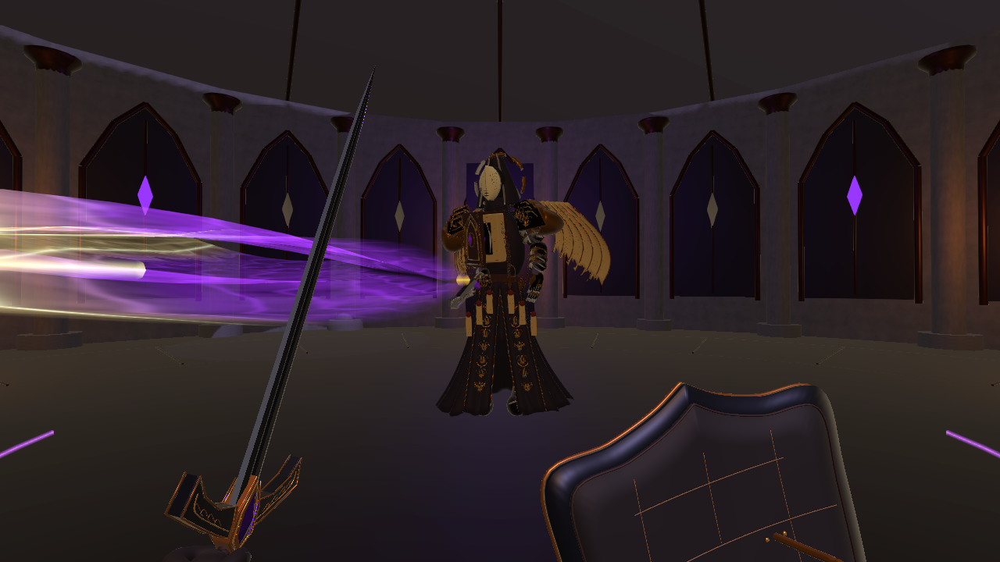

# Boss 近身压迫调整（2026-10-30）

本轮只增强 Boss 近战。玩家普攻与四技能的脚本、特效脚本、武器配置与本轮修改前快照完全一致，原攻击距离为 2.8 / 3.1 / 2.4 / 3.2 / 3.3 米。

## Boss 行为

| 项目 | 调整前 | 当前 |
| --- | --- | --- |
| 横斩距离 | 3.25 米 | 4.8 米 |
| 横斩扇面 | 135° | 160° |
| 近战选择距离 | 4.3 米 | 距离 + 逼近距离，即 6 米 |
| 前摇 | 0.90 秒 | 0.78 秒 |
| 前摇逼近 | 无 | 前 0.36 秒内最多 1.2 米，胶囊扫掠约束，贴身停止 |
| 前摇转向 | 110°/秒、间隔感知 | 240°/秒、前段跟随当前玩家位置 |
| 最终锁向窗口 | 0.32 秒 | 0.24 秒，同时停止逼近 |
| 收招 | 1.15 秒 | 0.85 秒 |
| 近战选择间隔 | 4.6 秒 | 4.0 秒 |
| 观察阶段近战响应 | 最早 0.55 秒 | 最早 0.35 秒 |

中近距离准备近战时主动压近，减少刚好离开旧攻击范围就原地安全输出的情况。横斩仍在攻击阶段 0.22 秒判定一次，伤害为 23；保留格挡、弹反、侧移、背后和超距躲避，以及墙体遮挡。其他法术和后闪弹幕继续参与攻击轮换。

地面提示使用同一距离/角度，魔法刀光沿实际刀刃方向延伸至横斩覆盖半径。武器本体和玩家动作不拉长。

## 修改文件

- Assets/Scripts/Core/BossDefinition.cs：近战范围和压迫参数。
- Assets/Scripts/Core/BossMeleeCombat.cs：近战选择距离、前摇逼近。
- Assets/Scripts/Core/BossEncounter.cs：近战响应、实时追踪、末段锁向。
- Assets/Scripts/Core/BossCombatBehaviours.cs：近战压近意图、转向和间隔，向动画传递攻击范围。
- Assets/Scripts/Visuals/WardenAnimationDriver.cs：将实际 Boss 位置/攻击范围传给刀光。
- Assets/Scripts/Visuals/WardenMeleeVfx.cs：扩展魔法刀光，保留真实武器亮刃。
- Assets/Art/ForbiddenWarden/WardenEncounter.asset：运行时实际参数。
- README.md、CHANGELOG.md。

逐文件哈希见 FilesChanged.json，修改前快照见 Before。PlayerRestoreVerification.txt 记录玩家相关四份文件的逐字节一致性。

## 最小检查

MinimalChecks.txt / MinimalChecks.cs.txt 记录 10 项专项检查：玩家原范围、4.5 米命中且仅一次、超距不命中、75° 侧面命中、主动压近、1.2 米逼近、末段锁向、提示半径、墙体阻挡，以及刀光范围。

最终刀光方向修整后，再复核编译、实机画面和刃向/范围。仅作最小检查，未执行完整回归、独立包构建或长期平衡测试。结束后恢复后台设置并退出 Play Mode。

