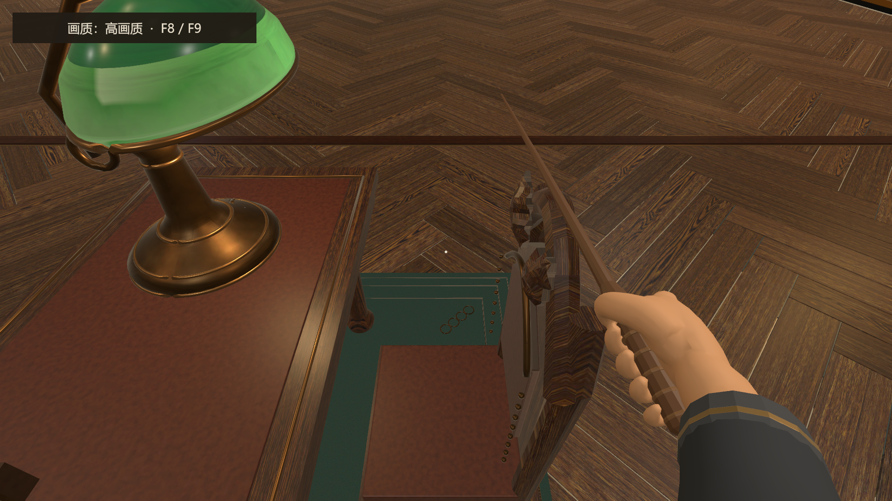
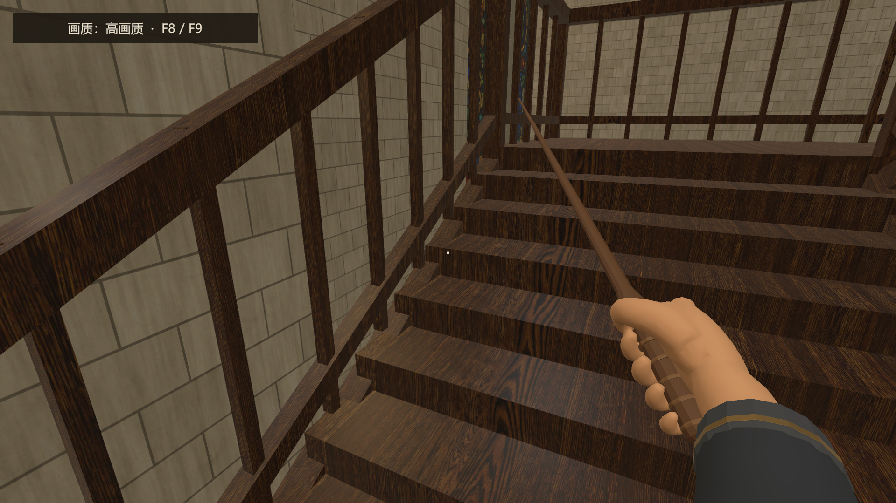
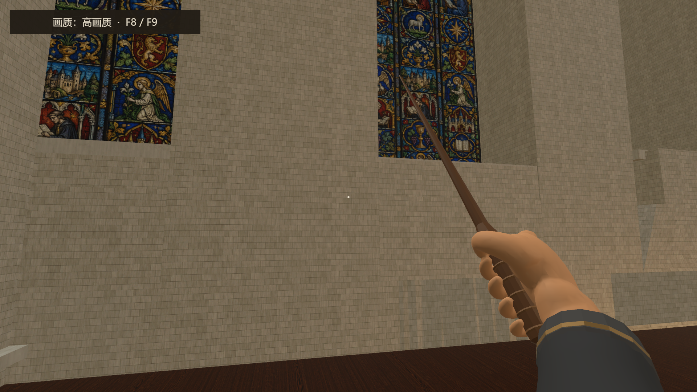
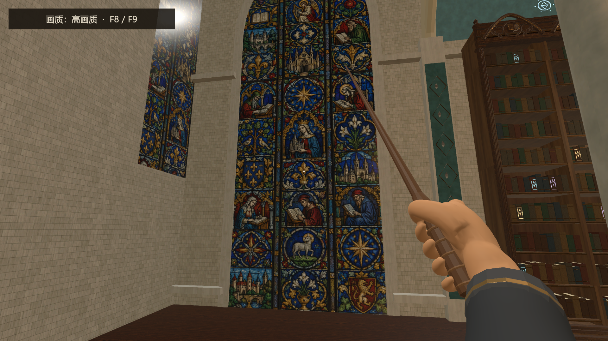

# 1.0.5 四项试玩反馈修复记录

完成日期：2026-10-17。目录日期为开始处理日期。

依据上级目录《魔法图书馆1.0.5试玩反馈_四项问题.docx》及其四张截图，修改当前 1.0.5 工程的 `Assets/Scenes/MilanLibrary_Magic_V6.unity`。Unity 版本：6000.3.25f1。

## 修复内容

| 反馈 | 原因与处理 | 验证结果 |
| --- | --- | --- |
| 座椅座面可以穿过 | 椅子渲染网格未配备完整碰撞。按实际座面分别定位 12 张椅子，新增座面、椅背与四条椅腿的 BoxCollider，共 72 个。没有将合并网格中的两张椅子包进同一个大碰撞盒。 | 12 个座面向下射线均命中 y=0.525；实际 CharacterController 从左右两侧接近的 24 次测试全部被阻挡。 |
| 楼梯与墙体交接处穿模 | 两侧彩窗石框向外突出到楼梯边缘。将窗框深度压回墙面范围，保留拱形轮廓与材质。 | 同角度前后截图确认石条不再穿入踏步。左右楼梯上、下行共 16 段路线均通过。 |
| 二楼墙面零散砖块凸起 | 外立面构件和窗台向内穿过入口二楼墙面。对这些构件生成局部修订网格，将内侧端面收至内墙后方；四处门头补块与内墙齐平。 | 运行截图确认零散凸块及突出的窗台收回。保留外立面及现有大门拓宽结果。 |
| 壁画前两条横杠突兀 | 连续石质腰线横穿彩窗。腰线在窗洞范围断开，端部封闭；同时修正两侧同类窗洞。保留窗下踢脚线、立柱和楼板。 | 运行截图中彩窗完整显示，横杠不再跨过图案。 |

## 修改资源与保护范围

- 修改主场景 `Assets/Scenes/MilanLibrary_Magic_V6.unity`。
- 新增 `Assets/Art/MilanLibraryV6/PlaytestRepairs20261016/`：22 个修订网格及 Unity `.meta`。原始 `.mlmesh`、GrandEntrance 网格和 Blender 源文件保持不变。
- 修订网格的 MeshFilter 与 MeshCollider 同步更新。精确来源和替代路径见 [repair_manifest.json](repair_manifest.json)。
- 椅子碰撞层级：`Milan Library — Magic V6/IV4_W04_Chair/Playtest_ChairColliders/Chair_01…Chair_12`。
- 新增离线生成工具 `Tools/MilanV6/fix_playtest_feedback_20261016.py`；使用标准 Python 库。门口已有修订网格的输入快照保存在 `SourceMeshes/`，避免生成时覆盖之前的大门修复。
- 没有修改任何运行时 C# 脚本、玩家输入、UI、Package 或 ProjectSettings；未删除原有物体或组件。原有地面、二楼楼板与楼梯通行坡面碰撞保留。
- Unity 保存时为两个已有自动门组件补写了 `safetyHalfWidth=3.9`、`safetyDepth=3.9`，与脚本原有默认值相同，没有改变开关门行为。
- 修复前场景保存在 `Backup/MilanLibrary_Magic_V6.unity.backup`。需要回退时，退出 Play Mode，用备份内容覆盖同路径主场景并重新打开；保留主场景原 `.meta`。

## 验证证据

- [运行时碰撞结果](playmode_collision_results.json)：24 次座椅侧向接近、16 段左右楼梯上下行，40/40 通过。
- 测试在 Play Mode 使用场景中实际玩家的 CharacterController.Move 执行，暂时关闭玩家脚本以隔离键盘输入；不是人工按键试玩。结束后退出 Play Mode，玩家组件恢复启用，出生点未改动。
- [场景验证](scene_validation.json)：22 组网格与对应碰撞引用一致；12 张独立椅子；Missing Script 为 0。
- [场景差异审计](scene_diff_audit.json)：原有对象及组件删除数为 0。
- 最终 Unity 不在 Play Mode，导入与编译均处于空闲状态；Console Error 0、Warning 0。主场景已保存。
- 本轮没有制作或运行独立构建，也没有提交或推送 Git。

### Play Mode 截图

座面侧向碰撞：

楼梯窗框修复：

二楼内墙修复：

彩窗横杠修复：

## 手动复验

1. 打开当前 1.0.5 的主场景，进入 Play Mode。
2. 靠近一楼各组阅读椅，分别从座面左右侧、正面和椅背方向行走接近，确认身体不能直接穿过座面或椅背。
3. 沿左右楼梯分别上下到二楼，重点看下段楼梯靠彩窗的扶手与踏步，确认没有石条插入、没有新堵点。
4. 在入口二楼检查正面内墙和东西两侧彩窗；转动视角，确认墙面无反馈中的零散凸块，彩窗图案不被横杠跨越。
5. 查看 Console，应无新增 Error；退出 Play Mode 后不要保存临时测试位置。

以后若从 Blender 重新导出或重建整场景，应重新核对这 22 个局部修订引用及椅子碰撞，避免场景重建覆盖本次修复。
