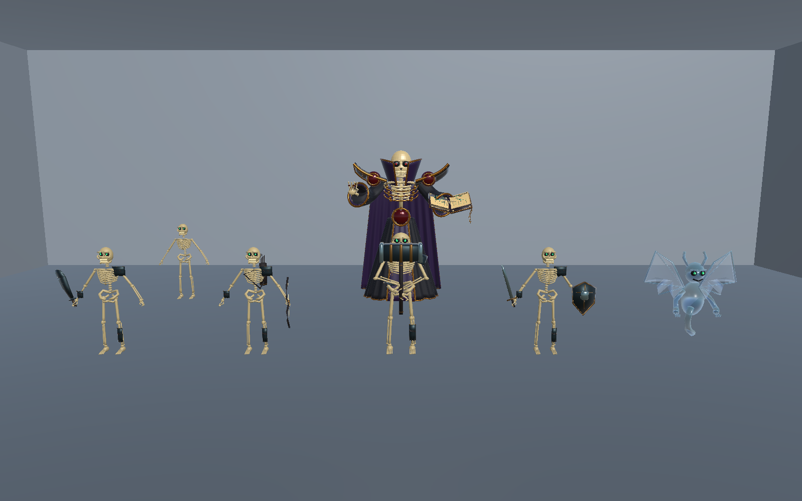
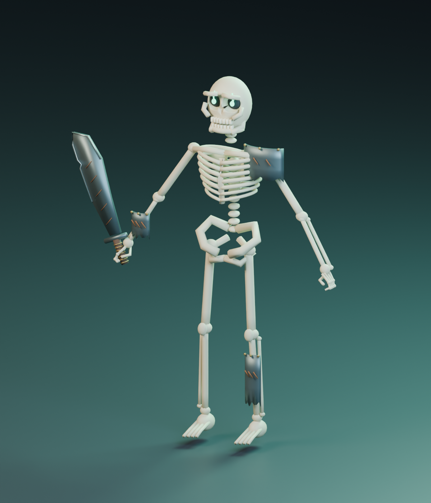
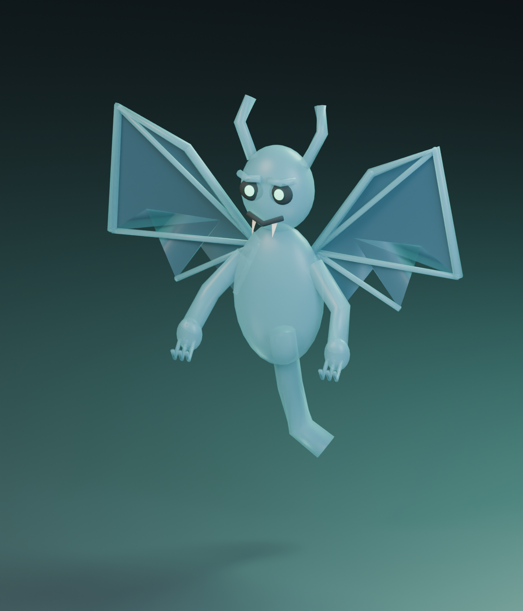

# 亡灵召唤物模型首版

2026-11-06。使用 Blender 4.3.2 制作，保留可编辑部件、绑定、游戏导出和预览图。已有 Boss 与死灵之书沿用此前成果，本轮没有重建 Boss 网格。

## 交付清单

| 资产 | 内容 | 骨骼 / 三角面 |
| --- | --- | --- |
| 共用骷髅、砍刀兵 | 空心眼窝、牙齿、肋骨、手指、鬼火眼、缺口砍刀 | 27 / 22,219 |
| 弓箭手 | 共用身体、反曲弓、背部箭筒及箭束 | 27 / 21,973 |
| 双手锤兵 | 更宽大的身体、中央双手持锤姿态、长柄重锤 | 27 / 22,337 |
| 剑盾兵 | 共用身体、单手剑、风筝盾 | 27 / 21,395 |
| 半透明亡灵 | 蓝色半透明身体、蝙蝠翼、鬼火眼、低空悬浮尾部 | 10 / 3,936 |
| 独立道具 | 箭矢、火球、紫色骷髅弹、魔法匕首 | 静态独立模型 |

砍刀兵总数包含身体、眼睛、武器、三件甲胄。甲胄分为肩甲、护臂、胫甲三个独立蒙皮网格，可分别开关；护甲数值由后续玩法代码按兵种配置，模型不计算额外生命。

## 文件位置

- Blender 源：`Blender/Minions/Skeleton20261106/`，含五个兵种的同名 `.blend` 和 `Undead_Projectiles.blend`。
- 四种骷髅的 FBX、GLB：`Assets/Art/Minions/Skeleton/Models/`。
- 半透明亡灵的 FBX、GLB：`Assets/Art/Minions/Undead/Models/`。
- 四种独立道具 FBX：`Assets/Art/Minions/Projectiles/Models/`。
- Unity 材质与 Prefab：上述各类目录下的 `Materials/`、`Prefabs/`。
- 原 Boss 的视觉 Prefab：`Assets/Art/Bosses/Summoner/Prefabs/Soulbinder_Visual.prefab`。
- 合看场景：`Assets/Scenes/Summoner_ModelReview.unity`。后排是已有 Boss，前排从左至右为砍刀、弓箭、锤兵、剑盾、半透明亡灵；另留一个无甲、无武器的共用身体。
- 原始火柴盒：`Assets/Scenes/Summoner_Blockout.unity`，单独保留。
- 生成与检查脚本：`Tools/SkeletonMinion20261106/`。

源文件的 `01_EDITABLE_PARTS` 保存拆分部件，默认隐藏；`02_GAME_EXPORT` 为合并后的蒙皮网格；`03_STUDIO_EXCLUDED_FROM_EXPORT` 为灯光、地面及相机。编辑时选择显示源部件或游戏网格其中一套，避免重叠。亡灵源中还保留隐藏的共用骷髅制作起点。道具源只显示道具集合，其他集合隐藏。

## 骨骼、动作与接入

- 共用动作草稿：待机、行走、挥砍、受击、破甲眩晕、死亡。弓箭手另有取箭拉弓动作草稿、锤兵有蓄力砸地草稿、剑盾兵有格挡草稿；亡灵有悬浮、投火球、受击、死亡草稿。
- 使用 Generic 骨骼。每块骨头刚性赋权到对应骨骼，所有顶点均有权重。四种骷髅骨骼名称一致，锤兵的持握休止姿态与体型作了调整。
- Prefab 控制器默认播放待机／悬浮，其他动作作为独立状态保留，尚未添加战斗状态切换或伤害事件。取箭接触、双手握持及挥砍轨迹仍需要结合实际战斗时序精修。
- Unity 1单位＝1米。视觉 Prefab 正面为本地 +Z；骷髅脚底已落地。半透明亡灵保留约0.3米的低空高度，身体仍在玩家可攻击高度。
- 箭矢与火球 Prefab 的飞行方向为本地 +Z；紫色骷髅面朝 +Z；匕首刃尖朝 +Y。道具没有碰撞体或运动逻辑。
- 材质为 URP Lit 的色块、金属与发光配置；半透明亡灵使用透明混合。现有 UV 是基础映射，未制作独立纹理图集。当前模型是可接入的首版资产，后续可继续细修。

## 验证与复现

新增 Unity 编辑器脚本：`Assets/Scripts/Visuals/Editor/SummonerModelReviewBuilder.cs`。

1. Blender 后台运行 `build_minion.py -- 项目路径` 生成共用身体与砍刀兵，再运行 `build_variants.py -- 项目路径` 生成其余资产。重建会覆盖本轮生成文件，手工细修请另存。
2. `validate_minion.py`、`validate_variants.py` 重新导入 FBX，检查网格数量、骨骼、动作、UV、材质、所有顶点赋权及动作采样的有限坐标。导出中不包含展示灯光或相机。
3. Unity 菜单 `Tools > IMMonster > Build Summoner Model Review` 生成材质、动作控制器、视觉 Prefab 和独立合看场景。
4. 打开合看场景检查五类模型，进入 Play 可以查看默认待机。其他动作在 FBX 的 Animation 预览中查看；护甲可在模型子物体中分别关闭。
5. `Tools > IMMonster > Capture Summoner Model Review` 输出本页的 Unity 合照。

检查数据：`model-report.json`、`export-validation.json`、`variants-report.json`、`variants-validation.json`。源模型在本地 main 工作目录的 Unity 6000.3.24f1 中完成编译、导入、材质、保存场景引用及朝向检查，最终批处理退出码0；原日志留在该工作目录的 `Logs/`。本次 art 交付的资源与脚本逐字节复制并核对 SHA256，没有为上传再创建一套 Unity 缓存。复制清单见 `art-transfer-manifest.json`；后续文档说明按本分支更新。

本提交在 `art` 分支交付模型、动作草稿及独立视觉场景，二进制源文件和游戏模型由 Git LFS 管理。第三 Boss AI、召唤、伤害、格挡、护甲破坏、箭矢击落及红圈预警仍待程序实现。原正式战斗入口未改。打开模型前请先运行 `git lfs pull`，确保拿到实体模型。

