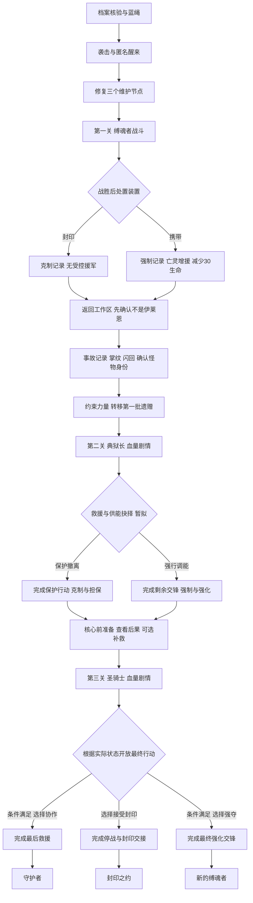

# IM MONSTER 三 Boss 与多结局完整故事策划

版本：v0.4 方案稿。更新：2026 年 11 月 5 日。

本文给出从开场到结尾的完整制作走向，并区分用户已确定的范围与本稿建议的细化。三关、血量剧情、装备继承与结局系统均须按[开发流程](DevelopmentWorkflow.md)另行实现和验证。本文不是已经完成的游戏说明。

## 一 游戏定位与核心体验

玩家扮演接收了封忆师记忆、误认自身身份的人形怪物，在灾后的终境守藏院完成救援，并逐步面对自己的过去。三场 Boss 战分别让玩家决定：是否控制亡灵、是否让救援优先于自身力量，以及最终如何使用恢复的力量。

游戏为单人第一人称探索与战斗。探索用物件和短文本提供证据；战斗以预警、走位、攻击、防御及现有吞印机制为基础；关键选择同时改变战斗资源、人物态度和最终可达结局。操作失败不等于道德上的坏选择。

不为三个结局分别制作三个最终 Boss。所有路线共享缚魂者、缄默典狱长、封印圣骑士三关，最终由过程中的事实状态和最后的主动决定分流。

原 v0.3 的 8—12 分钟是旧短篇目标，不能直接用于新增三 Boss 版。新时长和难度先用白盒与首次试玩确定，不通过延长字幕或强制等待凑时长。

## 二 必须保留的世界规则

1. 终境守藏院利用源石和导流法阵维持档案、亡灵收容与深层封印。源石始终位于深处，修复外圈维护节点不等于拿走源石或解决全部灾难。
2. 逝者自愿留下记忆，能力遗赠另有意愿和受赠限制。阅读记录、拾得记忆不代表可以随意获得全部死者能力。
3. 亡灵保留不同程度的意识与执念，其中既有求救者，也有危险个体。解除强制控制与任其伤人是两件事；封印装置后仍要有安全隔离与引导。
4. 玩家是百年前企图夺取源石、被封印的怪物。开场记忆属于伊莱恩维尔；新的身体不是她复活后的身体。
5. 怪物逐渐恢复的力量属于自身。缚魂装置的亡灵增援来自强制控制，不伪装成普通遗赠奖励。
6. 典狱长先救人、组织撤离，后因发现封印特征而要求收容。冲突源于危险判断和行动优先级，不将他突然改写为反派。
7. 圣骑士负责源石与最深层封印，承担最终切断供能的决定。原长篇中由典狱长承担的部分最终封印冲突，在本稿中分配给圣骑士；典狱长仍负责监狱与外圈救援。这是新增关卡方案的改编，不修改原 v0.2 框架原件。

## 三 人物与三位 Boss

| 角色 | 动机与职责 | 与玩家的冲突 | 难度方向 |
| --- | --- | --- | --- |
| 玩家 | 先以为自己是封忆师，后逐步认清怪物身份；希望生存，也受新接收的记忆影响而参与救援 | 力量与过去使他人不敢轻信；玩家必须用实际行动回应 | 逐步掌握自身力量与选择代价 |
| 伊莱恩维尔 | 开场工作的封忆师；临终仍试图保护遗赠并留下记忆 | 她的记忆造成误认，也提供玩家理解他人的起点 | 作为身份线索，不制作敌对 Boss |
| 缚魂者，名称暂定 | 原镇魂监狱缚魂官，已投靠教派；突袭后夺取收容设施，将亡灵编成军队 | 玩家恢复维护节点，破坏其控制；他又发现玩家能吸纳魔能，想将玩家变成控制亡灵的工具 | 略低于现有典狱长，教会处理召唤物与装置 |
| 缄默典狱长 | 监狱负责人，组织收容和撤离，防止危险存在混入人群 | 发现玩家封印特征与逃逸怪物一致，要求立即收容；玩家坚持仍需抢救遗赠 | 中等；沿用现有战斗资源并适配剧情 |
| 封印圣骑士，名称暂定 | 守护源石与最深层封印的最后防线，继承百年前镇压怪物的职责 | 判断怪物已恢复力量，准备封闭核心并切断外层；玩家知道外面仍有人、亡灵和遗赠未撤离 | 最难；考验前两关得到的资源与战斗能力 |

三位 Boss 的建模、武器、场景细节和技能组合需分别评审。此前讨论的大剑与盾、重甲等属于候选外观，不在未确认时写成模型硬性要求。

## 四 全故事顺序

| 段落 | 剧情与玩家行为 | 本段必须交代的事 |
| --- | --- | --- |
| 序章 档案工作 | 查验三份遗赠记录，系蓝绳并完成交接 | 记忆与能力遗赠须尊重意愿；玩家建立对工作和物件的熟悉感 |
| 灾变与醒来 | 警报、袭击、黑屏；从低处醒来，听见典狱长画外救助 | 身体与视角发生变化，但不提前告诉玩家真实身份 |
| 维护与第一关 | 修复三个外圈维护节点，发现异常收容线路；进入缚魂者控制区 | 三个节点属于同一段维护，不是三个 Boss 关；修复触发敌人干预 |
| 第一关结算 | 战胜缚魂者，封印或携带装置 | 第一次关键选择，直接决定是否拥有亡灵增援及生命代价 |
| 返回与身份揭示 | 回到工作区，观察遗体三证据；核对事故记录、掌纹和闪回 | 先确认不是伊莱恩，再确认是怪物，两次揭示分开成立 |
| 中段救援 | 约束自身力量，将第一批遗赠转入安全箱 | 保留现有短篇的救援成果；完成一批不等于全院撤离结束 |
| 第二关 | 在转移或撤离通道遭典狱长拦截；血量剧情中决定救援或强行调能 | 让救助者与主角的冲突有证据；产生新的关系和资源后果 |
| 核心前路 | 观察撤离是否完成、装置与装备状态；提供有限补救机会 | 为最终决定建立清楚的条件，不能靠突然出现的新道具解围 |
| 第三关 | 圣骑士准备封闭核心；战斗达到阈值后听见解释并作最后决定 | 前两关选择影响其信任、可用资源及最终可选行动 |
| 结尾 | 守护者、封印之约、新的缚魂者之一 | 交代人物、遗赠、亡灵、源石与自由的具体结果 |

## 五 序章与身份揭示的制作

开场仍在既有工作台。三份档案可任意顺序核验，关闭正文不算完成，确认才累计。蓝绳成为玩家亲手留下的证据。交接完成并关闭阅读面板后，才发生袭击。

袭击使用声音、局部物件、视角下沉和短黑屏，不为此扩建教派全员模型。伊莱恩护住档案包，受伤位置与后续遗体证据一致。她留下记忆的意愿明确；记忆异常传递到怪物的具体机制只交代目前可知的部分，不把事故记录写成全知系统。

醒来后字幕只称“你”或“幸存者”。典狱长请玩家修复外圈节点，说明自己正在疏散。恢复输入后允许探索；不在 HUD 提前显示怪物身份、姓名或旧战斗编号。

第一关后返回工作区，通过同一蓝绳、伊莱恩工作牌、腹部伤口三项证据，得出“那些记忆属于她，我不是伊莱恩”。随后事故抄件、左掌三缺环纹与第一人称短闪回共同支持“我是怪物”。先后顺序不能颠倒。

现有力量控制和遗赠转移可作为中段救援。原结尾动画保留为第一批遗赠成功转移的演出候选；为三关版另接后续目标和过渡，不提前显示全游戏通关或原制作名单结束页。原版本仍可作为独立短篇保留。

## 六 第一关 缚魂者与装置

### 战斗与冲突

玩家恢复节点后，原本流向收容设施的魔能重新分配，缚魂者的控制出现裂缝。他派亡灵阻止玩家，继而试图用玩家的身体稳定更大的控制回路。

战斗以敌方亡灵、召唤位置和装置弱点建立节奏。数量有上限，攻击有预警，玩家必须有可走的路线。低血量可触发短对白，但处置装置的关键选择仍在战胜 Boss 后出现，不在其继续伤人的时候要求玩家操作菜单。

### 两个选择

| 选项 ID | 玩家决定 | 战斗与叙事结果 |
| --- | --- | --- |
| `seal_device` | 封印缚魂装置 | 不再控制亡灵；后续没有受控援军。部分亡灵进入安全隔离或接受引导，不把所有魂体直接消灭。记录一次克制选择 |
| `carry_device` | 携带缚魂装置 | 获得亡灵增援，减少 30 生命；玩家接替 Boss 成为控制者。记录一次强制选择，并记录持有装置的事实 |

减血方式仍需确认。建议测试“携带时降低生命上限 30”，以便代价持续存在；若采用该方案，必须定义当前生命裁剪、卸除后上限恢复但不免费回血、跨关和读档不重复扣减。正式计算方式与平衡未验收前，不能宣称已经定稿。

### 碎片叙事

- 名牌原有姓名被军团编号盖住，提示亡灵被当成工具。
- 装置操作记录说明活体承担反噬，提前解释代价。
- 牢笼有求救与威胁两类声音，说明释放不是没有风险。
- 磨损的锁环和残留魂迹表现长期挣扎；携带后低语随装置进入下一关。

关键代价必须在确认选择前可读；额外碎片补充细节，不让玩家必须找齐全部小物件才知道援军来自强制奴役。

## 七 第二关 缄默典狱长

典狱长在早期已经完成救助。返回后，他通过封印特征确认玩家极可能是逃逸怪物；若玩家携带装置，还能直接看到受控亡灵。玩家此前救过人是有利证据，但不足以自动消除巨大风险。

他要求先收容玩家，再由守卫继续救援。玩家则认为立即收容会耽误仍未转移的遗赠。对话中双方都说出具体依据，战斗发生在疏散通道以外，不能让主要撤离人群被当作无保护背景。

血量跨过可配置阈值后进入剧情暂停。以下选项和奖励为本稿建议：

| 选项 ID | 玩家决定 | 选择后的动作与奖励候选 |
| --- | --- | --- |
| `protect_evacuation` | 停手协助保护转移 | 进入有限合作与救援目标；完成后记录克制、救援进度和典狱长担保。防护类奖励作为候选，不自动等于永久减伤 |
| `seize_supply` | 强行抽取局部供能以便突破 | 继续剩余战斗；战胜后取得攻击强化类奖励候选。记录强制和供能损害，额外救援需另行补救 |

“选择保护”与“救援确实完成”分别记录，不能点一句好台词就跳过全部行动。典狱长是否停战、是否提供担保应跟随实际结果。选择强行调能也不把他改写成邪恶人物；他可以在失败后仍组织撤离。

典狱长原有模型、动画、技能与水晶机制优先复用，按新入口与剧情阈值适配。三水晶现有功能与证据不意味着新剧情和存档已经接通。

## 八 核心前路与补救

最终战前用一段可控准备区展示实际后果：被转移的档案、还在等待的遗赠、撤离清单、受损供能线，以及仍跟随玩家的亡灵。玩家可检查装备与状态，读取接近核心的警告。

建议提供一次有成本的补救：携带装置的玩家可在已有安全节点解除控制，失去亡灵增援并按规则解除携带代价，帮助亡灵安全离开；其历史强制记录保留，同时记录一次实际补救。补救需要稳定站位和完成反馈，不用单击卸装备直接抹去剧情后果。

第一关已封印装置的玩家可在此确认封印仍稳定，不重复领奖或累计善行。若要支持重新启封装置，需另行批准并设计后果，本稿不默认提供。

碎片线索提示核心封闭会切断外层，说明圣骑士面临的风险，也让玩家知道“突破封锁”可能付出的代价。主线必须提供足够事实，完整档案只是补充理解。

## 九 第三关 封印圣骑士

圣骑士看到怪物力量恢复、外层失控和深层封印受损，准备以封闭核心、切断外层来阻止灾难向外扩散。他知道外层尚有牺牲风险，因此需在场景与对白里交代已尝试过的撤离、隔离或修复措施，以及为何不能无限等待。

玩家认为仍能保护外面的人与遗赠，双方首先为是否继续给予时间而战。骑士使用何种武器、格挡与阶段组合由骑士组另交战斗设计，不在此强行把某套未确认的外观定稿。

血量阈值进入剧情时，停止双方、飞弹、回血与亡灵行为。该节点决定最终行动；达成阈值不要求必然杀死圣骑士。

本稿建议最后给出三个有条件的行动，保留玩家的主动决定：

1. **请求协作，完成最后救援。** 需要足以支持信任与稳定供能的事实条件，随后进入短救援收尾；完成后到“守护者”。
2. **接受重新封印，换取撤离时间。** 作为可达的保底路线，停止攻击并完成封印交接，到“封印之约”。
3. **以亡灵军队强夺控制。** 需要仍能控制亡灵并满足对应力量条件；进入最终强化交锋，完成后到“新的缚魂者”。

未满足条件的行动应给出角色能理解的原因，例如“受控亡灵仍在你身后”或“外层转移还没有完成”，而不是显示善恶分不足。失败可重试，不直接转为坏结局。

## 十 三个结局

结局名称与细节均为本稿候选。需要交代的不只是主角去向，还包括遗赠、亡灵、源石和其他人的结果。

| 结局 | 收尾行动与画面 | 代价与主题 |
| --- | --- | --- |
| 守护者 | 玩家不再控制亡灵，以可控的自身力量协助稳定外层回路；典狱长担保，圣骑士延后最终切断。剩余救援完成后核心安全关闭；源石留在原位。玩家被允许在有约束、有监督的条件下离开，而非瞬间获得所有人的信任 | 放弃奴役带来的便利，用实际行动争取自由；救援成功不等于守藏院全部恢复 |
| 封印之约 | 玩家接受与圣骑士重新建立封印，自己留在院内，换取明确的撤离窗口；典狱长带走可救人员和本轮遗赠，留下玩家自愿接受约束的记录。结尾可见蓝绳或已封好的转移箱，回应开场 | 不是战败或失败结局；保住他人需要牺牲自由，信任尚未完成 |
| 新的缚魂者 | 玩家继续控制亡灵，在最后交锋后取得核心局部回路控制权并突破封锁；镜头呈现跟随者的锁环、原姓名被编号覆盖，以及未能安全转移的档案损伤。源石仍留在深处，不突然变成背包装备 | 玩家获得自由与力量，却重复了第一位 Boss 的奴役；不将消灭所有人当作默认奖励 |

现有遗赠转移动画可以复用同一批物件与箱体，但结尾目标、镜头、字幕与完成标记分别制作。三个结局无需三套完整新地图，也不因结局不同新增第四个 Boss。

## 十一 选择计数与结局判定建议

已确认的是“剧情中作选择、不同选择通向不同结局”。是否仅按好坏次数判定还未最终确定。本稿建议保留计数，但将实际状态和最后决定作为主要条件，避免一项剧情事实被几次无关对话抵消。

至少保存：`restraintCount`、`coercionCount`、`deviceEverCarried`、`deviceControlledNow`、`deviceSealed`、`evacuationCompleted`、`wardenGuarantee`、`finalDecision`、各节点的选择 ID 和奖励提交状态。

第一关封印、第二关保护分别计一次克制；第一关携带、第二关强行调能分别计一次强制。解除装置的补救单独记录，不删除历史选择。最后协作、接受封印、强夺控制作为终局决定分别存储，不能用中文结尾标题代替稳定 ID。

可执行的初版候选规则如下，具体计数门槛需负责人确认后冻结：

| 最终行动 | 前置条件候选 | 完成要求 | 结局 |
| --- | --- | --- | --- |
| `cooperate_rescue` | 当前不控制亡灵；保护行动成立；救援链可继续；有典狱长担保或等价的事实证据 | 完成最后救援并稳定回路 | 守护者 |
| `accept_seal` | 最终对话正常到达；作为所有合法路线都可达的保底选择 | 完成停战与封印交接 | 封印之约 |
| `dominate_core` | 当前持有并可使用缚魂装置；至少有对应强制路线与力量准备记录 | 完成最后交锋与控制交接 | 新的缚魂者 |

若团队先做纯计数原型，可以临时用“全克制／全强制／混合”测试三种结尾展示，但不得将该测试规则与上表同时当作正式规则。最终只能发布一份判定表，并明确覆盖所有组合、优先级、补救和不可达原因。

结局由共同流程统一判定，不由每个 Boss 脚本各自写一套。结局前保留检查点以便调试与选择最终可用行动；想改变前面已经提交的事实需要回相应检查点或重玩，不能靠重新看结尾重复刷奖励。

## 十二 全流程图

## 十三 奖励与装备原则

关卡选择后的奖励立即进入本轮后续战斗。缚魂装置是明确的第一关奖励与代价；第二关防护或攻击类奖励仍是待定候选，须给出实际数值、获得时机与视觉反馈。

装备状态既影响玩法，也可影响角色判断，但不把所有装备简单贴上善恶标签。克制路线要有清楚的反馈与可完成的战斗难度，不能因为拒绝奴役就被动进入不可通关状态。

奖励由公共层一次性提交，来源可追踪；跨关不重置选择，不重复扣除 30 生命，死亡重试不再生成另一件同名装置。若未来做结局收藏、外观或二周目装备，与本轮选择状态分开存储，避免新奖励反过来更改已经发生的结局。

## 十四 场景 美术与声音

| 区域 | 主要视觉与物件 | 必要玩法约束 |
| --- | --- | --- |
| 记忆档案馆 | 深色木作、旧黄铜、暖纸、蓝绳、工作牌、同一批档案与转移箱 | 保留灾前灾后对应关系，物件搬移不复制第二份证据 |
| 缚魂者区域 | 收容栅栏、破损控制回路、名牌、锁环、束缚装置 | 召唤与退场位置清楚，不以不可见碰撞围死玩家 |
| 典狱长区域 | 沿用现有封印厅与三水晶资产，加入撤离指示与供能状态 | 战斗区与主要人群疏散区分开，选择后环境状态一致 |
| 核心与圣骑士区域 | 深层封印、供能门、撤离窗口、历史镇压痕迹 | 留足移动与武器净空，剧情镜头和恢复站位都可验证 |

碎片物件服务于身份、选择代价和人物动机。关键条件通过主线交互和对话也能理解，不用找齐所有日志才能通关。台词字幕完整；配音可后补，但攻击、选择确认、增援、反噬、装置封印和结尾均应有清楚反馈。

## 十五 制作优先级与验收

P0：共同接口与三关占位串联；两组完整战斗闭环；血量剧情与装置处置；状态与奖励跨关；重试与存档；至少可复现的三个结局；指定平台独立包。

P1：正式模型动作、碎片物件扩充、完整混音、镜头打磨与结尾表现升级。P2：配音、复杂同行行为、二周目与额外收集系统。若时间不足，先交可信的白盒闭环，不把未完成模型或分支写成已实现。

验收必须覆盖高伤害跨血量阈值、同帧死亡优先级、暂停与失焦、召唤物暂停及清理、选择只提交一次、装置跨关不重复扣血、友方亡灵对骑士的真实命中、全部最终选项前置条件，以及三结局正常入口完整路线。

原比赛截止为 11 月 7 日 22 时，但该日期不等于两个新 Boss 与三结局已承诺可以在此前完成。负责人需按两组实际人数、完成度和可用工时确定本轮交付范围；保留现有短篇与整合包作为可回滚基线。

## 十六 设计依据与当前待定项

依据包括原故事框架 v0.2、比赛版 v0.3、现有剧情与典狱长成果、本次三 Boss 背景图及用户关于分组开发、装置、亡灵援军、血量剧情、选择与结局的说明。

《空洞骑士》可参考关键物品与终战实际行动改变结局，以及结尾后回到终战前状态的组织方式，不把它误写为善恶计数系统。参见[结局机制资料](https://hollowknight.wiki/w/Endings_(Hollow_Knight))。本稿为原创剧情扩展，不复用其人物、地图或结尾画面。

待负责人和两组冻结：减血计算方式；Boss 武器外观和技能；血量阈值；计数是否参与硬门槛；补救是否采用；终局选项条件；第二关奖励与数值；目标平台、性能预算、组负责人和排期。文中建议值及候选剧情在这些项目冻结前不得作为已实现验收结论。
