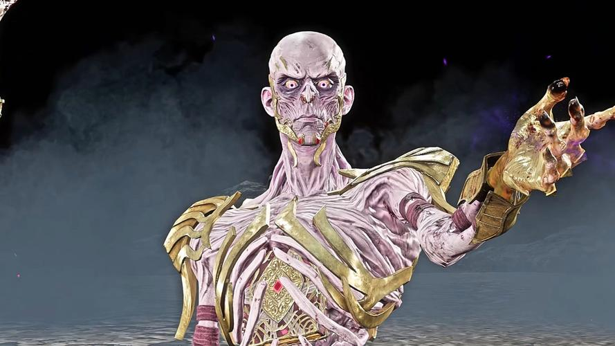
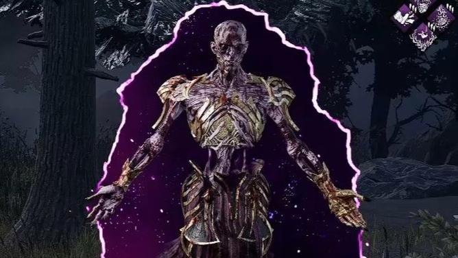
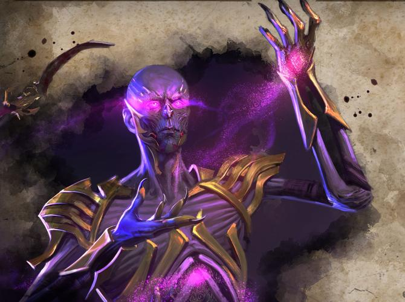
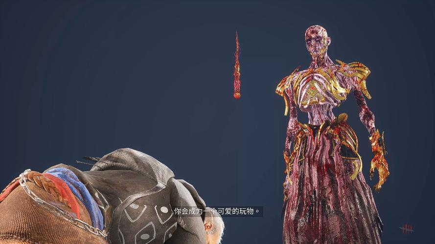
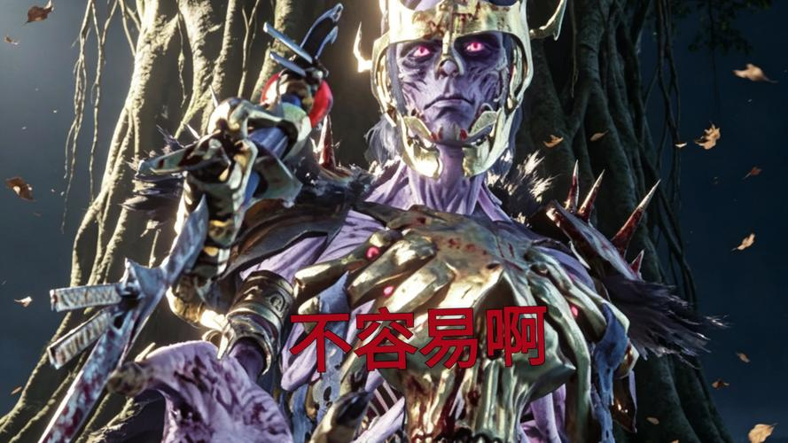
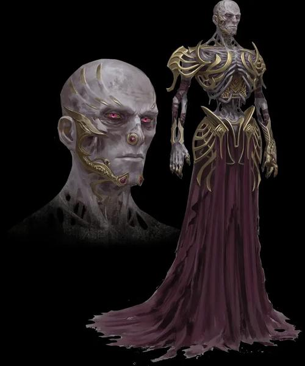

# 用户提供的《黎明杀机》巫妖参考图

按用户上传顺序保存原图。仅作视觉参考，图片中的文字、界面或背景内容不作为项目需求。

| 编号 | 主要可观察内容 |
| --- | --- |
| 01 | 面部、上半身、伸手施法与悬浮武器 |
| 02 | 正面胸甲、肩甲和施法手势 |
| 03 | 双臂展开的施法姿态与紫色法术边缘 |
| 04 | 紫色眼光、掌心魔法与施法动作 |
| 05 | 全身比例、长袍和手臂轮廓 |
| 06 | 带冠饰的另一套外观与悬浮武器 |
| 07 | 面部特写及完整角色轮廓 |

