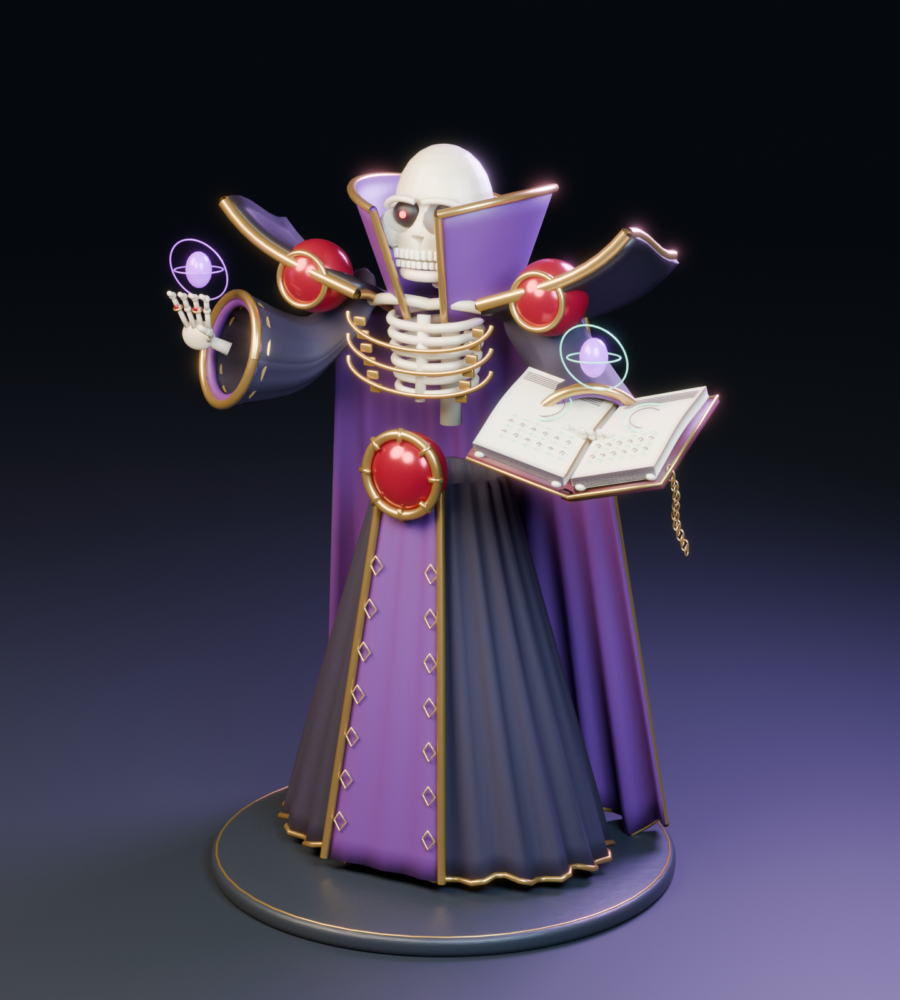
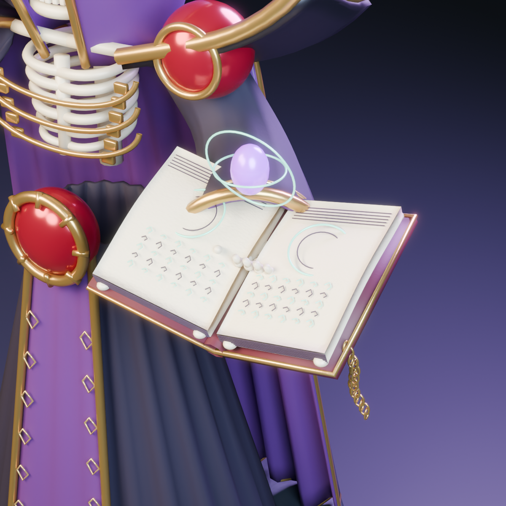

# 缚魂者造型首版：骷髅法师与死灵之书

2026-11-06。按用户要求参考《Overlord》安兹的骷髅面部、黑紫长袍、金色宽肩与红色魂珠，一手托打开的死灵之书，另一手施法。造型参考：[官方角色图](https://overlord-anime.com/assets/character/1c2.webp)。网格由本项目 Blender 脚本制作，未使用下载的角色模型。

用户后续补充的召唤、五类亡灵、护甲和破甲眩晕规则，单独记录在 [缚魂者战斗设定](../SummonerBossDesign20261106/README.md)；模型首版不等于这些玩法已经实现。

## 文件

- 可编辑 Blender 4.3.2 源文件：`Blender/Bosses/Summoner/OverlordStudy20261106/Soulbinder_OverlordStudy.blend`。
- 原 Blender 会话副本 `BeforeUserSession.blend` 仅留在本地 main 工作目录，未上传个人会话备份。
- Unity 可导入 FBX：`Assets/Art/Bosses/Summoner/Models/Soulbinder_OverlordStudy.fbx`。
- 低面数候选：同目录 `Soulbinder_OverlordStudy_LOD1.fbx`，需要在 Unity 手动配置 LODGroup；单独文件不自动构成完整 LOD 组。
- 通用预览 GLB：同目录 `Soulbinder_OverlordStudy.glb`，Unity 本轮将其作为 DefaultAsset 收录，不宣称已配置 glTF 渲染插件。
- 生成与导出检查脚本：`Tools/SummonerModel20261106/`。
- 详细网格、骨骼和导出检查：本目录 `model-report.json`、`export-validation.json`、`material-manifest.json`。

## 当前成果

角色约 3.62 米高，包含基础 50 骨骼绑定。身体与打开的书是两个独立蒙皮网格；下颌、手指、书与部分衣摆有对应骨骼。Blender 源中保留 328 个角色/书籍制作部件，另保留展示用灯光、相机和台座。

高面数版本：身体 85,081 三角面，书 16,600；低面数候选：身体 35,733，书 6,972。可选施法光球单独保存在 Blender 中，不混入主 FBX。主 FBX 包含待机与施法两个动作草稿；低面数 FBX 保留骨架，不重复输出动作。

打开源文件可以直接查看模型。细修时先隐藏 `04_GAME_EXPORT`，再显示 `01_EDITABLE_CHARACTER_PARTS` 和 `02_EDITABLE_GRIMOIRE_PARTS`，避免源部件与合并模型重叠。`05_STUDIO_NOT_FOR_EXPORT` 是展示场景，`07_LOD1_EXPORT_ALTERNATIVE` 是低面数替代网格。

普通编辑直接打开 `.blend`；重建工具从空场景生成，应在独立后台 Blender 进程运行。重新生成会写回这批生成文件，手工修改请另存新文件后保留。

## 验证与接入边界

Blender 源重新打开、主/低面数 FBX 重新导入均通过：两个网格、50 骨骼、UV 存在，无未赋权重顶点，无丢失外部图片；主 FBX 的两个动作可重新读取。GLB 检查为两个网格、一个蒙皮，无展示相机。

Unity 6000.3.24f1 批处理已成功导入两个 FBX，并生成对应 `.meta`。Blender 的程序化微表面细节没有烘焙成游戏贴图；在 URP 中接入时，应根据 `material-manifest.json` 建立材质、配置发光并进行实际场景复验。当前绑定和动作是制作起点，手部持书接触、布料权重、UV 与纹理仍可继续精修。

**本提交在 art 分支交付模型资产。** 五类召唤物已有模型首版，见[召唤物清单](../SkeletonMinion20261106/README.md)。Boss 已与召唤物一起放入 `Assets/Scenes/Summoner_ModelReview.unity` 进行视觉检查，URP 材质和待机控制器位于 `Assets/Art/Bosses/Summoner/`。召唤 Boss AI、亡灵战斗行为、装置选择及跨关奖励尚未实现，也未将新模型挂到正式战斗入口。main 当前正式战斗仍是典狱长，圣骑士 V5 仍为另一工程的候选。

