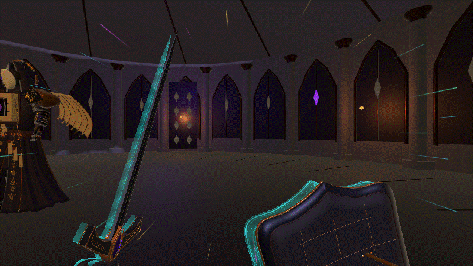
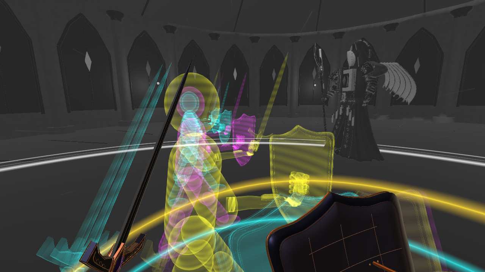

# 时停灰圈、奖励保护与彩色虚影 · 2026-10-30

在当前 1.0.6 工程通过 Unity MCP 完成。延续 Shift 突进和真实极限闪避判定，按本轮要求强化奖励的视觉辨识度，并保护刚成功闪避的玩家。

## 行为与参数

- 仍为 4.8 米 / 0.24 秒突进，消耗 20 体力、冷却 0.85 秒，真实闪避窗口 220 毫秒。
- 奖励持续 0.75 秒真实时间：前 0.45 秒世界速度从此前的 25% 调为 **5%**，接近静止；最后 0.30 秒平滑恢复，玩家移动和近战继续响应。
- 触发时，圆形灰色边界在约 0.18 秒内从画面中心向外扩散，脚边同时爆发银灰色地面波圈；结束时灰色范围由外向内收回，外部先恢复颜色。灰色暗部保留可见细节。
- **仅成功授予奖励后的前 0.30 秒无敌**。后续近战、弹体和地面伤害统一经过该保护检查，不扣血、不额外消耗受击格挡体力、不打断动作。计时使用真实时间；0.30 秒后恢复受伤，即使慢速效果尚未结束。
- 普通突进仍会受伤。确认奖励之前的同帧受击/格挡接触/吞印仍会取消候选奖励，避免按 Shift 就自动无敌。
- 玩家周围四层青绿、青蓝、紫红、金色波纹扩大至约 3 米半径，光带宽度 0.065～0.10 米；第一人称残影更明显，外围光丝也加宽加长。
- 沿实际扫掠走过的路径留下 **4 道固定在世界中的彩色人形虚影**，保留约 **1.10 秒**。身体为连续的轻量光影轮廓，剑盾和蒙皮手部取自当前模型姿态。玩家移动、转头不会拖动旧虚影。
- Esc / I、失焦、死亡和返回图书馆会清理保护、波圈、虚影和时间倍率。正常恢复时间后，身后虚影可继续短暂消散。

## 预览

固定战斗姿态、按真实时间步进效果的动态预览（20 fps）：

转身可见身后固定的彩色虚影：

## 渲染与资源

世界先通过径向灰度效果，再绘制彩色虚影，之后统一进入原有后处理。手部和 HUD 保持可读。采用项目已安装 URP 的 FullScreenPass / RenderObjects 接口，支持现有 RenderGraph 与相机叠加。

高画质与均衡画质共用的 MilanV6_Renderer 新增两项特效；空闲层 30 命名为 TemporalAfterimages，只由彩色虚影绘制阶段处理。保留场景深度遮挡，均衡画质 0.85 渲染比例下也验证了墙体遮挡。没有新增相机或修改场景。

## 修改文件

| 工程内文件 | 用途 |
|---|---|
| Assets/Scripts/Player/PlayerDash.cs | 5% 世界速度、0.30 秒奖励保护、实际轨迹采样、效果生命周期 |
| Assets/Scripts/Player/PlayerCombat.cs | 统一受伤入口中的奖励保护检查 |
| Assets/Scripts/Visuals/DashAfterimageVfx.cs | 加强第一人称彩色残影与外围光丝 |
| Assets/Scripts/Visuals/TemporalStopRendererFeature.cs | 新增世界灰圈渲染 |
| Assets/Scripts/Visuals/TemporalWorldEchoRendererFeature.cs | 新增保留色彩和遮挡的世界虚影绘制 |
| Assets/Scripts/Visuals/TemporalStopPulse.cs | 新增银灰色地面扩散 / 收回波圈 |
| Assets/Scripts/Visuals/DodgeWorldEchoes.cs | 新增四层彩色波纹与沿路径固定的四色人形虚影 |
| Assets/Art/PlayerSwordShield/TemporalStop.shader | 新增灰度扩散、透镜边界和恢复效果 |
| Assets/Resources/PlayerDash/TemporalStop.mat | 新增灰圈材质及构建引用 |
| Assets/Resources/PlayerDash/TemporalTravelerEcho.asset | 新增连续人形光影轮廓网格 |
| Assets/Art/MilanLibraryV6/Settings/MilanV6_Renderer.asset | 注册两项渲染效果与层过滤 |
| ProjectSettings/TagManager.asset | 使用空闲层 30：TemporalAfterimages |
| README.md、CHANGELOG.md | 同步当前玩法、时间和保护参数 |
| Docs/PerfectDodge20261030/README.md、Docs/DodgeTuning20261030/README.md | 更新当前机制，并标明历史参数 |
| Docs/TemporalStop20261030/ | 本轮备份、截图、预览、检查与清单 |

新增脚本、着色器、材质和网格均带 .meta。SHA-256 清单见 [FilesChanged.json](FilesChanged.json)。

## 最小验证

[11 项检查全部通过](MinimalChecks.txt)，仅验证本轮行为与渲染，没有全量测试或构建：

- 普通突进可受伤，真实极限闪避才获得保护与 5% 世界速度。
- 保护内连续近战、弹体和地面伤害均被拦截；290 毫秒仍受保护，301 毫秒恢复受伤，玩家动作不被保护内的攻击打断。
- 4 道虚影位置匹配实际突进轨迹；玩家移动、转头后仍固定；1.10 秒后隐藏。
- 0.75 秒恢复全局时间与物理步长；Esc 清理保护、灰圈和虚影。
- 两档画质实际相机渲染通过；均衡档遮挡探针中，虚影彩色像素从 99,136 降到 0（墙体完全置于整个虚影含盾牌之前）。
- 实际画面检查了向外变灰、灰色保持、由外向内恢复与彩色虚影。最终 Console 0 Error / 0 Warning，返回图书馆成功，已退出 Play Mode。

手动体验：成功极限闪避后观察灰色波圈、放大的彩色环；立即侧转可见身后的固定虚影。保护只持续奖励开始后的 0.30 秒，之后仍需继续移动或防御。

复查方法体保存在 .cs.txt 中，不参与编译；动态预览使用受控运行场景。原始帧保存在 Frames/，运行清理见 [RuntimeCleanup.txt](RuntimeCleanup.txt)。
