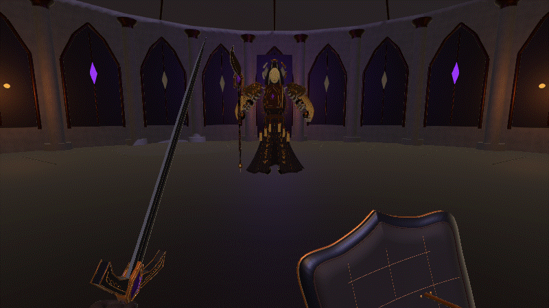
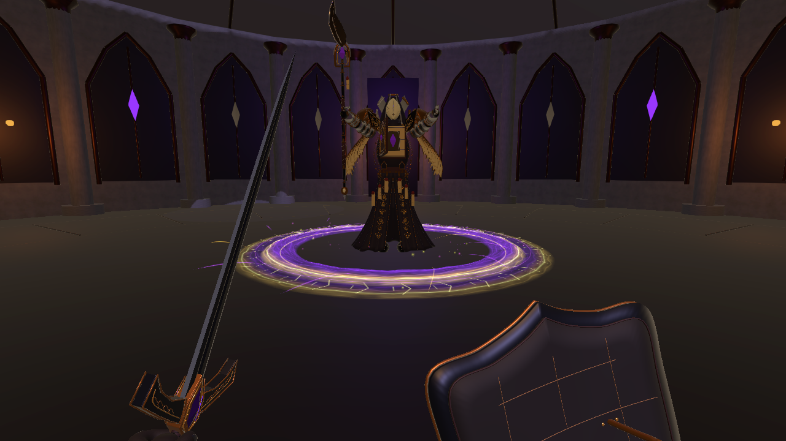
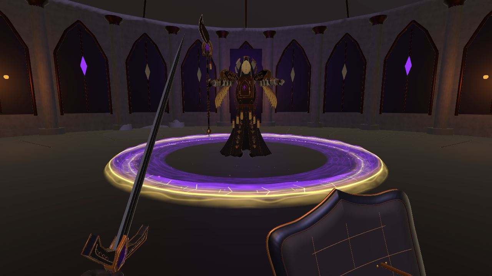
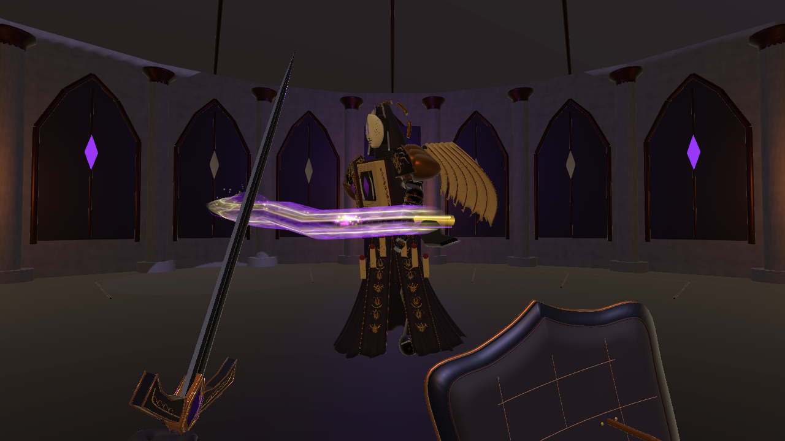

# 环波吸入前摇与近战刀光重制（2026-10-30）

在当前 1.0.6 工程中通过 Unity MCP 完成，沿用旧金、紫黑和符印风格。本轮只处理 Boss 跳跃躲避的环波与近身挥击表现。

## 环波

- 总预备动作 1.15 秒，第一次释放仍在攻击阶段 0.15 秒。释放前最后 **0.70 秒**，Boss 脚底出现向内收束的明显特效。
- 吸入圈从 3.7 米缩至 0.48 米；三层符环、十二道螺旋光丝、32 组刻纹和金紫粒子同步汇聚。
- 吸入仅为特效，不改变玩家位置或提前造成伤害。
- 放出带宽度和高度的金紫能量波峰，附加柔和紫色拖尾、雕刻光纹、明亮前缘和散射粒子。
- 二阶段第二波也有独立 0.70 秒吸入前摇。
- 维持原有 4 米/秒扩散速度、单波单次伤害和跳跃躲避判定。发光前缘与实际判定半径同步；内部消散光纹不增加伤害。

## 近身攻击

- 替换原有两条很薄的刀刃带，改为沿实际刀刃路径生成的上下双层弯月曲面。
- 增加流动细纹、金色亮刃、紫色柔边和逐段消散；前缘做透明过渡，减少生硬切面。
- 预备时能量沿刀刃缠绕，挥动时形成残光，在原本 0.22 秒命中时刻爆发碎光。
- 近战动作、伤害、范围、弹反与失衡逻辑保持原有规则。所有新特效由战斗计时推进，支持暂停和中断清理。

## 文件

新增：
- Assets/Scripts/Visuals/ArcaneEnergyMesh.cs
- Assets/Scripts/Visuals/WardenWaveVisuals.cs
- Assets/Scripts/Visuals/WardenMeleeVfx.cs
- Assets/Scripts/Core/BossWavePresentation.cs
- Assets/Art/ForbiddenWarden/CombatV2/WardenEnergy.shader
- Assets/Art/ForbiddenWarden/CombatV2/Materials/WardenWaveEnergy.mat
- Assets/Art/ForbiddenWarden/CombatV2/Materials/WardenCrescentEnergy.mat
- 上述资源对应 .meta。

修改：
- Assets/Scripts/Core/BossEncounter.cs：环波生命周期、预备与释放表现接入。
- Assets/Scripts/Core/BossDefinition.cs：环波曲面材质引用。
- Assets/Scripts/Visuals/WardenAnimationDriver.cs：新近战表现接入实际骨骼与动作计时。
- Assets/Art/ForbiddenWarden/WardenEncounter.asset：波面材质及预备参数。
- Assets/Art/ForbiddenWarden/CombatV2/Prefabs/ForbiddenWardenRigged.prefab
- README.md、CHANGELOG.md。

精确路径与前后 SHA256 见 FilesChanged.json。Before 中保留本轮修改前快照。

## 最小检查

通过 MCP 在临时 Play Mode 中调用实际逻辑，12 项通过、0 项失败，结果见 MinimalChecks.txt，调用脚本见 MinimalChecks.cs.txt：

1. 吸入环收缩且发出粒子。
2. 前摇不拉动玩家、不造成伤害。
3. 正式释放前没有伤害波对象。
4. 第一次释放生成一波。
5. 落地经过波环只受一次伤害。
6. 跳起越过波环不受伤。
7. 二阶段第二波重复吸入前摇。
8. 二阶段恰好生成两波。
9. 暂停冻结波半径及战斗特效时钟。
10. 中断清理吸入与已释放环波。
11. 近战生成曲面刀光与命中时刻粒子爆发。
12. 收招后近战刀光及粒子完全消散。

完成最后的刀光边缘柔化后，再检查编译和实机动态预览；最终 Console 为 0 Error / 0 Warning，退出 Play Mode 并恢复原后台运行设置。没有完整回归、独立构建或长时性能测试。

## 动态预览与截图

以下是原场景中按战斗时钟逐帧驱动的定点演示，先显示吸入与环波，再显示近身横斩；用于检查美术表现，不是完整战斗录像。

