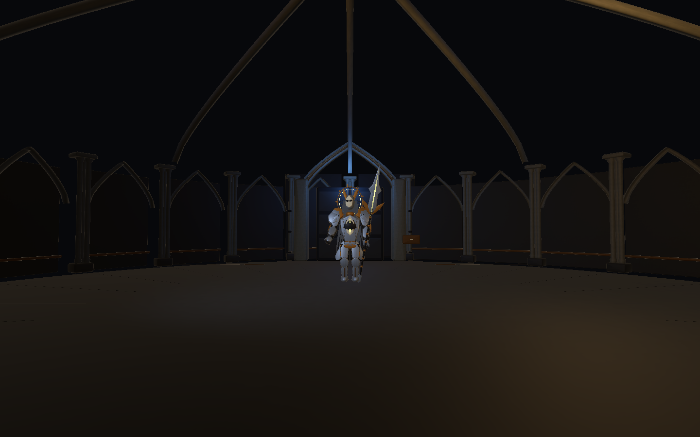
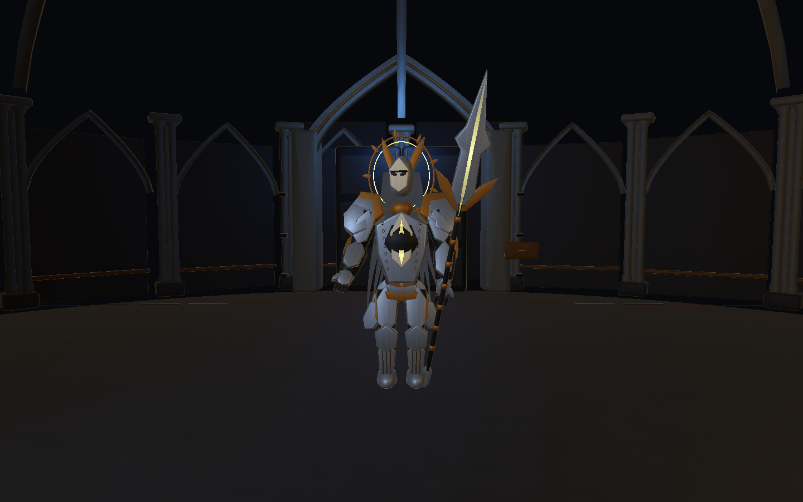
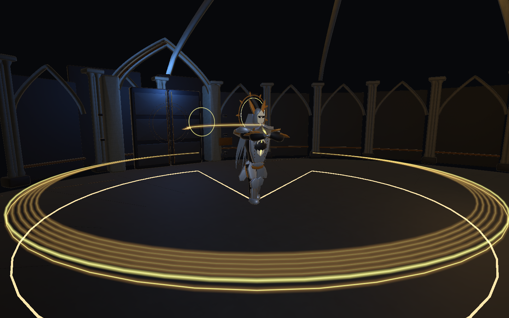

> 2026-11-06 归档说明：本 V5 完整工程已由用户指定收录为 `lixiang/1.0.8`。下文的本地分支及未上传状态保留为制作时历史记录；当前归档验证见 [Archive108](../../Archive108/README.md)。

# V5 骑士骨骼与终扉前庭接续开发

本轮基于远端 lixiang `19d8d46` 的 V4，按工程 README 中的三套提示词继续制作。工作在独立本地开发分支 `codex/knight-continuation-20261105`，没有合并或覆盖原工作区，也没有自动推送。本次 V5 是制作迭代名，不是新的归档版本号。

## 入口与阅读顺序

- Unity **6000.3.25f1** 打开本工程，运行 `Assets/Scenes/BossTests/Knight_Production_Test.unity`。
- 大厅《星图与魔法笔记》的圣骑士按钮已在本开发副本中指向 V5；典狱长按钮继续使用原配置。
- [战斗制作规格](CombatProductionSpec.md)：八招时间、动作、应对、绑定和中断要求。
- [角色与场景交接](ArtHandoff.md)：实际 Prefab、可编辑源、模块、挂点、材质和后续精修。
- [生成清单](BuildManifest.json)、[受控运行验证](Verification.json)、[Windows 构建报告](WindowsBuild.json)。构建报告以实际生成文件为准。

## 已完成

| 内容 | 本轮结果 |
| --- | --- |
| 新工作区 | 从远端提交建立独立开发副本，工程内 919 项 LFS 文件已还原 |
| 角色绑定 | 实际 100 骨骼的蒙皮角色，两档 LOD；主体甲片刚性绑定、十二条长带各六段双骨权重 |
| 持握与脚底 | 右手主握、近战左手渐入及施法/盾防释放；脚底射线、可达范围和跳转后重新落脚 |
| 运行资源 | 新建 V5 模型、配置与场地，V4 原资源保留；V4 八招和玩家参数不变 |
| 角色细节 | 补胸甲连接件、腿甲槽线、眉框；合并渲染网格，武器和腕盾独立显隐 |
| 场景 | 北门三层尖拱、双门扇、外缘柱间、高位承重肋、门后遮挡、供能接缝和少量撤离线索 |
| 光照与材质 | 石材基础色与法线、克制的金属细纹；3 盏实时灯，阶段门纹，退出恢复图书馆环境光 |
| 原始源文件 | 分件 Unity 制作 Prefab、Unity 生成脚本、重建数据，以及角色与场景的可编辑 `.blend` |
| 动作交接 | 从生产骨骼姿态采样的 8 份 AnimationClip，不增加伤害事件，不与运行曲线争夺骨骼 |

运行角色的骨骼数与 Blender 制作源骨骼数不同：Blender 源保留更多附件与制作节点，不将其计作同一运行性能指标。具体几何、骨骼和 Renderer 数读取 BuildManifest。

## 验证如何理解

本轮 Unity 编译已执行；受控检查在真实生产场景中运行八招两阶段，并检查 72 个外环位置、绑定与权重、握柄、脚底、暂停、剧情高伤害跨阈值、重试、返回、环境光恢复和原典狱长切换。精确通过数和误差见 Verification.json。

检查为隔离问题设置了测试生命、显式伤害与战斗时钟；采样截图来自实际 Unity 相机，不是概念图，也不是完整真人实战录像。编辑器 SearchDatabase 索引异常按原堆栈单独保留在 `editorIssues`，因此不宣称整份 Console 为零错误。游戏运行错误与编辑器索引问题分别报告。

Windows 包使用单个 V5 测试场景和显式构建选项，不改正式 Build Settings。若运行带参数的原生预览检查，其报告仅代表启动、渲染和指定条件下的 120 帧样本；焦点/暂停状态会记录，不能当成真人战斗帧率验收。

本次实际 Windows 构建成功，报告为 0 Error、0 Warning；原生启动与 120 帧采样完成，游戏错误列表为空，见 [原生报告](Native/NativePreview.json)。退出日志另有 ComputeBuffer 自动释放提示，保留在本地日志中，不据此宣称退出日志全无警告。

## 截图

## 重新制作与验证

1. 保存当前手工修改并退出 Play Mode。菜单 `Arcane Archive / Knight / Build V5 production rig and forecourt` 从 V4 来源构建 V5；它会更新本目录生成资产，不用于覆盖未保存的手工作品。
2. 执行 `ArcaneArchive.Visuals.Editor.KnightProductionAcceptance.Run` 运行受控检查与动画采样。该入口自动进入 Play Mode，结束后退出编辑器，适合隔离批处理验证。
3. 用 Blender 执行 `Tools/KnightProductionV5/build_editable_sources.py`，传入本工程路径，生成打包纹理的角色与前庭源文件。常规打开工程不需要重新制作。
4. 执行 `ArcaneArchive.Visuals.Editor.KnightProductionBuilder.BuildWindows`，输出到 `Builds/KnightProductionV5/IMMonster-KnightV5.exe`。需要复制整个构建目录，不能只取 EXE。

脚本、Meta、模型、源文件和说明均保存在本工程内。`Builds`、`Library`、`Logs`、`Temp` 为本地生成内容，不属于源码交付。Blender 源沿用本工程 Git LFS 规则。

## 尚未完成的边界

当前不是最终精细美术成品：仍需手工拓扑、UV/高模烘焙、手指与局部穿插、动作润色、最终混音和静态光照烘焙。采样动画用于交接，不冒充已经用手工动画替换全部程序姿态。

正式公共三 Boss 契约、亡灵友军、多目标、跨关奖励、选择与结局存档尚未接入。20% 试炼窗口仍是测试入口，不偷偷添加正式结局。真人完整战斗、第二设备和最终性能验收仍需执行；现有文档中的精细目标与已生成资源分开看待。
