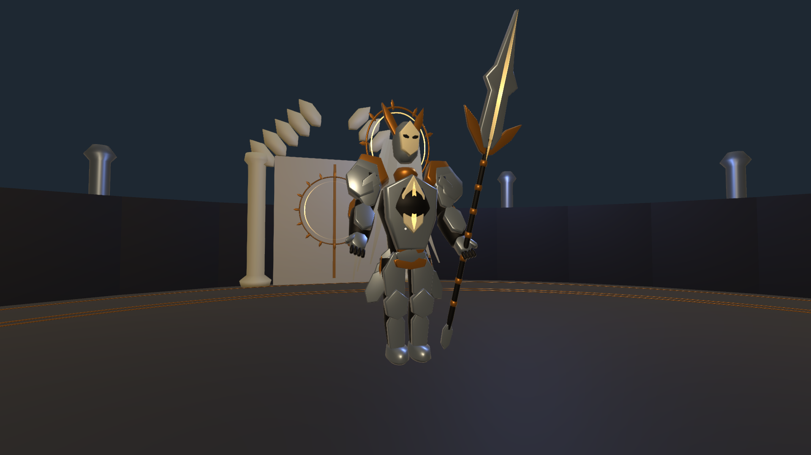
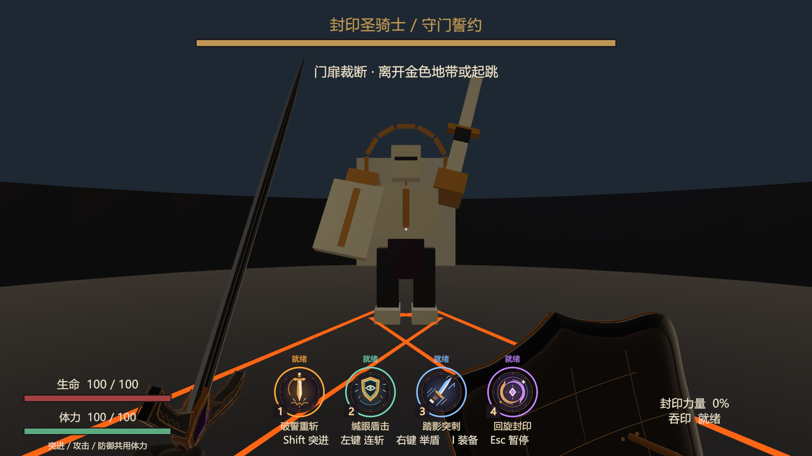
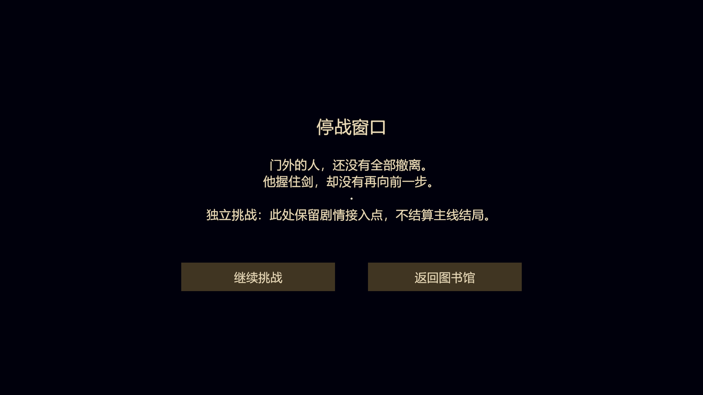

# 封印圣骑士：设计与后续精细开发入口

**本地接续 V5：[蒙皮、持握脚底与终扉前庭](ProductionV5/README.md)**。从远端 V4 独立继续，原V4资产和参数保留；实际完成、验证与尚待精修的内容在V5单独记录，本轮未推送。

**最新V4：[书籍Boss选择与连续动作](SelectionV4/README.md)**。三套精细建模与详细设计提示词已写入工程根README。

**当前试玩以 [V3书籍入口与战斗强化](PressureV3/README.md) 为准**：大厅《星图与魔法笔记》已临时接圣骑士，范围、动作、行动与特效均更新。下方V2内容作为设计与制作依据保留。

日期：2026-11-05。基线：当前工作区完整剑盾系统的 1.0.6，Unity 6000.3.25f1。

这位 Boss 的核心是：**守住深层封印的人，和仍想为外层救援争取时间的怪物，在同一道门前交锋。** 用户补充本地洛希德视频后，已重做修长银甲、长柄刃器、封缄长带与金雷战斗。当前设计以 [V2 视频参考与详细改编](RefinementV2/Design.md) 为准；下方 V1 资料保留原始推导与历史验证。

## 阅读顺序

0. **[先读当前 V2](RefinementV2/Design.md)**：实际视频时间点、模型与动作改动、八招参数、旋斩/落雷完整节奏、后续精细化边界。

   **[V2 角色与场景精细版制作说明](RefinementV2/ArtProduction.md)**：具体比例、部件、动作音画交接、建筑构图与制作验收，供后续开发直接使用。

   [V2交付与验证记录](RefinementV2/Validation.md)：试玩入口、修改文件清单、61项受控检查、资源核对及验证边界。

1. [世界观、战斗基线与角色设计](BossDesign.md)：为什么是这个身份、怎样表现神圣、怎样沿用现有玩家能力。
2. [场景设计与精细化方案](ArenaDesign.md)：布局、尺度、空间叙事、灯光、碰撞、剧情位置与分阶段制作。
3. [招式详细设计](MoveDesign.md)：逐招动作、完整时间线、判定、应对、反击、二阶段与组合逻辑。
4. [开发交接与验证](Development.md)：实际实现范围、代码入口、精细版本任务顺序、验证边界。
5. [资料依据与冲突处理](SourceAudit.md)：原案、比赛短篇、三 Boss 方案和实际代码的来源与优先关系。

## 当前可试玩内容

打开 `Assets/Scenes/BossTests/Knight_Test.unity`，进入 Play Mode 自动进入圣骑士试炼。仍使用原有第一人称玩家、剑盾、输入、体力、HUD 和 Esc 菜单。支持胜负、重试、返回图书馆。主场景和 Build Settings 未替换。

场地为半径 14 米的平整圆台、可见围墙与细化封印门；当前角色采用分层银甲、关节、12 条封缄长带、长柄刃器、完整冠环与临时展开的腕盾。实际测试场景复制原场景以保留完整玩家接线，进入战斗时停用原大厅；它不是已完成场景瘦身的发行关卡。

当前八招：誓舞连锋、贯门突刺、封印飞矛、地脉雷裁、收锋格御、退界盾击、回身旋锋、悬誓落雷。二阶段增加第三斩、第三条地面线路与竖向落雷。20% 血量剧情门槛可以通过测试入口组件的 `storyGate` 开关启用；默认关闭，以便完整测试胜负。

## 已实现和后续规格的区别

本表为 V1 原型与原规划的历史对照；V2 的实际实现、验证和剩余工作见 [当前设计](RefinementV2/Design.md)。

| 内容 | 当前原型 | 后续精细版 |
| --- | --- | --- |
| 战斗系统 | 复用 1.0.6；6 条数据配置；2 阶段 | 公共三 Boss 契约接入、正式多目标与剧情流程 |
| 模型 | 基础几何与 Transform 手臂姿态 | 正式重甲、蒙皮骨骼、脚步、握持、动作混合 |
| 场景 | 平台、边界、门、2 盏补光 | 门框与供能沟槽、外环撤离线索、合理的后景纵深 |
| 预警 | 真实范围的线框、白金/蓝/橙分类 | 加入形状、动态和声音的冗余提示；地带填充与竖向释放 |
| 剧情 | 一次性阈值锁定与事件；测试继续/返回 | 接公共选择、事实状态、奖励与检查点；不在 Boss 内判结局 |
| 验证 | [31 项受控运行检查](RuntimeChecks.json)通过；编译检查 | 真人完整战斗、真实输入回归、低帧率、性能与独立构建 |

数值是本次设计及原型起点，不表示已经通过正式难度平衡。不能把文档中的精细版动作、音效、镜头和剧情承诺当作当前已经制作完成的资产。

## V2 当前预览

[回身旋锋动态预览](RefinementV2/Orbit.gif) · [悬誓落雷动态预览](RefinementV2/Heavenfall.gif)。动态预览为固定站位、按正式战斗方法受控推进；落雷预览在锁点后移动玩家以便观察雷柱。它们不是完整真人实战录像。

## V1 历史实机预览

以下为 Unity 内固定战斗时刻的实际 Game View，包含原有剑盾与 HUD；用于确认极简模型、提示和预警，不是完整实战录像。

启用剧情阈值后的停战窗口，只保留本轮继续/返回，不选择正式结局：

