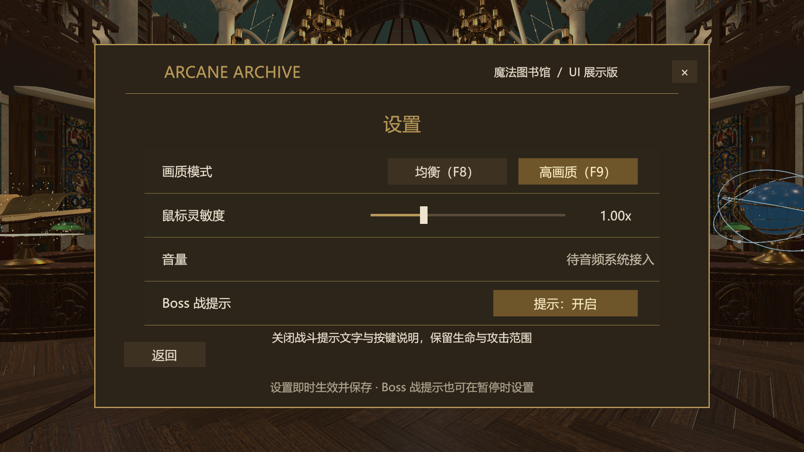
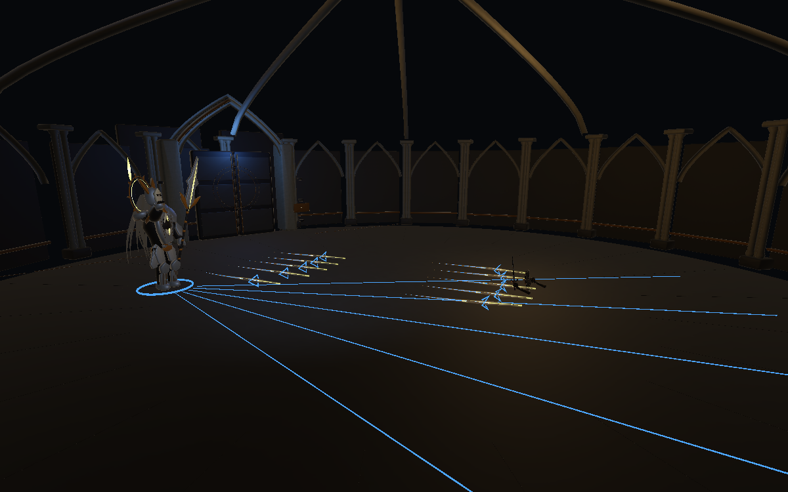

# 特效、动作衔接与 Boss 提示开关

2026-11-06 · 1.0.8 接续开发。保留六招、追踪规则、伤害、锁定与跳跃判定。本轮美化针对圣骑士；提示开关对圣骑士与典狱长共用 HUD 生效。

## 特效

- 刀光：渐细金色柔光拖尾与象牙白光芯；收招后仍保留短暂尾迹。
- 弹幕：运行时隐藏原块状弹体的渲染部分，改成金白光刃、青色吞印符号、沿实际飞行路径延伸的渐细拖尾。原碰撞体、追踪与伤害代码继续生效。
- 落雷：下落阶段与命中阶段均有金色主干、柔光外层和细白光芯；命中有径向火花与双层地面光环。
- 跳劈、剑击和瞬移：增加有速度与重力趋势的短暂金色火花，按战斗时钟推进。
- 金雷波：在扩散环上增加十二处游走的径向电弧，不扩大已有碰撞范围。
- 特效生命周期：正常 Attack → Recovery 只清除预警，火花、命中光和尾迹自然消散；打断、失败、退出仍立即清除。暂停时特效与动作一起冻结。缓存爆发特效中的线条列表，避免每帧重复遍历对象树。

## 动作

起手混合由 0.28 s 调整至 0.32 s，出招过渡由 0.12 s 至 0.14 s，收招混合由 0.48 s 至 0.55 s。攻击中武器响应更快，收招跟随更柔和，保留原命中时刻与角速度上限。

按实际移动速度加入平滑的前后倾身及侧倾，瞬移位移不当作高速奔跑。继续使用原生产模型的双手握柄、脚底约束和分段长带。没有制作新的手工关键帧动画，也没有改动六招数值或关卡布局。

## 提示开关

入口：大厅菜单或战斗暂停 → 设置 → **Boss 战提示**。按钮显示“提示：开启 / 提示：关闭”，点击切换，立即保存到 PlayerPrefs；默认开启。

关闭时隐藏：战术/招式反馈文字、底部按键说明、一般体力机制说明。保留 Boss 名称与阶段、双方生命、体力条、破防/耗尽状态、技能图标与冷却、攻击地面预警、弹体和特效。不会改动实际战斗规则或故事流程。

设置页已实点确认开关；退出 Play 后关闭选择仍保留。验收结束恢复测试前的开启状态。初次查看发现静态中文字库缺少“血/调”，已用完整支持的“生命/设置”表述修正并验证新增全部文字不缺字。

## 验证

23 项受控检查通过，执行体见 Verify.cs.txt，原始结果见 Verification.txt。覆盖按钮回调、保存与重新打开、两 Boss HUD 提示隐藏/显示、核心状态与地面预警保留、六招收招、武器姿态有限值、握柄误差小于 3 cm、余光跨收招存续并自然结束、暂停冻结、弹幕渲染组件和碰撞体保留，以及结束/返回清理。

另完成设置页实际点击与退出 Play 后的保存检查、字体覆盖检查、设置页和弹幕运行截图检查。最终编译通过，Console 查询无 Error / Warning；已退出 Play。受控测试通过高生命、明确位置和时钟步进隔离动作，不代替真人连续战斗、动作审美或性能验收。未重新构建 Windows 包。

## 修改文件

- Core/BossPresentationSettings.cs：提示偏好读取、保存，及自动生成的 .meta。
- UI/RecoveryMenu.cs：设置按钮、显示状态与解释文字。
- UI/BossCombatHUD.cs：根据偏好控制提示，同时保留核心状态。
- Visuals/Bosses/Knight/KnightRefinedEffects.cs：渐细刀光、分层雷光、径向火花、爆发渐隐及缓存。
- Visuals/Bosses/Knight/KnightBoltVisual.cs：光刃、青色符号与路径拖尾，及 .meta。
- Visuals/Bosses/Knight/KnightVisuals.cs：姿态混合、平滑移动倾身和武器跟随。
- Core/Bosses/Knight/KnightEncounter.cs：正常收招保留特效自然结束。
- Core/Bosses/Knight/KnightMobility.cs：弹幕装配新视觉组件。
- Core/Bosses/Knight/KnightThunder.cs：分层下落雷光与金雷波电弧。
- Core/BossEncounter.cs：在实际弹体移动后更新拖尾。

以上脚本路径均相对于 Assets/Scripts。文档与截图仅存放在本版 Docs/KnightMobility108/Polish。

