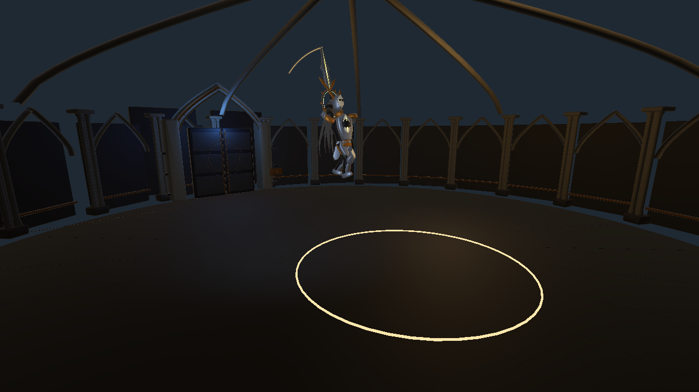
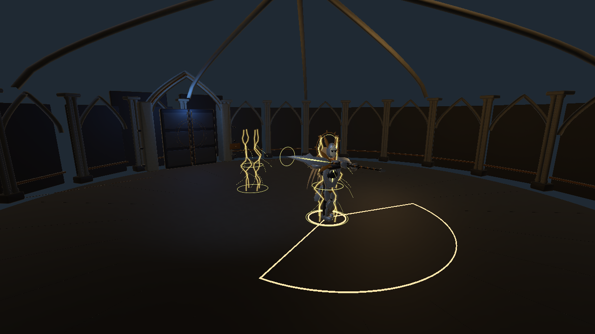
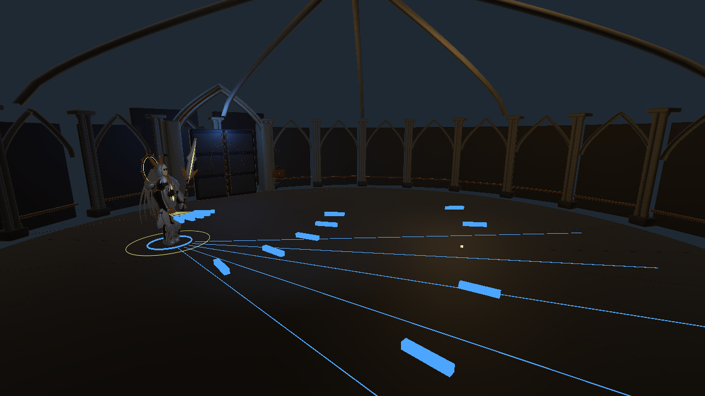

# 1.0.8 圣骑士机动招式 · 2026-11-06

> 本页记录上一轮十一招与直射弹幕版本。当前已收敛为六招，并强化回旋追身、弹幕追踪，参数和新验证以 [招式精简与追踪修订](Streamlined.md) 为准。

在现有 V5 模型、终扉前庭和完整剑盾系统上接续开发。原有八招和共享战斗参数保留；生产配置追加三招，书籍选择和 `Knight_Production_Test` 均生效。没有修改历史版本，也没有重新打包或上传。

## 先明确当前招式样式

圣骑士是持长柄刃器的封印守门人，动作以沉稳架势、转体挥刃、金色封印和短暂失衡为核心。机动新增后形成“地面剑舞 → 追身/侧闪换位 → 留出收招”的节奏。沿用之前本地洛希德参考的舞步与持刃方向；本轮未重新分析视频，也没有替换角色造型。

| 招式 | 当前动作和覆盖 | 玩家应对 |
|---|---|---|
| 誓约连斩 OathCombo | 两次交替挥刃，二阶段追加第三击；5.4 m、150° | 挡、弹反、离开扇区；不要在第二击后过早抢攻 |
| 封印突刺 SealThrust | 蓄力后向锁定方向推进 6 m，刃前再覆盖 3 m；宽 1.8 m | 横向闪避或弹反 |
| 后撤召刃 SealBolts | 后撤 2.2 m 后分三次放出封印弹 | 移动、挡弹、吞印 |
| 门印裂斩 GateCleave | 两条 / 二阶段三条 15 m 地面裂印，宽 2.1 m | 离开线区或跳过低位地印；不可格挡 |
| 守门盾阵 Bastion | 正面 120° 减伤；两次正面受击后接盾击 | 绕侧或盾击打断 |
| 盾击 ShieldBash | 3.5 m、130° 短促推击 | 挡或闪避，不能弹反 |
| 回旋锋 OrbitSweep | 横移 3.2 m 并转体两次横斩；6.5 m、300° | 把握两击间隔，挡或弹反 |
| 悬誓落雷 Heavenfall | 悬起后在三处锁定地印依次落雷；每处半径 2.2 m，二阶段选用 | 离开落点；不可格挡 |
| **踏光·跳劈 LeapCleave** | 屈膝蓄力、前跃举刃、落地重劈和压身缓冲；半径 3.8 m | 锁定后侧闪或举盾；重劈不可弹反 |
| **追誓·瞬斩 BlinkChase** | 落点符印 → 原地与落点金雷 → 显形蓄刃 → 横斩；4.8 m、140° | 看落点与剑势，侧闪或弹反 |
| **折光·封印幕 BlinkBarrage** | 侧闪换位、伸手布刃、三次掌势释放扇形弹幕 | 横移穿隙、格挡或吞印 |

## 三招的具体时序

下表时间从起手开始计算；伤害时刻是 Attack 阶段开始后的局部时间。战斗时钟控制动作、位移和特效，暂停冻结。

| 项目 | 踏光跳劈 | 追誓瞬斩 | 折光封印幕 |
|---|---|---|---|
| 预警 | 0.95 s | 1.20 s | 1.35 s |
| 追踪结束 | 0.55 s | 0.55 s | 0.55 s |
| 瞬移时刻 | 不瞬移 | 起手后 0.65 s | 起手后 0.65 s |
| 实际动作 | 0.72 s 抛物线前跃，峰高 2.6 m | 显形后保留 0.80 s 至命中 | 显形后保留 0.82 s 至首轮出弹 |
| 伤害 / 释放时刻 | 0.72 s，单次 28 | 0.25 s，单次 24 | 0.12 / 0.56 / 1.00 s，各 5 发，每发 8 |
| 动作段总时长 | 1.08 s | 0.66 s | 1.32 s |
| 收招窗口 | 1.20 s | 1.05 s | 1.25 s |
| 最大计划位移 | 9 m，目标前约 1.9 m 落地 | 9 m，目标前约 3.1 m 显形 | 横向 5.5 m + 后撤 1.2 m；约 5.63 m 对角距离 |

**跳劈**：预警期间显示落地伤害圈。前半段按玩家位置更新；0.55 s 后锁定，不再空中转向追赶。横移用平滑插值，竖直轨迹峰高 2.6 m；落地当帧结算一次圆形范围伤害。模型有蓄力下沉、空中屈腿、挥刃、落地压身和恢复，金色冲击圈对应伤害半径。

**瞬移追踪**：追踪的是预警前半段的目标位置，不是发招后的玩家输入。瞬移落点先可见；0.65 s 实际换位，保留原地和目标处金雷。方向锁定后完成横斩，不能在玩家翻滚后再转身补追。不给瞬移附加伤害或无敌，玩家仍可攻击 Boss。

**侧闪弹幕**：优先按交替侧向换位；一侧受墙柱阻挡时选更开阔侧。每轮 5 发，第一/第三轮角度为 -24°、-12°、0°、12°、24°，中间轮整体偏移 6°，形成错位空隙。弹速 11.9 m/s、射程寿命约 18 m；释放后不追踪。蓝色地面射线提示首轮飞行走廊，不是瞬时地面伤害。弹体直接走原有碰撞、盾防和吞印逻辑。

## 机动选择、碰撞和动作连续性

- 三招一、二阶段均可选。中远距离更偏向跳劈/追身，侧闪弹幕在近中距离用于换位。每个新招冷却 9 s，不连续选相同招式，也不会连续选择两种瞬移。
- 整体仍保留原八招，不强制循环新招；盾阵受击触发盾击不变。没有读取玩家按键决定选招。
- 计划落点先按竞技场边界裁剪，再用完整 Boss 胶囊检查沿途墙柱、玩家等碰撞体。实际换位再次验证；跳跃横移也沿地面胶囊做保守检测，因此不会利用腾空穿墙。若路径受阻，位移会缩短。
- 开放地面的伤害圈与落点一致；若起跳后有人突然进入路径，实际落地可能被截短，落地时更新圈与判定。后续多人/动态障碍版本可继续细化这类边界表现。
- 瞬移不累计成行走步幅，脚底约束重新落脚；跳劈和瞬移斩沿用双手握柄约束。武器仍用受限角速度与连续曲线，收招仍平滑回到待机。
- 金雷、刀光、弹体和预警归属本场战斗。跳劈被打断时落回地面；转阶段、失败、重试和返回清理已有攻击。

## 验证和实际预览

本轮结果：75 条汇总检查通过（其中一条覆盖 500 次 AI 选择），新增脚本编译通过，最终 Console 查询无 Error / Warning。瞬移、腾空和弹幕截图已逐张检查；最后重新开启正常 Play，从大厅书籍进入骑士，确认第一人称场景、Boss、剑盾和 HUD 正常显示。已退出 Play 并回到未改动的大厅场景。原八招数据逐项 JSON 比较一致。

`Verification.txt` 记录本轮 Unity Play Mode 受控检查，`Verify.cs.txt` 与 `VerifyCounters.cs.txt` 保存执行体。设置高生命、关闭自动 Update、显式推进真实战斗时钟来隔离招式；反制检查显式设置格挡/弹反/吞印窗口。这些不是真人通关或平衡结论。

覆盖两阶段三招释放次数、实际位移/高度、命中伤害、旧八招完成、锁定后移位、暂停、空中打断、墙体、边界、500 次 AI 选择的连续瞬移限制、弹体寿命/非追踪、格挡/弹反/吞印、失败重试、两种书籍 Boss 入口及返回清理。操作中的初次测试夹具曾未推进受击无敌计时，修正为同时推进 `PlayerCombat.Tick` 后通过；没有为通过测试修改玩家受击规则。

复现：Play 大厅，先通过书籍启动圣骑士；将 Encounter 和 FirstPersonController 的自动 Update 暂停，以 Unity `execute_code` 执行两个文本里的 C# 方法体。第一次检查执行结束会重新进入骑士待机。运行完成后退出 Play，全部生命和位置设置随 Play 结束丢弃。不要直接运行旧 `KnightProductionAcceptance.Run()` 做交互测试：它是原批处理验收入口，结束会退出 Editor。本轮只更新了它的八招基线比较以兼容新增招式，没有重跑整套 V5 构建验收或重烘十一招动画资源。

截图为真实运行状态的第三人称检查机位，不是概念图；三招在正式战斗仍使用第一人称。姿态由现有程序骨骼驱动，原八份采样动画不是新增招式的运行依赖。

## 文件交接

- `Assets/Scripts/Core/Bosses/Knight/KnightDefinition.cs`：追加枚举及可重复调用的生产配置迁移。
- `KnightEncounter.cs`：选招权重、冷却、伤害路由、移动阶段调用和中断落地。
- `KnightMobility.cs`：落点规划、胶囊检测、跳跃、瞬移、预警和三轮弹幕。
- `Assets/Scripts/Visuals/Bosses/Knight/KnightVisuals.cs`、`KnightRigConstraints.cs`：动作曲线、下沉/落地、步态与握柄。
- `KnightRefinedEffects.cs`：瞬移双点金雷、跳劈冲击、弹幕释放与刀光。
- `Assets/Art/Bosses/Knight/ProductionV5/KnightProduction.asset`：生产入口实际使用的十一招数据。
- `Assets/Scripts/Visuals/Editor/KnightProductionBuilder.cs`：重建时保留三招；`KnightProductionAcceptance.cs`：兼容新配置的原基线检查。

继续精修优先做：真实第一人称连续战斗的可读性与平衡、空中轮廓/落地重量、手工动作和长带穿插修正、分招音效。模型和场景精细制作提示词仍见主 README 及 ProductionV5 交接文件。
