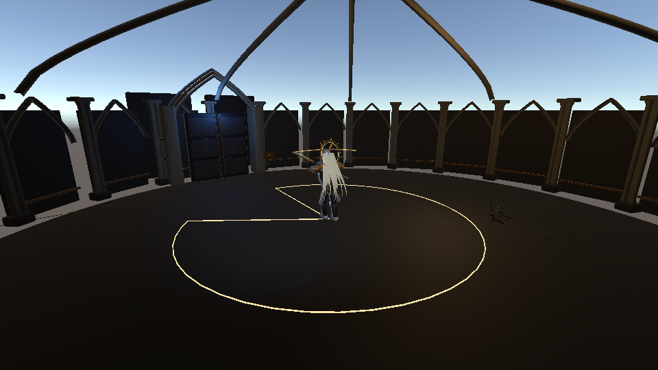

# 招式精简与追踪修订 · 2026-11-06

## 当前实际招式池

一阶段五招：誓约连斩、追身回旋、踏光跳劈、追誓瞬斩、折光封印幕。二阶段增加悬誓落雷，总共六招。二阶段连斩追加第三击的旧规则保留。

| 精简对象 | 当前处理 |
|---|---|
| 普通突刺、瞬移近身斩都承担追身 | 保留瞬移斩 |
| 后撤三发封印弹、侧闪三轮弹幕都承担远程压制 | 保留侧闪弹幕 |
| 地面裂斩、跳劈均用于地面范围压制 | 保留有位移与起落变化的跳劈 |
| 独立盾阵 → 受击盾击 | 从当前选招池移除，减少独立记忆点 |
| 连斩与回旋 | 分别承担原地近战和持续移动压迫，保留 |
| 落雷 | 保留为二阶段三点空间压制，与跳劈近身落点不同 |

生产配置启用 streamlinedKit。旧枚举与十一份数值保留供历史场景/调试兼容，**正常 AI 只选上述六种**。选招耗尽冷却时也只回退到连斩/回旋，不重新拿出已退役的招式。生产构建器重建配置时同样启用精简模式。

## 回旋追身

此前是沿固定方向横移；现在在第一击前和两击间对玩家当前空间位置转向，以 6.5 m/s 追近，带少量切向绕步；转向上限 140°/s，单招位移预算 5.8 m。距离 2.7 m 内转为绕步，沿用胶囊碰撞和场地边界保护。

追踪窗口为 Attack 的 0–0.08 s、0.35–0.88 s；实际命中仍在 0.24 / 1.06 s，因此出刀前有明确锁向。第二击能追上连续后退/侧移，玩家仍可在最后锁向后闪避或弹反。地面扇区随实际位置、方向更新。

## 弹幕追踪

- 施法时以最高 110°/s 持续转向玩家，后三轮出弹不再全部沿最初朝向；最后一轮后收招。
- 每轮仍为五发、共三轮；伤害、弹速、数量和寿命不加码。
- 发射 0.12 s 后开始弯曲追踪，最高 120°/s；单弹累计转向预算 55°，追踪最长至弹龄 1.15 s。
- 五发分别追向玩家两侧的偏移点，间距 0.8 m，中间轮错开 0.4 m，保留扇形空隙。
- 距离玩家 1.7 m 内锁定弹道；已经飞过玩家的弹体不掉头，墙后不继续修正方向。仍走原有碰撞、格挡和吞印路径。
- 该追踪只用于当前圣骑士弹幕，不改变典狱长及玩家弹体的追踪参数。

## 修改文件与验证

修改 KnightDefinition.cs、KnightEncounter.cs、KnightMobility.cs、BossEncounter.cs（弹体标识）、BossCombatBehaviours.cs（专用追踪路由）、KnightProduction.asset 及旧生产验收的基线归一化。主 README 指向本文；同目录旧 README、Verify.cs.txt 与 Verification.txt 是上一轮十一招/直射弹幕的历史结果，不能用来验证当前追踪行为。

新验收执行体和结果见 TrackingVerify.cs.txt、TrackingVerification.txt。受控推进实际战斗与弹体代码，检查两阶段选招、冷却回退、回旋接近与锁向、连续施法调整方向、弹体转向/速度/预算、近身锁向、墙后不追踪、清理；不等同于真人难度验收。

本轮 19 项汇总检查全部通过，其中两项分别覆盖各阶段 300 次选招。Unity 编译通过，结束时 Console 查询无 Error / Warning；已退出 Play。实际追身回旋的扇区位置和姿态截图已检查：

