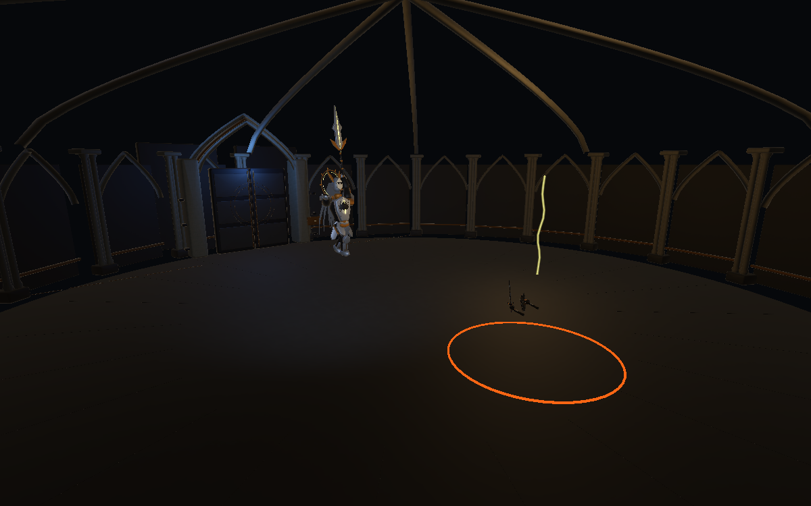
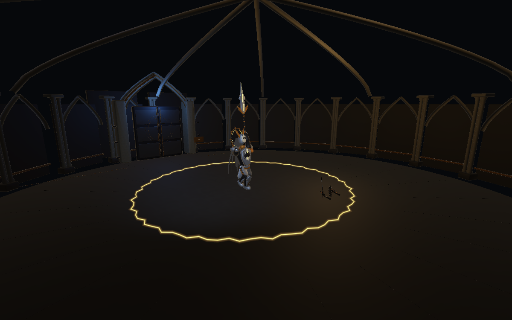

# 三道追身雷与跳劈金雷波

2026-11-06，直接接续 1.0.8 的六招版本；修改现有落雷、跳劈，不增加新选招。

## 三次追踪下落

原来的三个固定横向落点改为三个独立位置记录。第一道雷在预警中跟随玩家；第二、第三道分别继续跟随之后的位置。每道雷在命中前 0.25 s 锁定，随后雷光从上方 7.5 m 下落。玩家移动后，下一道雷会重新追到新位置，已经锁定/命中的位置不会漂移。

伤害时刻仍是 Attack 的 0.16 / 0.86 / 1.56 s，每道半径 2.2 m、24 伤害，不能格挡。地面只显示当前即将落下的圈，避免三圈重叠；下落雷光和命中闪电使用相同落点。观察锁定后用突进离圈，不能靠一次移动躲掉后两道。保留二阶段才从 AI 池选用的规则。

## 跳劈后的金色闪电波

跳劈原有 28 点落地伤害和半径 3.8 m 保留，可格挡；落地同时积聚金雷，0.3 s 后释放一次环形波，以 12 m/s 从实际落点向外扩散。金色锯齿电弧和柔光环随实际半径移动，覆盖到场地最远边缘才消失，不是整片圆盘持续伤害。

波的伤害为 20，同一波至多接触一次；判定带半宽 0.6 m（含角色容差），脚部相对地板达到 0.6 m 可越过。举盾、弹反和地面突进不能代替起跳；检测玩家与波环之间的连续穿越，避免高速移动从一侧穿到另一侧而漏判。跳过后落在波后安全，不重复结算。正常受伤无敌时间继续保留，防止刚中跳劈又被紧接着重复伤害；这不是格挡/闪避成功。

实现仅为该波跳过突进奖励保护及完美闪避接触登记，不改其他招式的玩家保护。暂停冻结扩散；正常收招不会提前消除波。Boss 在波覆盖完场地前不会开始下一招；失衡/清除攻击、转阶段、失败、重试或退出时立即清理。

## 文件与验证

- KnightThunder.cs：三个独立落点、追踪/锁定、下落雷光、金色波环、连续碰撞与生命周期。
- KnightEncounter.cs：更新落雷目标、同步警示、跳劈触发、收招等待和提示文字。
- BossEncounter.cs：通用清理与活动攻击计数包含金雷波。
- PlayerCombat.cs：新增可选的单次命中参数，仅金雷波使用，以避免突进奖励替代跳跃；默认行为不变。
- 主 README：当前说明入口。

执行体为 ThunderVerify.cs.txt，结果为 ThunderVerification.txt。20 项受控检查通过，包括三个不同位置的追踪/锁定/三次释放、真实跳劈触发、波跨越收招存续、延时、格挡无效、跳过、落回安全、快速地面穿越、单次伤害、暂停、自然结束和清理。测试显式控制角色高度/位置、格挡状态和时钟；不是手动输入跳跃通关或完整难度验收。

本页覆盖 Streamlined.md 中旧“三点空间压制”和旧跳劈描述。原有受控报告作为历史记录保留。当前修改仍未打包 Windows 版本。

最终脚本编译通过，Console 查询无 Error / Warning，已退出 Play。以下为运行时检查机位：第一张截取下落过程；第二张单独触发波环以核对电弧外观，并非跳劈动作截图。

