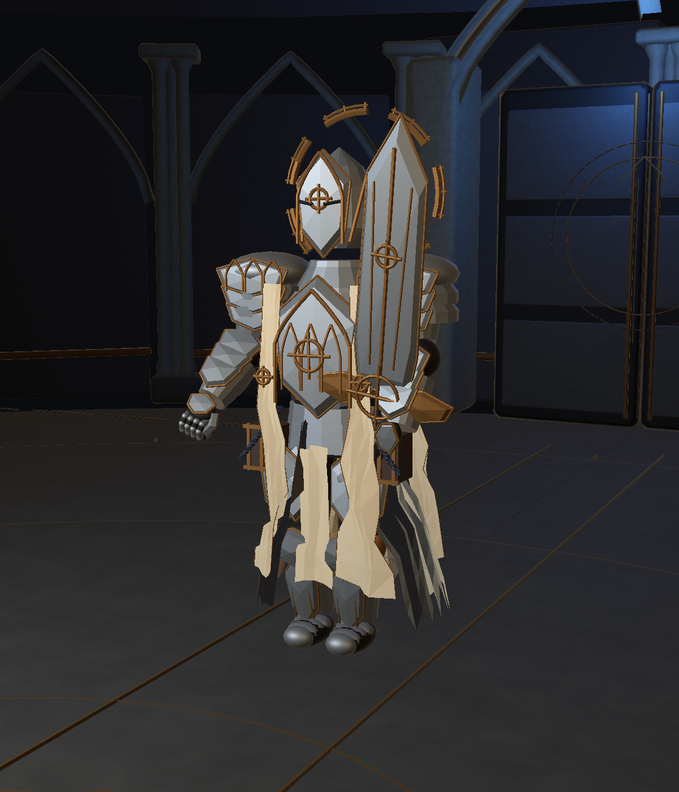
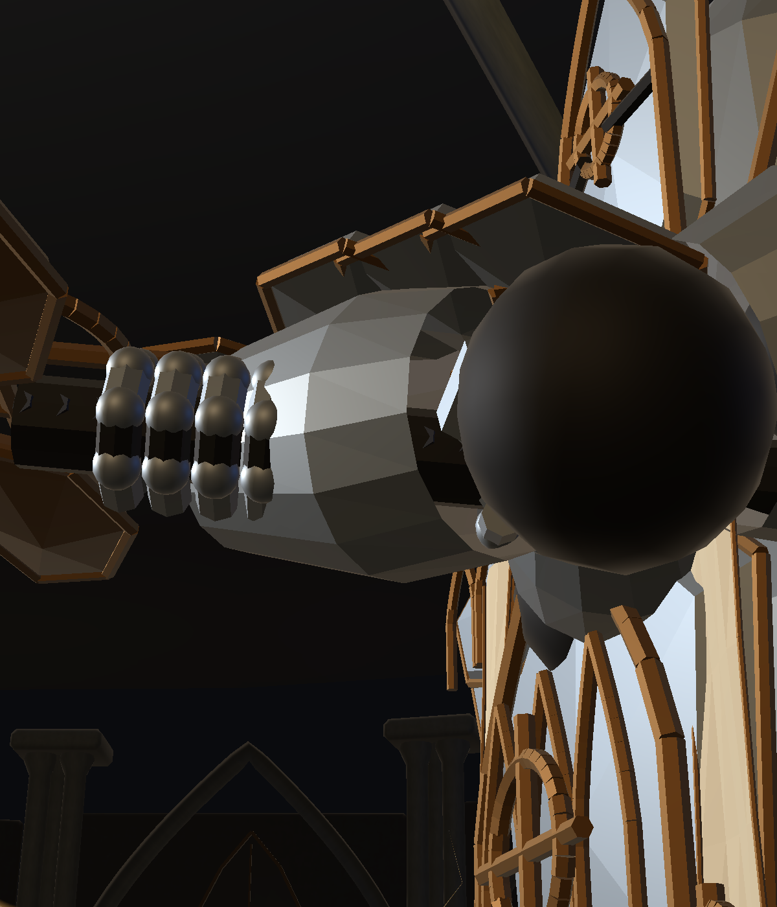

# 大剑握持修正与最小检测

2026-11-07，当前 1.0.8。

右手改到护手下方，左手握柄下段。两手使用镜像手腕方向，手指改为环抱剑柄的弯曲指节；横斩、回旋、瞬斩和跳劈明确指定刃面方向。转动剑身前重新对齐主手握点，避免长握柄偏移带动手腕漂移。施法时辅助手腕恢复中立姿态。

修改文件：

- `Assets/Scripts/Visuals/Bosses/Knight/KnightVisuals.cs`：大剑刃面方向与主手定位。
- `Assets/Scripts/Visuals/Bosses/Knight/KnightRigConstraints.cs`：辅助手腕握持及松开混合。
- `Assets/Scripts/Visuals/Editor/KnightReferenceBuilder.cs`：握点、镜像握拳网格及可重复生成的绑定姿态。
- `Assets/Scripts/Visuals/Editor/KnightReferenceReview.cs`：增加 `RunGrip()` 专项检查。
- `Assets/Art/Bosses/Knight/ProductionV5/KnightProduction.prefab` 与 `SealedGuardian/SealedGuardian_KnightSkin_LOD0.asset`、`SealedGuardian_KnightSkin_LOD1.asset`：保存的新握持与手部网格。

Unity 编译完成，最终 Console Error / Warning 查询为空。[GripVerification.json](GripVerification.json) 的 30 项检查全部通过，覆盖两阶段六招的握柄贴合、刃面方向、施法松手和暂停。两手握持中心最大误差均小于 0.04 mm，握持时手腕方向误差为 0°。这是受控动作检查，不是完整真人战斗验收。

另在推进姿态后等待真实编辑器渲染帧，再拍摄以下实际蒙皮结果，确认手指包围剑柄。同步检查函数中生成的早期 `Grip_Idle` / `Grip_OathCombo` 截图可能使用前一帧的蒙皮姿态，最终视觉证据以 `Grip_Final_*` 为准。

复验：打开 `Assets/Scenes/BossTests/Knight_Production_Test.unity`，Play 后启动骑士遭遇，执行 `ArcaneArchive.Visuals.Editor.KnightReferenceReview.RunGrip()`。测试会禁用自动推进并设置测试生命。复验完成后退出 Play，务必重新打开 `Assets/Scenes/MilanLibrary_Magic_V6.unity` 再正常试玩；专项测试场景本身会自动启动 Boss。

启动修正：此前检测后遗漏恢复大厅，导致直接 Play 进入专项 Boss 测试。现已恢复大厅场景；大厅运行 1,199 帧后仍为 Explore，Boss 状态 Inactive，无战斗场地、无自动测试启动器，书籍挑战配置有效，Console 无 Error / Warning。Build Settings 首场景原本就是大厅，无需改动。当前编辑器停在大厅编辑模式。
