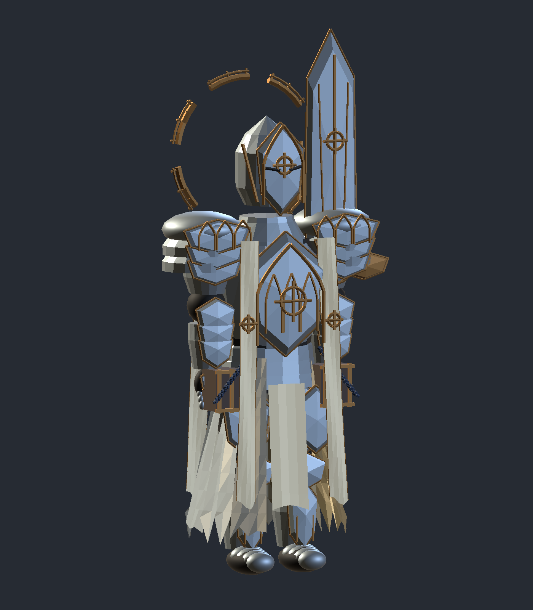
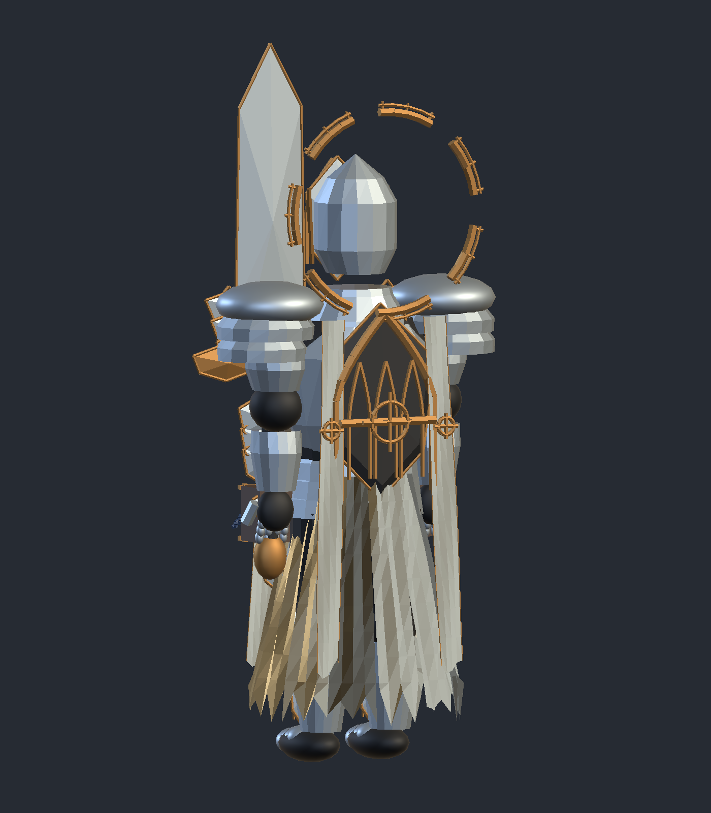
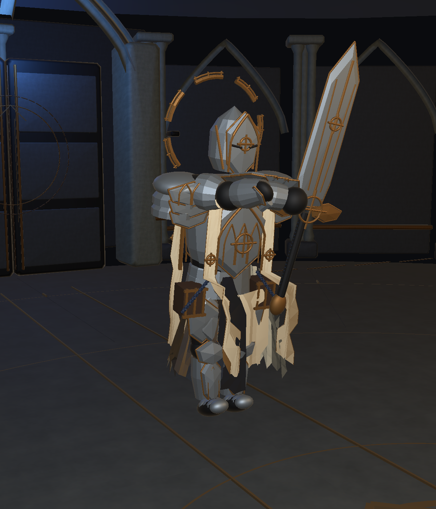

# 封守圣骑参考图修订 · 2026-11-07

后续修订：已修正大剑握持方向、主辅手位置与挥斩刃面，完成 30 项专项检查及实际渲染核对。新增修改文件、检测步骤与最终截图见 [大剑握持修正](GripFix.md)。下方三角面计数与预览为本轮初版记录，手部网格以握持修正版为准。

本轮在当前打开的 1.0.8 开发工程中完成，未提交或推送 Git，未重新打包 Windows。参考为用户提供的 `824e38f7-9e9a-4e96-8545-6476b19dc873.png`。

## 当前技能

折光·封印幕执行三组“侧方瞬移 → 释放一次五发弹幕”，合计三次瞬移、三轮、十五发；第三轮后进入 1.25 秒收招。

每组预警 1.35 秒，在预警的 0.65 秒瞬移；攻击段 0.12 秒出弹，0.55 秒结束。前两轮结束后重新获取玩家方向、规划安全侧方落点、进入下一轮预警。优先交替侧移，受障碍阻挡时尝试另一侧，继续使用原有胶囊碰撞检查与场地边界限制。上一轮已经释放的弹体继续存在，不因下一轮起手被清除。转阶段、死亡、退出等原有清理路径会停止连发。

原单发伤害、速度、追踪上限和吞印逻辑保留；三轮总压力高于上一轮单发版本，仍需要真人试玩判断难度。

## 模型

生产 Prefab 的两个蒙皮网格已替换，保留原 100 骨骼、动作驱动、碰撞、握柄约束及大厅入口引用。

- 分层银灰肩甲、肘腕板甲、指节和护胫；肩盖绑定躯干肩带，避免跟随挥臂大幅翻转。
- 尖拱面甲、胸前尖拱门纹、背部封印门与横闩、旧金圆环封缄。
- 七段断环圣环、象牙前后披带、破损布裙及细边线。
- 腰侧档案箱、皮革底色和蓝绳；长柄双刃外观换为封印大剑，并更新剑尖与刀光起点。
- 高低两档网格分别为 39,040 / 16,504 三角面；远档省略细刻线，合并相同顶点，使用七个共享材质槽。

这是程序化游戏网格版本，制作源是 `KnightReferenceBuilder.cs` 与 Unity Mesh 资源。没有声称完成参考图级别的写实雕刻、手工拓扑或纹理烘焙，也没有把旧 Blender 文件冒充本轮新源。布料沿用分段骨骼摆动，快速动作中的局部穿插仍可继续打磨。

## 修改文件

| 文件 | 内容 |
| --- | --- |
| `Assets/Scripts/Core/Bosses/Knight/KnightMobility.cs` | 三组循环、逐轮落点重算、交替侧移 |
| `Assets/Scripts/Core/Bosses/Knight/KnightEncounter.cs` | 前两轮攻击段结束后进入下一组，第三轮收招 |
| `Assets/Scripts/Core/Bosses/Knight/KnightDefinition.cs` | 三轮提示与默认配置迁移 |
| `Assets/Scripts/Visuals/Editor/KnightReferenceBuilder.cs` | 新模型、双 LOD、材质、字体补字与独立棚拍生成工具 |
| `Assets/Scripts/Visuals/Editor/KnightReferenceReview.cs` | 生产场景时序、骨骼、暂停、清理及截图检查 |
| `Assets/Art/Bosses/Knight/ProductionV5/KnightProduction.asset` | 当前生产提示文字 |
| `Assets/Art/Bosses/Knight/ProductionV5/KnightProduction.prefab` | 新网格、材质与大剑接入 |
| `Assets/Art/Bosses/Knight/Refined/KnightRefinedChinese.asset` | 添加静态中文补字后备字体 |
| `Assets/Art/Bosses/Knight/SealedGuardian/` | 两档角色网格、大剑网格、七种材质、中文补字与配套 meta |
| `README.md`、本目录 | 当前行为说明、截图及验证报告 |

## 验证

Unity 6000.3.25f1 编译通过。最终 [Verification.json](Verification.json) 的 47 项受控检查通过，最终 Console Error / Warning 查询为空。

两阶段分别以 1/60 秒、1/15 秒、0.19 秒步长推进，逐次记录瞬移、轮数与**实际新增弹体数量**，确认每次为五发、总共三次，并检查收招不补发。另覆盖转阶段取消、其他五招收招、右手握柄误差小于 3 cm、蒙皮权重与材质、暂停、战败清理、返回与重进。

测试使用高玩家生命和显式推进战斗时钟，属于生产场景受控检查，不代替真人连续战斗、独立构建和设备性能验收。开发中有一次测试启动前玩家已经战败，受控检查未进入指定招式；重新开始遭遇并立即禁用自动推进后，最终完整检查通过。

试玩：打开 `Assets/Scenes/BossTests/Knight_Production_Test.unity` 并 Play，或从大厅《星图与魔法笔记》选择圣骑士。

复验：生产测试场景 Play 后，在未战败时执行 `ArcaneArchive.Visuals.Editor.KnightReferenceReview.Run()`；若已经战败先调用遭遇的 `Retry()`。测试会关闭自动输入/推进并设置测试生命，完成后请退出 Play 再正常试玩。

重建：编辑模式执行 `KnightReferenceBuilder.Build()`，字体补字执行 `CompleteFont()`，独立棚拍执行 `Studio()`。这些方法位于 `ArcaneArchive.Visuals.Editor`。重建会替换本轮生成资源，手工编辑前应复制资产。

## 实际预览

下图是 Unity 对实际生产 Prefab 的渲染，棚拍增加了临时摄影灯光；场景截图也使用临时检视灯。它们不是生成概念图，临时灯不会保存到游戏场景。

