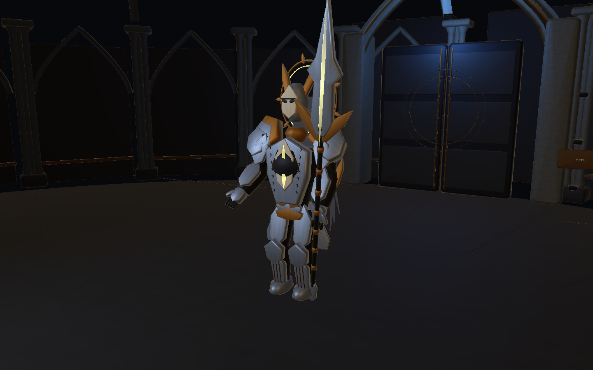
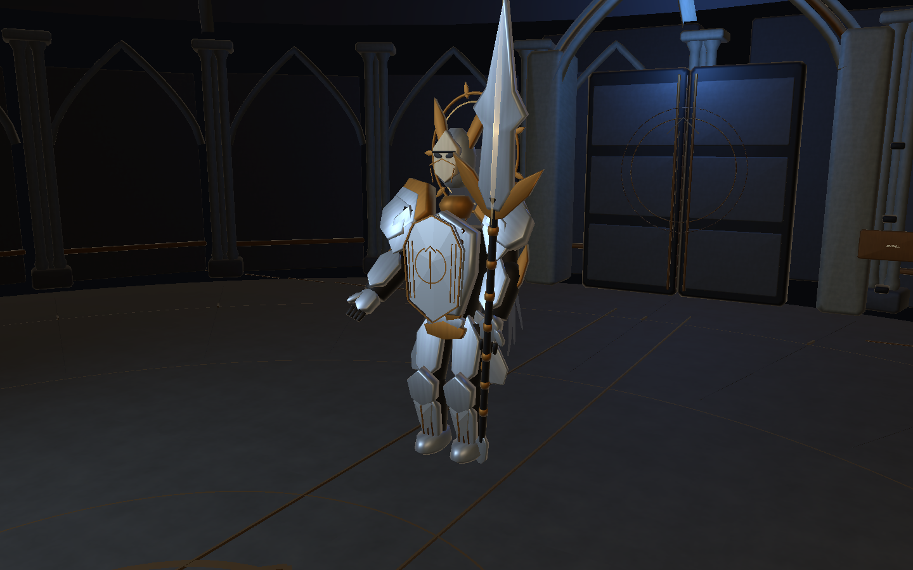
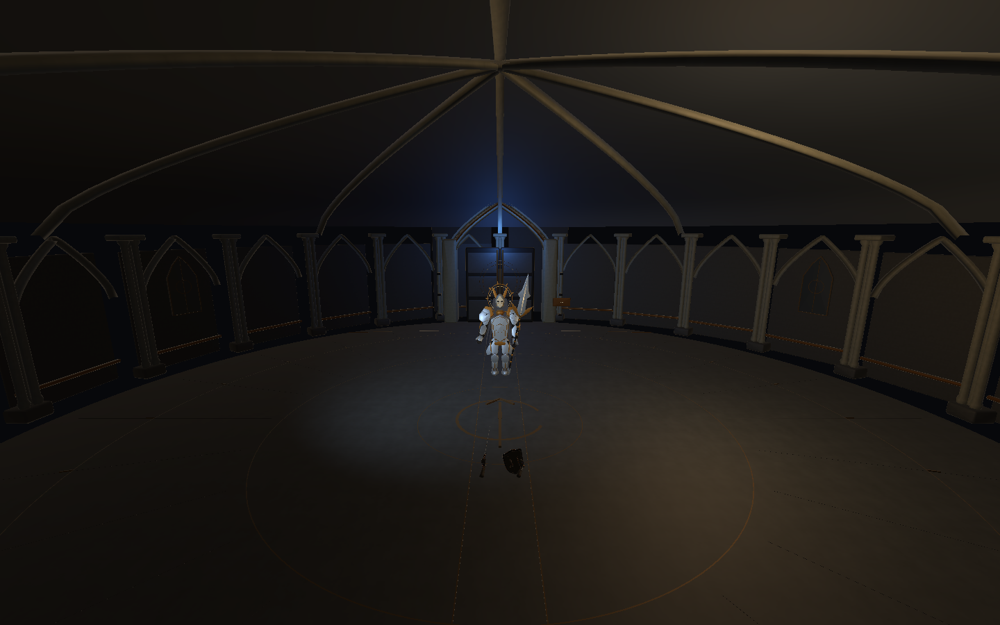
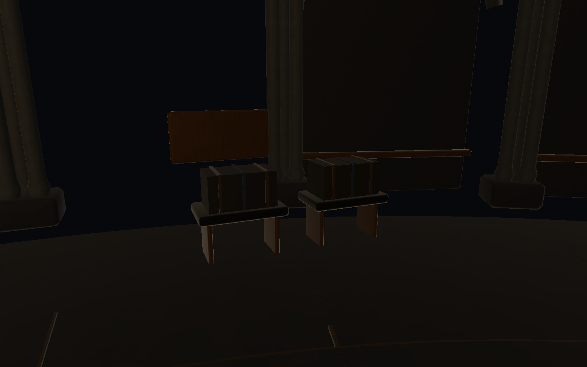

# 骑士风格统一 · 2026-11-06

本轮是按用户“阅读项目、分析风格、自拟提示词并按它修改”的要求完成的本地制作迭代。来源为 lixiang `60f452b` 的完整 1.0.8，使用 Unity 6000.3.25f1。工作副本位于 `E:/unity_project/骑士开发/2026-11-06-style/1.0.8`；此前下载的各分支与原工作区保留。用户明确要求将本轮成果继续提交到 `lixiang/1.0.8`，不另建版本号；仅更新当前 1.0.8，1.0.1～1.0.7 保持原样。

## 风格判断与实际提示词

[完整执行提示词与依据](StylePrompt.md)。main 比赛策划 v0.3 使用哥特图书馆、木作、皮革、旧黄铜、暖纸与绿色灯罩；program 三 Boss 方案 v0.4 将圣骑士定位为守护深层封印的最后防线。这里采用冷色石材和银甲作为封印区基底，用旧金、封缄纹和蓝绳把它接回同一守藏院。角色表达庄严、克制与负担感。

三 Boss 与多结局仍是团队策划；本轮没有把它们写成已实现玩法。最新骑士依据 README 顶部的六招修订，一次侧闪只释放五发弹幕；旧八招/十一招数据仅保留兼容。

## 本轮已实现

- 胸甲：补齐原中央空洞，形成银灰甲面、中脊、旧金边框、外围细槽和断环封缄徽记。面甲保留眼缝，增加窄边框；护胫采用同一造型语言。
- 材质：统一钢甲、暗关节、象牙/灰色封缄布、旧金；降低常驻装饰发光，保留技能与危险预警的视觉优先级。
- 前庭：补齐高穹面，加入柱间嵌窗、低亮地面铜嵌线、中央徽记与门扇封缄线。穹面使用连续法线，地面纹样不闪烁、不产生伤害。
- 叙事小物：外围转运台补两只带蓝色封缄的档案箱。它们为非交互陈设，不记录任务状态、不追加关卡条件。
- 阶段表现：胸甲徽记在第二阶段逐渐变暖，共用 BattleTime；暂停冻结，重进恢复初态。

实际资源见 `Assets/Art/Bosses/Knight/OathStyle/`，生产入口仍为 `ProductionV5/KnightProduction.prefab` 与 `KnightArenaProduction.prefab`。原角色骨骼与两档 LOD 保留：LOD0 **7,446** 三角面，LOD1 **5,810** 三角面，100 根骨骼、12 个角色 Renderer 组件。新增场景装饰合入一个 Renderer 的五个材质槽，实时灯仍为三盏，原碰撞形状与启用状态完整保留。详见 [资源清单](ArtManifest.json)。这些计数不等同于目标设备帧率验收。

本轮细饰的可编辑源为 Unity 网格与生成脚本；已有 Blender 源保留原样，没有宣称同步完成新的手工高模、UV 或 Blender 精修。

## Git 交付范围

本次包含源码、Prefab、网格、材质、配套 .meta、提示词、实景和验证报告。Windows 试玩包留在本机构建目录，按归档规则不进入 Git；队友可用下方 BuildWindows 入口从源码构建。根 README 与 ARCHITECTURE 同步记录本轮同版本更新。

## 验证与边界

[本轮报告](Verification.json) 为真实生产场景下的 **36 项受控检查**，游戏运行错误列表为空。覆盖：核心/玩家脚本、生产配置、HUD/菜单和包锁的逐文件哈希；原碰撞签名；100 骨骼及权重；LOD；三盏灯；当前六招两阶段实际推进；暂停、阶段变色、退出光照恢复、重进和攻击清理。最大右手握柄误差约 0.031 mm，落脚误差约 13.54 mm。

检查使用高测试生命、显式位置和战斗时钟隔离问题，不能代替真人连续战斗和最终动作审美。截图来自真实 Unity 运行相机，修改前/后的 Hero、Armor、Forecourt 使用相同机位与视角，无图像生成或后期增强。

编辑器的 SearchDatabase 索引异常在 baseline 与本轮报告的 editorIssues 中保留原堆栈；它与游戏错误分别报告，不能称整份 Console 全程零错误。开发中发现并修正了无 Domain Reload 时验收协程未重置、重复生成网格后的引用/刷新问题，最终报告要求实际执行足量检查，且已复验重建。

Windows 构建成功，0 Error、0 Warning，详见 [构建记录](WindowsBuild.json)。原生启动与 120 帧错误/渲染采样通过，knight=true、paused=false、errors=[]，见 [原生报告](Native/NativePreview.json)。该报告中的帧时和限帧描述仅保留原采样器数据，不作为有效性能结果；退出本地日志仍有 ComputeBuffer 自动释放和 D3D12 资源回收提示，不宣称完整退出日志零警告。本轮没有真人难度、第二设备和完整性能验收；后续仍需手工拓扑、纹理烘焙、动作穿插与连续实战打磨。

## 打开和复验

Unity Hub 添加本工程，运行 `Assets/Scenes/BossTests/Knight_Production_Test.unity`。大厅魔法书的原骑士入口也使用同一生产 Prefab。Windows 包位于 `Builds/KnightOathStyle/IMMonster-Knight.exe`，需保留整个文件夹。

- `KnightOathStyleReview.VerifyOnly`：检查现有资源，保留首次修改前的截图与基线。
- `KnightOathStyleReview.RebuildAndVerify`：重建本轮风格资源并检查。重建会覆盖本轮生成网格/材质，手工修改前应另存副本。
- `KnightOathStyleReview.Run`：仅用于从未应用本轮修改的干净源副本，先采样 Before，再制作并检查 After；已应用后不要重写首次 Before。
- `KnightOathStyleBuilder.BuildWindows`：从当前骑士测试场景构建专项 Windows 包。

上述类位于 `ArcaneArchive.Visuals.Editor`。本轮修改的脚本为 KnightVisuals.cs（可选表现桥接）、KnightOathPresentation.cs（战斗时钟材质表现）、KnightOathStyleBuilder.cs（美术资源生成/构建）与 KnightOathStyleReview.cs（编辑器采样/验证）；前两项位于 `Assets/Scripts/Visuals/Bosses/Knight`，后两项位于 `Assets/Scripts/Visuals/Editor`。运行数值、Core/Player/UI、输入和三关剧情没有重写。

## 实景对比

修改前：

修改后：

