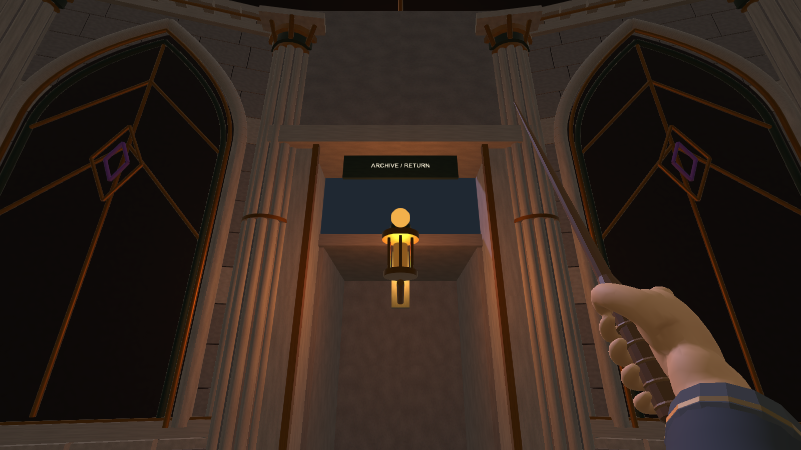
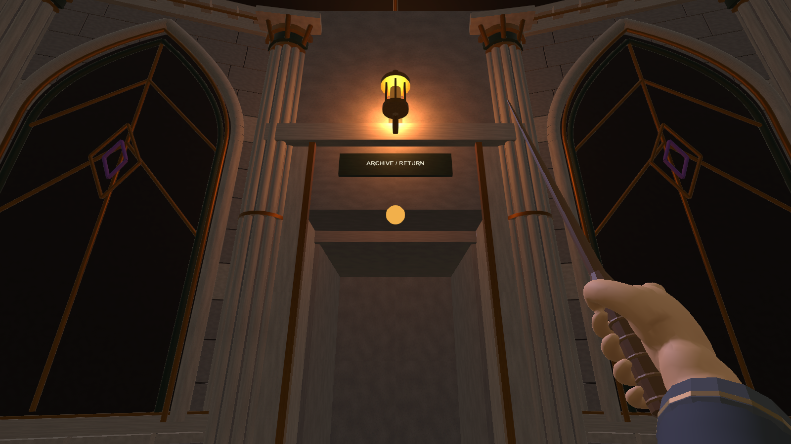

# 门头与短过渡修正复核

2026-11-03检查既有运行结果。补齐门框上沿至短过渡顶之间的石墙，原入口灯移到上方石墙，仍保留6盏点光；门框、侧壁、末端和顶碰撞补控制器接触余量，物理净高3.49m，地面Y=0及R14活动区保持。

| 修正前 | 修正后 |
| --- | --- |
|  |  |

现有Unity6000.3.24f1独立副本结果：维护厅208条断言通过（含5处真实控制器直接贴靠），工作区124项及三次往返通过，既有战斗36项通过。门头15、门楣接缝5、侧向通行12、门框包络2项静态检查通过。断言包含重复落点等复核，不能解释为208种独立操作。

证据：[维护厅报告](../../ART-W20261028-01/runtime-validation.json)、[静态报告](../../ART-W20261028-01/static-validation.json)、[工作区路线](../Stage2/runtime-validation.json)、[最终战斗回归](../Stage2/combat-regression.json)。两段录像分别约102.68秒及78.99秒，来自真实采集时间戳，无凑时长填充。自动输入和测试适配器不代表正式剧情接线或真人试玩；25版、独立包与目标设备尚待验收。

本次核查时补丁尚未提交或推送，Client尚未正式采用。
