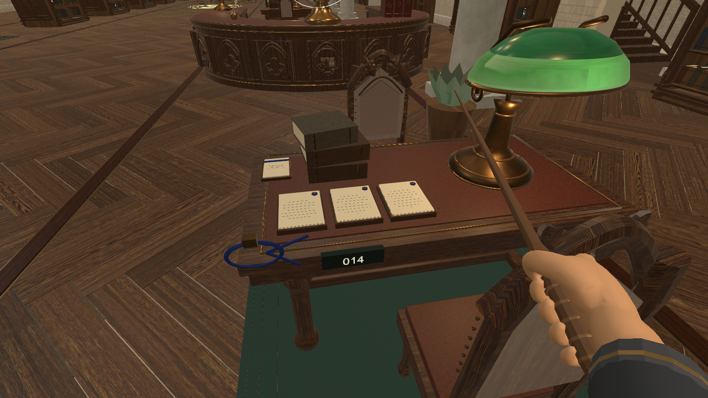
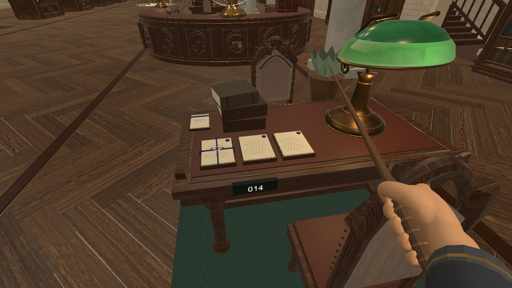
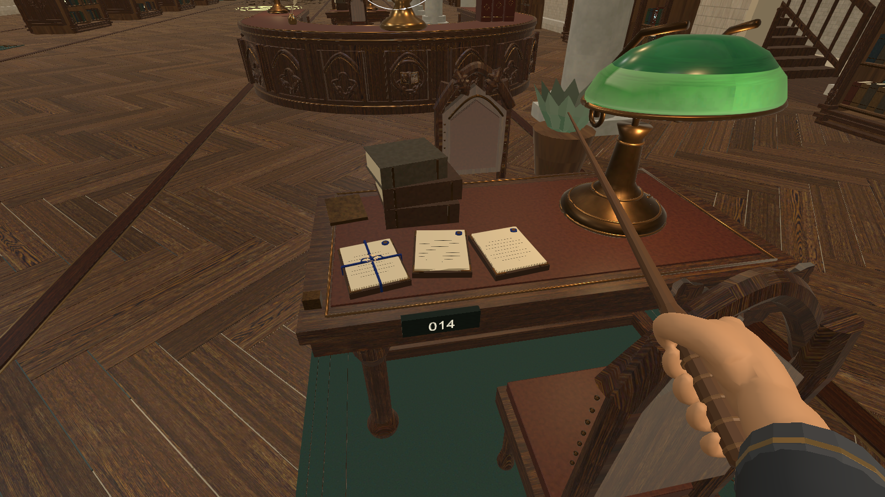
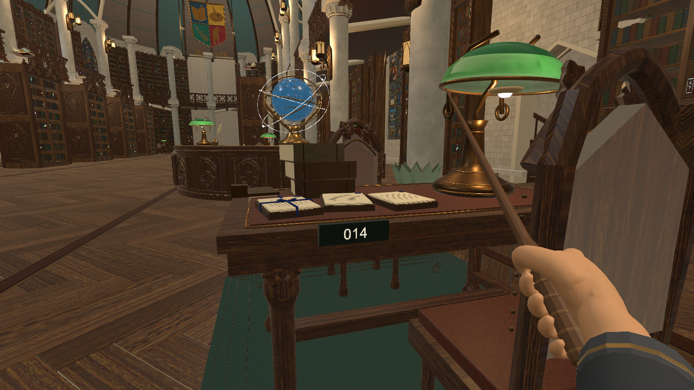
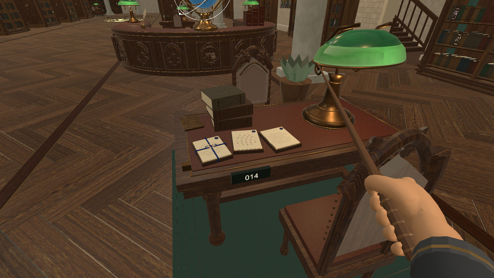
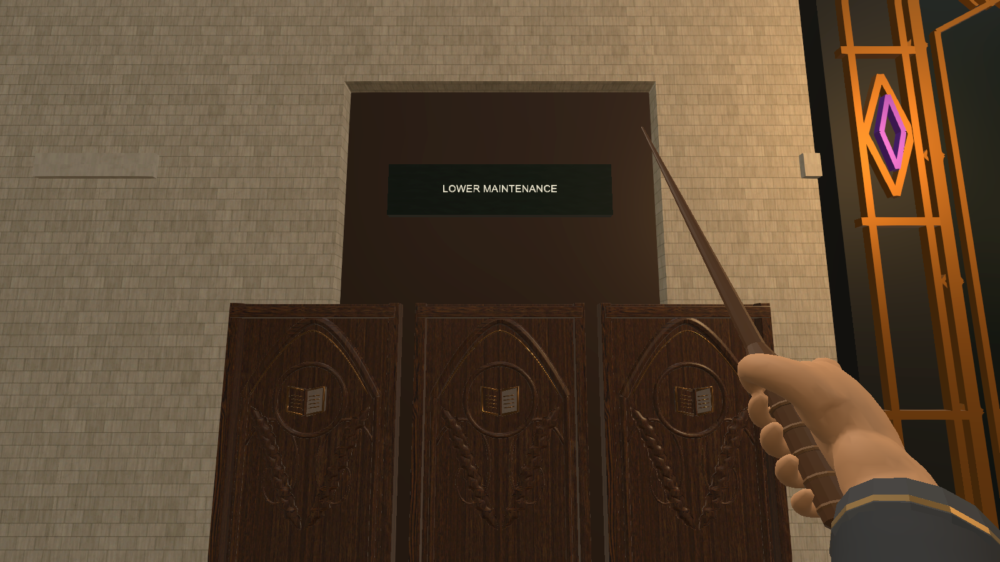
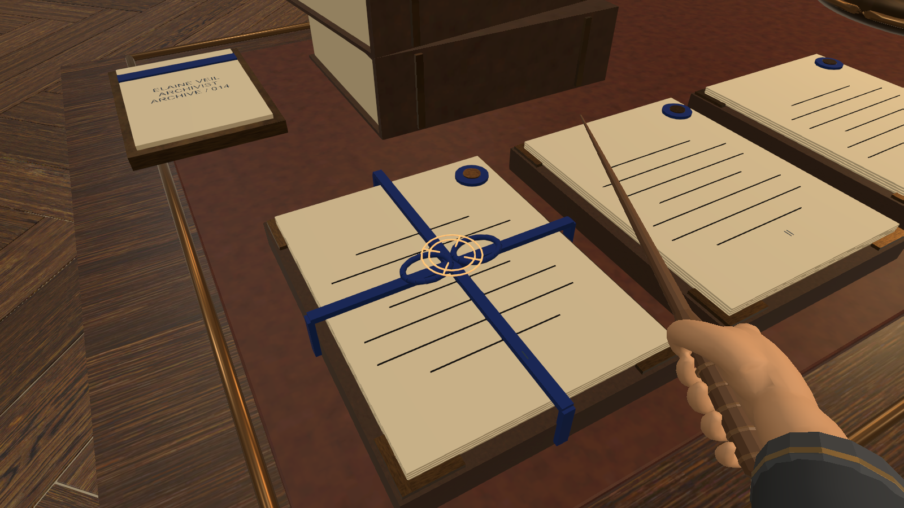
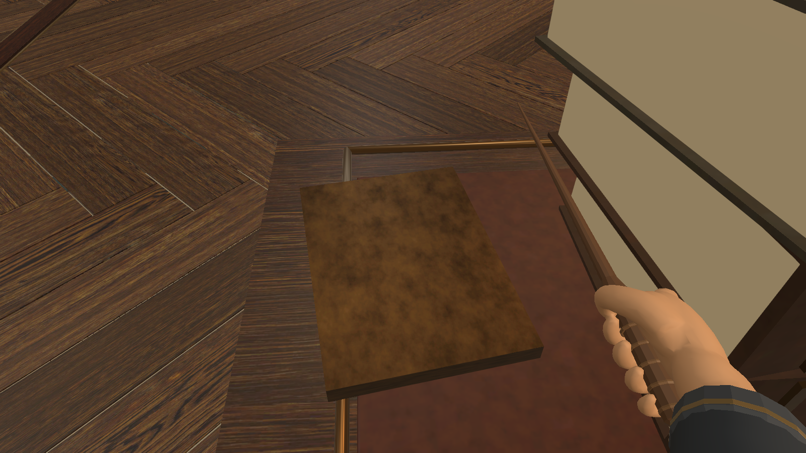

# 正式大厅中的镜头预演候选

依据已重读的策划框架v0.2与本周流程；保持已有大厅、材质和灯具。Unity6000.3.24f1在实际大厅中的编辑器渲染，1600×900。九个取景均通过目标视野/实体遮挡检查，记录位置、方向和视角；它们不是Play Mode时序过场或九个已验证玩家站位。

醒来后无姓名印字；返回止于取记录。低视角只移动相机，近景为美术观察，不能据此移动玩家胶囊。图中的现有手持工具为基线表现，剧情段是否隐藏由程序按演出表处理。灾变照明仍待程序绑定现有灯具，本组没有额外运行灯光。

[取景参数与检查结果](camera-validation.json) · [镜头交接](../镜头预演与交接.md)

## 开场工作位

眼点 (5.20, 1.68, 7.10)；朝向目标 (5.405, 0.890, 8.205)；视角 65°。

## 完成封档，同视角

眼点 (5.20, 1.68, 7.10)；朝向目标 (5.405, 0.890, 8.205)；视角 65°。

## 受袭后，同视角

眼点 (5.20, 1.68, 7.10)；朝向目标 (5.405, 0.890, 8.205)；视角 65°。

## 睁眼低视角候选

眼点 (5.05, 1.10, 7.00)；朝向目标 (5.405, 0.890, 8.205)；视角 65°。

## 恢复站立视角

眼点 (5.05, 1.68, 7.00)；朝向目标 (5.405, 0.890, 8.205)；视角 65°。

## 走道中的侧门方向

眼点 (6.00, 1.68, 3.10)；朝向目标 (6.000, 2.100, 0.200)；视角 65°。

## 返回同工作区

眼点 (5.20, 1.68, 7.10)；朝向目标 (5.405, 0.890, 8.205)；视角 65°。

## 封档绳结近景

眼点 (5.03, 1.15, 7.95)；朝向目标 (5.170, 0.890, 8.205)；视角 48°。

## 受袭后工作牌背面

眼点 (5.04, 1.17, 8.32)；朝向目标 (5.060, 0.899, 8.610)；视角 48°。

逐文件SHA256检查后，仅保存不同内容的图片；相同取景/状态共用图像路径，九个镜头不等于九张重复文件。
