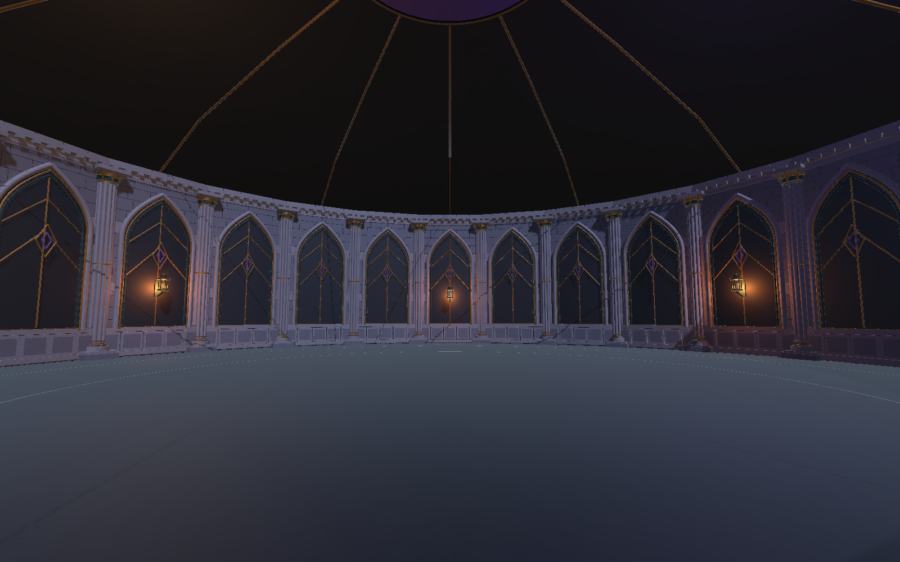
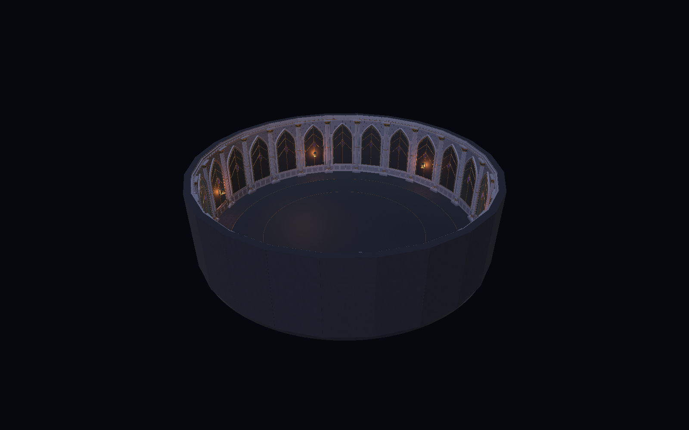
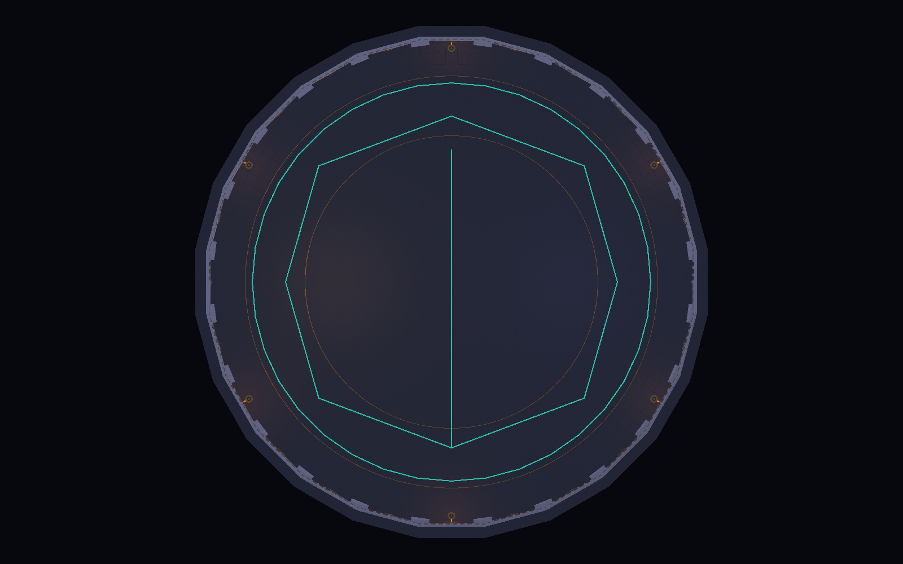

# 圆形封印厅拼装候选

2026-10-27，根据用户要求，在已完成的场景美术小样上补齐整圈摆放、圆形地面及通行检查。本候选由场景 Server 在 `art` 分支交付，供 Client 决定采用。

## 已完成内容

- 24 段墙、24 根簇柱围合，沿用 1.0.6 建场代码的 24 等分、墙半径 15.1 m 和 14 m 战斗半径作为尺度参考。
- 柱中心调整至半径 14.9 m，并将碰撞盒横截面包住 1.12 m 见方柱脚；保留人物活动区的净空。
- 中心圆形拼板、24 个复用的 15° 扇形地面模块及连续地面碰撞。没有把原来的方地板直接重叠复制成圆形。
- 6 盏黄铜灯具及可单独关闭的点光；穹顶、肋线和顶部封印色点缀。
- 中线、左右侧和半径 12 m 环线四条参考路线，以及玩家/Boss 的空物体参考位置。
- 四张 Unity 实际渲染图、路线坐标及本轮验证记录。

## 查看成果

路线图中，青色直线为中线，折线为左右侧移动路线，最外圈青线为半径 12 m 环线。金线是地面美术嵌线。青色线只在路线截图时生成，不保存在游戏场景或候选 Prefab 中。

[无路线的俯视图](Captures/03_topdown.png) · [验证记录](validation.json) · [路线坐标](routes.json)

## 在 Unity 打开

工程仍是外层 `SealChamberSample` 文件夹，Unity 6000.3.24f1、URP 17.3.0。

1. 打开 `Assets/Art/SealChamberStudy/Layout/Scenes/SealChamber_LayoutReview.unity`。
2. Game 视图提供固定的人眼高度观察视角。Scene 视图可查看整圈拼装。
3. `SealChamber_LayoutCandidate/Vault_Optional` 为屋顶，可在 Scene 视图暂时隐藏以查看布局。
4. `PlacementMarkers` 只是摆放参考；本工程没有新增玩家或 Boss 战斗代码，进入 Play Mode 仍是静态美术预览。
5. 若仅重新截图，退出 Play Mode 并保存当前工作，使用 `Art Studies → Seal Chamber → Capture circular layout`。重建候选则使用 `Build circular layout`；两个工具都以本候选的保存场景和资源为目标。

## 交给 Client 的增量资源

- 一并复制 `Assets/Art/SealChamberStudy/` 及对应 `.meta`，避免只复制 `Layout` 导致引用不到旧的小样网格和材质。
- 主要交付为 `Layout/Prefabs/SealChamber_LayoutCandidate.prefab`。墙柱继续引用原有小样 Prefab 和网格；24 个地面扇区共用同一份扇区网格。
- `Layout/Prefabs/FloorSector_15deg.prefab` 是以圆心为原点的半径 12.4–15.3 m 扇形地面。绕 Y 轴每 15° 复制一次，共 24 份闭合。该分体只提供美术网格，连续碰撞位于完整候选的 `WalkSurface_Flat_Y0`。
- 候选根位置为世界圆心，Y=0 为行走面，Z 正方向为 Boss 参考方位。`PlacementMarkers` 可供程序成员对齐已有控制器和战斗系统。
- `REVIEW_ONLY_Lighting` 属于独立展示场景，包含展示月光与补光；不包含在候选 Prefab 中。正式工程已有灯光时应评审后选择接入。
- 不复制本样板的 `Packages` 或 `ProjectSettings` 到正式工程；材质依赖目标已有 URP 17.3.0。
- 编辑器制作源为 `Assets/Scripts/Visuals/Editor/SealChamberLayout.cs`，运行时 Prefab 不依赖该源代码。

## 本轮验证口径

本轮在 Unity 中编译、生成并读取保存后的候选场景进行批处理验证和渲染。没有执行人工按键试玩。

- 地面：半径 0–14 m，每 0.5 m 一圈、每 5° 一个方向（圆心一次），共 2,017 点，向下射线必须命中 Y=0。
- 人物净空：使用 1.0.6 玩家 CharacterController 尺寸作为参考，半径 0.28 m、高 1.75 m；探针底部距地面 0.01 m，2,017 点均不得与墙柱碰撞重叠。
- 路线：四条路线共 46 段胶囊扫掠，验证完整线段而非只检查端点。
- 接缝：24 个扇区接缝、4 个半径、接缝左右两侧，共 192 点。临时给实际扇区网格添加 MeshCollider 检查，结束后移除；这项检查独立于连续的地面碰撞，不能靠整片碰撞掩盖美术接缝缺口。
- 资源：检查空网格、空材质/不支持的着色器、Missing Script；实际计数与资源规模见 `validation.json`。

## 正式接入仍需验证

本候选完成的是场景模块拼装和静态通行检查。真实玩家控制、Boss 飞弹与预警可读性、重试/返回、游戏 UI、目标设备 FPS、LOD 和遮挡仍需要在正式工程接入后验证。Client 尚未确认采用，原归档版本未修改。

该候选以已有 Demo 的圆形封印厅为基础。它不代表记忆档案馆、镇魂监狱、地下源石区域或完整世界地图已经制作完成。
