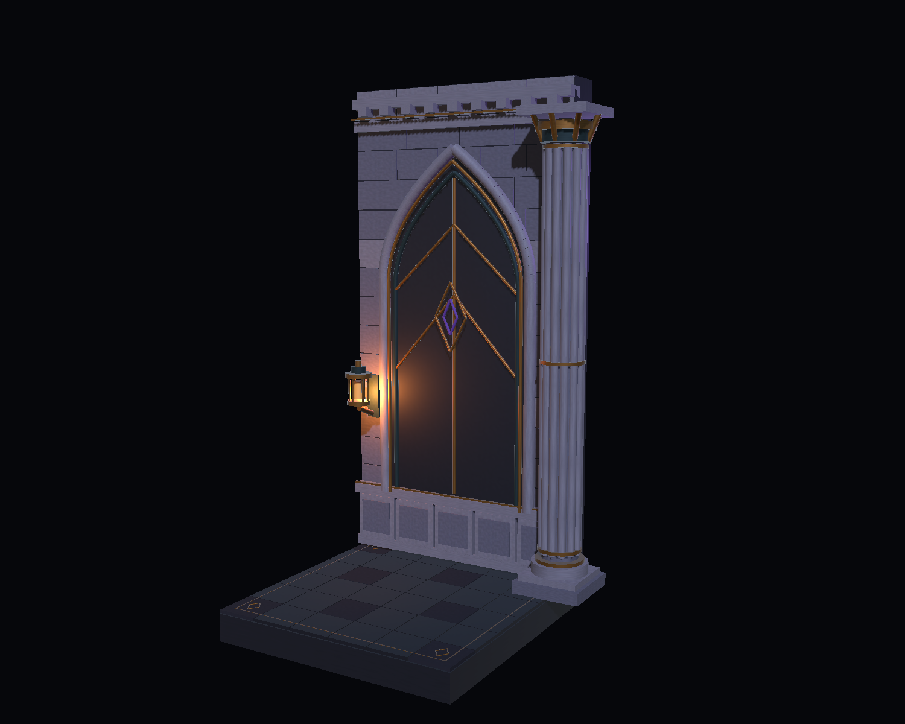

# 封印厅场景美术小样

这是最初自主尝试的独立Unity美术制作源，供Client评审与程序接入。历史整厅已纳入main v0.1.0；本周维护厅新增资源仍为待评审候选，不是新的Demo发布版本。

2026-10-27 新增：[圆形封印厅拼装与通行候选](Docs/Layout/README.md)，包含完整环形摆放、圆形地面、路线图与验证记录。原单模块小样及其对比图继续保留。

2026-11-02 本周任务 ART-W20261028-01：[维护厅资源与接入说明](Docs/ART-W20261028-01/接入说明.md)。包含对应已有侧门的入口、短过渡、三个维护节点、三件伏笔道具及墙裙碰撞修正。使用现有Unity6000.3.24f1；任务目标25版未复验。新预览场景为 `Assets/Art/SealChamberStudy/MaintenanceW20261028/Scenes/MaintenanceArtReview.unity`。

2026-11-02 用户追加候选：[档案工作区摆放与灾前/受袭后状态](Docs/ArchiveWorkstation20261102/README.md)。本阶段交付独立摆放预演、封档表现和接入锚点，待正式大厅环境与角色路线复核；未进入运行主场景。

## 内容与方向

- 墙面：沿用 1.0.6 的哥特盲拱、石墙和金色嵌线，补充石块接缝、双层拱线、窗格、墙裙与檐口。
- 柱子：保留原有高度，增加阶梯柱脚、簇柱、金属箍与柱头分层。
- 地面：低对比黑曜石拼板，装饰集中在边缘，中央保持安静，避免混淆 Boss 的战斗预警。
- 灯具：旧黄铜灯笼、暖色灯芯及可单独关闭的实时点光；紫色仅作封印点缀。

所有模型、材质及程序生成石材纹理均随本样板保存；没有新下载的第三方美术资源。它沿用了项目已有的建筑语言和尺寸参考。

## 打开与查看

1. 用 Unity Hub 添加本文件所在的 `SealChamberSample` 文件夹。该目录有 `Assets`、`Packages` 和 `ProjectSettings`。
2. 使用本机 Unity **6000.3.24f1**，等待 URP **17.3.0** 导入与编译。
3. 打开 `Assets/Art/SealChamberStudy/Scenes/SealChamber_Review.unity`。Game 视图显示固定展示视角；Scene 视图可自由查看。
4. 展开 `SealChamber_ArtSample`，分别查看墙、柱、地面和灯具。`REVIEW_ONLY_StudioLighting` 是展示灯光，不属于交付模块的必要组成。
5. 若要重建，先退出 Play Mode，再使用 `Art Studies → Seal Chamber → Build sample and capture`。该命令只生成本样板自己的资源和展示场景；不要在未保存的其他场景中运行。
6. 只重新出图时使用 `Art Studies → Seal Chamber → Capture saved review`，它读取已保存的展示场景，不重建模型。

## 对比图

[打开对比页](Docs/Review.html)。原结构参考与新小样使用相同相机、公共展示灯光和输出分辨率；新小样还包含自身灯笼的点光。

[原结构重建示意](Docs/Captures/00_baseline_reconstruction.png) · [近景细节](Docs/Captures/02_detail.png) · [地面细节](Docs/Captures/03_floor.png)

**参考图是依据 `lixiang/1.0.6/Assets/Scripts/Visuals/Editor/BossEncounterBuilder.cs` 的 `BuildArena` 重建的局部结构示意，并非原关卡截图。** 材质、柱头和地面为独立样板的简化呈现，不能将对比图解释为原 Demo 的完整前后改造。原始版本未被覆盖。

## 作为增量资源交给 Client

- 将本工程 `Assets/Art/SealChamberStudy/` 连同所有 `.meta` 复制到目标 Unity 工程的同名路径。目标需已安装 URP；现有 Demo 使用相同 URP 17.3.0。
- 拖入 `Prefabs/SealChamber_ArtSample.prefab`。也可以分别使用墙、柱、地面和灯具 Prefab；这几个模块已合并同材质网格，生成源代码仍保留，便于继续修改。
- 不复制本样板的 `ProjectSettings`、`Packages`、`Library`，不替换目标工程的渲染管线。`Settings` 子目录只供展示场景引用。
- 生成器位于 `Assets/Scripts/Visuals/Editor/SealChamberStudy.cs`，可选择保留作为编辑器制作源文件；运行时 Prefab 不依赖该脚本。
- 墙宽 4.05 m、高 8 m、厚 0.65 m；柱高 7.5 m；地面 4.05 m × 4.05 m，行走碰撞顶面为 Y=0。
- 组合体原点在墙底中心；墙在 Z=0，展示面朝向 -Z，地面沿 -Z 延伸。模块局部坐标和独立 Prefab 的摆放与展示组合体一致。

## 尚待 Client 评审和后续验证

- 本轮只验证独立小样；未改动或回归 Boss 战斗、玩家控制、导航、胜负流程。
- 该方形地面是材质与边缘装饰样板，尚未沿原圆形大厅裁切、闭合和整圈拼接。
- 正式采用前需按 Boss 活动半径、墙柱位置调整摆放，确认柱脚与装饰不侵入战斗通道；保留正式工程原有碰撞的决定权。
- 单模块灯光不能直接按整圈数量复制；应由 Client 结合实时灯光预算、烘焙、LOD、遮挡和目标设备实测决定。
- 本机使用 6000.3.24f1，尚未在归档要求的 6000.3.25f1 中复验。

自动结构检查结果见 `Docs/validation.json`，本轮实际验证及已知限制同时写入团队提交说明。

本机结构检查：缺失网格、材质/着色器和脚本均为 0；组合 Prefab 为 17 个网格渲染器、15,532 三角面、3 个简单碰撞体、1 个可选实时点光；地面与上方净空的 64 个向下射线均首先命中 Y=0。已在编辑器进入和退出 Play Mode，结束查看时 Console 为 0 Error、0 Warning。以上是独立小样检查，不代表目标设备性能或正式关卡验收。
