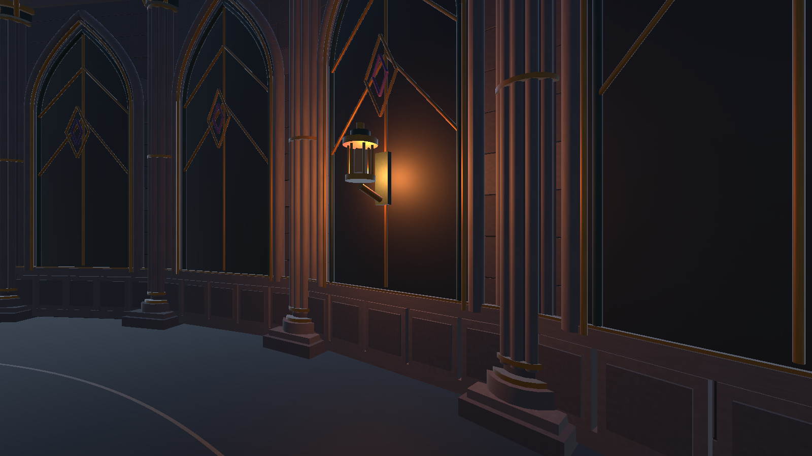
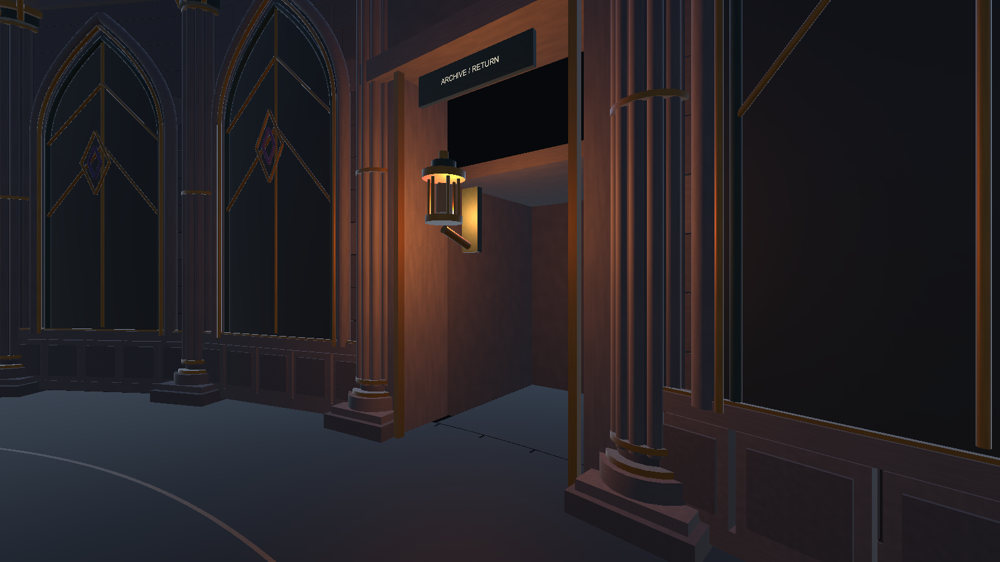

# ART-W20261028-01 · 下层维护厅场景候选

提交分支：`art`。基线：main v0.1.0（b984c5d）。日期：2026-11-02。状态：场景成员已交付，待Client验收与程序装配。

## 完成什么

- 复用档案馆右侧靠内X=6的现有侧门，提供入口标识、交互点及馆内安全返回点；新厅对应一处门框与短过渡，不另建完整长廊或替换正门。
- 交付共用供能节点模块及三个外圈实例，带编号、青蓝状态条、交互请求和稳定状态接口；不侵入中央R14活动区。
- 交付蓝色封档绳、伊莱恩工作牌、档案记录三件独立道具。没有制作本轮范围以外的遗体、角色群或完整破坏动画。
- 新候选23段实体墙增加墙裙/装饰碰撞包络，旧第12墙段改为出入口。短过渡弧形地面与圆地板在Y=0衔接，避免方形地面重叠；末端有防跌落阻挡。
- 保留基线8个旧点光禁用状态，新厅启用6灯，原运行方向光保持。未叠加第二套建筑或制作展示灯光。
- 交付七个Prefab、四个新增材质、网格、完整meta、生成源、坐标接口、对比图、真实控制器联测记录和90秒无声录像。清理本成员可重建缓存/旧日志，历史小样与整厅保留。

主要文件位于 `ArtStudies/SealChamberSample/Assets/Art/SealChamberStudy/MaintenanceW20261028/`，配套接口为同根 `Scripts/MaintenanceArtAnchor.cs`，制作源为 `Assets/Scripts/Visuals/Editor/MaintenanceArtBuilder.cs`。

完整资源清单、坐标、入口门片定位、回调约定及重跑方法见[接入说明](../../../ArtStudies/SealChamberSample/Docs/ART-W20261028-01/接入说明.md)；该路径下 `asset-manifest.json`记录文件SHA-256。

## 怎么验证

按用户明确要求，全部使用现有 **Unity6000.3.24f1 + URP17.3.0**，没有安装新Unity。运行联测发生在独立1.0.6副本，正式运行工程、共享场景和程序战斗源码未被修改。

| 检查 | 实际结果 |
| --- | --- |
| 墙面碰撞包络 | 345/345，覆盖23墙段、5高度、3横向位置 |
| 外圈地面 | 1080/1080，R13.5/14/14.2每度采样，地面Y=0 |
| R14角色胶囊净空 | 360/360；门口地面/净空17/17 |
| 引用与打包 | 缺失引用0；97个meta范围内缺失/孤立/重复GUID均0；新增空网格、无引用材质/网格均0 |
| 真实生产控制器 | 47处墙/柱方向实测冲向接触面，再沿面移动；冲刺约6m/s；跳起后落地、2m受控下落、蹲起均通过 |
| 真实交互 | 三节点均由原工程PlayerInteractor的E键射线经过测试适配器触发；已稳定/超距拒绝，回调本身不推进剧情 |
| 往返与灯光 | 门口双向走过；生产安全返回接口完成三次往返；6新灯与8旧点光禁用状态复核通过 |
| 生产管线视觉 | 实际Boss预警和轮廓截图；节点青蓝与战斗金橙色可区分，地面无新增中央台阶 |
| 既有战斗回归 | 最终资源导入候选后，原36项仪式检查36/36，complete=true；退出Play Mode后未编译、场景未脏 |
| 性能观察 | RTX4060 Laptop、i7-14650HX、Windows11、Ultra、相机960×540；不编码截图的战斗窗口1392帧，中位6.87ms、P95 8.96ms、P99 10.50ms，仅为本机编辑器观察 |

运行报告共有191条断言，包含重复的落点、资源和往返复核；不能解读为191种独立玩家操作。见[静态报告](../../../ArtStudies/SealChamberSample/Docs/ART-W20261028-01/static-validation.json)、[角色联测](../../../ArtStudies/SealChamberSample/Docs/ART-W20261028-01/runtime-validation.json)、[36项回归](../../../ArtStudies/SealChamberSample/Docs/ART-W20261028-01/combat-regression.json)及同目录原始帧时间CSV。

### 图片与录像

| 同视角旧厅：封闭墙段 | 本周候选：对应门口与短过渡 |
| --- | --- |
|  |  |

[节点近景](../../../ArtStudies/SealChamberSample/Docs/ART-W20261028-01/Captures/03_supply_node.png) · [三件伏笔道具](../../../ArtStudies/SealChamberSample/Docs/ART-W20261028-01/Captures/04_archive_props.png) · [侧门标识](../../../ArtStudies/SealChamberSample/Docs/ART-W20261028-01/RuntimeCaptures/01_existing_archive_side_door.png) · [实际Boss预警](../../../ArtStudies/SealChamberSample/Docs/ART-W20261028-01/RuntimeCaptures/06_boss_warning_and_silhouette.png)

[90秒通行联测录像](../../../ArtStudies/SealChamberSample/Docs/ART-W20261028-01/通行联测_90秒.mp4)：960×540、10帧/秒、H.264、约6.3MB、无音轨。来自生产角色自动键盘输入下的相机连续采集，非人工试玩、非完整剧情Demo；真实采集时间另附capture-times.csv。末轮将馆内标识下移到Y=2.85，仅影响标识可读性，已在最终管线单独复拍并纳入36项回归的最终资源；录像开头仍是调整前标识高度，维护厅通行资源相同。

## 清理范围

制作源内约1.6GB Library/Logs/UserSettings及4个旧构建日志已删除。必要源文件、meta、历史小样/整厅、图片、录像和交付文档保留；本周材质与网格未发现无引用冗余，因此不删除有效资源。清理记录见[cleanup.json](../../../ArtStudies/SealChamberSample/Docs/ART-W20261028-01/cleanup.json)。

其他成员目录、WPS正在使用的文档锁文件和开始前已有的ShaderGraphSettings空白差异均保留，排除本次提交。联测临时副本与逐帧中间图片在证据导出后清理，不作为重复工程入库。

## 还有什么问题

1. 任务目标25版未复验，按用户要求使用24；不宣称完成25版兼容验收。
2. 本次是场景资产交付。完整五事件剧情、正式门/淡出传送接线、三节点任务一次性状态、身份泄露文案替换及独立运行包仍由程序/剧情成员负责。联测临时适配器不进入正式工程，不代表6–8分钟主线已实现。
3. 本机编辑器帧时间不代表独立运行包或目标设备在所有技能峰值下达标；该项待程序候选包和Client正式验收。未用三角面数推断流畅。
4. 编辑器日志存在Unity Search索引异常和许可/云服务提示；未发现C#编译错误，最终角色联测及36项检查完成。自动检查运行时恢复了编辑器错误暂停以避免Search异常中断，不覆盖游戏菜单暂停逻辑。
5. 本成员仅推art，不合并main、不替Client宣告采用。程序已知暂停/遮挡问题不在本成员修改范围。
